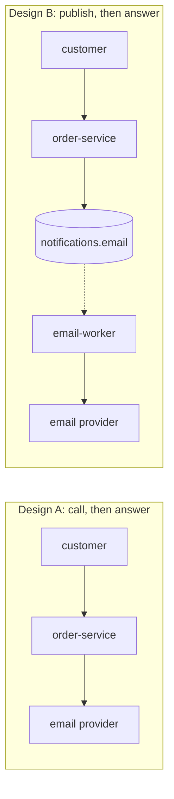

# 01 — Why a message broker? Stop making checkout wait

**Level:** Engineer  
**Episode:** Why a message broker? Stop making checkout wait  
**Language:** English  
**Code:** Java 21 · Maven · RabbitMQ Java client · Docker Compose  
**Requires:** nothing (first episode of the course)  
**Reading time:** about 15 minutes, plus the experiments

## YouTube

The video link will be added here when the episode is published.

This README is the **written version of the lesson**. It tells the same story as the video, with more room for the reasoning and for the code. You can read it before the video, after it, or instead of it. Everything it describes can be run on your machine with `./run.sh`.

> **The one sentence of this episode**
>
> **A broker lets the caller answer now and leave slow work for a consumer to do later.**

> **Learning-project disclaimer:** no email is sent. The email provider is simulated by the program: a send is a pause (`--provider-ms`), and a provider that is *down* refuses the connection at once. The three terminal demos in the video run this project against a real RabbitMQ. The code is illustrative, not production-ready (see [What this project does not cover](#what-this-project-does-not-cover)).

## Learning objectives

After this episode you should be able to:

- Define **producer**, **broker** and **consumer**.
- Say what a broker gives the caller (an answer that does not wait) and what it does not give (less total work, or a guarantee that the work is happening).
- Predict what a customer sees when the slow dependency is down, with and without a broker.
- Decide whether a piece of work can move behind a broker.
- Read the code of the demo and say which line makes the checkout answer without waiting.

## Contents

1. [The problem: a checkout that waits](#the-problem-a-checkout-that-waits)
2. [The vocabulary](#the-vocabulary)
3. [Three beliefs, three experiments](#three-beliefs-three-experiments) (with the setup first)
4. [The rule](#the-rule)
5. [Read the code](#read-the-code)
6. [Try it yourself](#try-it-yourself)
7. [Where the rule fits](#where-the-rule-fits), [summary](#summary) and [what this project does not cover](#what-this-project-does-not-cover)

| Video scene | Where it is in this README |
|---|---|
| Cold open, "The checkout we have today" | [The problem](#the-problem-a-checkout-that-waits) |
| "A restaurant solved this long ago" | [The vocabulary](#the-vocabulary) |
| Belief 1, 2 and 3 (board, demo, verdict) | [Three beliefs, three experiments](#three-beliefs-three-experiments) |
| "Answer now, work later", "What the broker actually carries" | [The rule](#the-rule) |
| Challenges, "Behind a broker: when it fits" | [Try it yourself](#try-it-yourself), [Where the rule fits](#where-the-rule-fits) |
| Recap | [Summary](#summary) |

## The problem: a checkout that waits

A customer places an order. The order service does two things: it saves the order, which takes about forty milliseconds, and it sends a confirmation email through an external email provider. In this project the provider takes two seconds per email.

The simplest code does both before it answers:

1. Save the order (about 40 ms).
2. Call the provider and wait for it (about 2 s).
3. Answer the customer.

The customer waits two seconds for something they did not ask for. The answer to "did my order go through?" does not depend on the email at all. And if the provider is slow today, every checkout is slow today; if it is down, every checkout fails, although the order was saved.

A message broker is the usual fix. Before the details, compare the two designs:



In design A the customer waits for the provider. In design B the order service saves the order, hands one message to the broker and answers. A separate program, the worker, takes the message later and talks to the provider. The customer is no longer in that conversation.

## The vocabulary

The video uses a restaurant. The waiter takes your order and walks away; the waiter does not cook. The ticket goes onto a rail in the kitchen, where it waits. A cook takes one ticket at a time and does the slow work.

| Term | Meaning | In this project |
|---|---|---|
| **Producer** | The part that creates a message and hands it over. | `order-service` (class `CheckoutService`) |
| **Broker** | The server that receives messages from producers and delivers them to consumers. It holds a message until someone takes it. | RabbitMQ |
| **Consumer** | The part that takes a message and processes it. | `email-worker` (class `EmailWorker`) |
| **Message** | A small piece of data that says what happened. | `order.created`, event `evt_0001` |

You will also see a counter called **ready** in the experiments. A message that is waiting in the queue for a consumer is *ready*. The next episode is about queues and that counter; for now, read it as "how many messages are waiting".

### What the message looks like

To the broker, the body of a message is just bytes. Here the bytes are JSON:

```json
{"eventId":"evt_0001","orderId":"ord_1001","type":"order.created"}
```

It is an event that says *what happened* (an order was created), not a command that says *what to do* (send an email). The order service knows nothing about email. The consumer decides what "order created" means for it, and here that means sending a confirmation.

## Three beliefs, three experiments

The video tests three beliefs about brokers. Exactly one is true. You will test them on your own machine, with the same program and the same numbers as in the video.

### Set up

You need **Java 21**, **Maven** and **Docker** (with Docker Compose v2). Then:

```bash
./run.sh up
```

This starts RabbitMQ in a container, compiles the project and declares the queue `notifications.email`. When it ends, the management page is at <http://localhost:15672> (user `guest`, password `guest`; those credentials are for local use only).

Open a second terminal and leave the counters running while you work:

```bash
./run.sh watch
```

That prints two numbers twice a second: **ready** (messages waiting) and **consumers** (programs connected to take them). In the video, this is the right-hand terminal.

> **About the output blocks below.** They show the *shape* of what the program prints. The timestamps (`12:00:00.043`) and the millisecond figures are illustrative: yours will differ. What does not change is the pattern: an answer behind the broker takes a fraction of a second, a synchronous one takes about two.

### Belief 1: "A broker makes everything faster"

**Predict first.** Three orders, two seconds per email. Without a broker, how long does each customer wait? With one, how long does the *last email* take to go out?

```bash
./run.sh experiment1
```

<details>
<summary>The commands behind it</summary>

```bash
mvn -q exec:java -Dexec.args="checkout --mode sync  --orders 3"    # each customer waits about 2 s
mvn -q exec:java -Dexec.args="checkout --mode async --orders 3"    # answered at once; ready 3
mvn -q exec:java -Dexec.args="work --limit 3"                      # three emails, 2 s each
```

</details>

What you see for the synchronous checkout, one line per event:

```text
12:00:00.001 [order-service] SYNC checkout, email provider up, 2000 ms per email
12:00:00.043 [order-service] order ord_1001 saved
12:00:00.043 [order-service] calling the email provider and waiting for it ...
12:00:02.046 [customer] ord_1001: answered in 2044 ms
```

And for the checkout behind the broker:

```text
12:00:07.001 [order-service] ASYNC checkout, email provider up, 2000 ms per email
12:00:07.044 [order-service] order ord_1001 saved
12:00:07.049 [order-service] published evt_0001 (order.created)
12:00:07.049 [customer] ord_1001: answered in 49 ms
```

After the three asynchronous checkouts the counters read `ready 3, consumers 0`: three messages are waiting and nobody has taken them. Then the worker starts and sends the three emails, two seconds each.

**Why.** Without a broker, three customers wait two seconds each, and the email work totals six seconds. With a broker, the three customers wait almost nothing, and the email work *still totals six seconds*. The broker did not remove a single second of it; it moved the waiting from the customer to the consumer. The caller got faster. The work did not.

**Verdict: false.** A broker makes the *caller* faster, not the work.

### Belief 2: "A dead email provider breaks checkout"

**Predict first.** The provider is down for both designs. Design A calls it and then answers; design B publishes a message and then answers. What does the customer see in each?

```bash
./run.sh experiment2
```

<details>
<summary>The commands behind it</summary>

```bash
mvn -q exec:java -Dexec.args="checkout --mode sync  --orders 1 --provider down"   # the customer sees an ERROR; the order was saved
mvn -q exec:java -Dexec.args="checkout --mode async --orders 3 --provider down"   # all answered; ready 3, consumers 0
mvn -q exec:java -Dexec.args="work --limit 3"                                     # the provider is back: the queue drains
```

</details>

The synchronous checkout saves the order and then fails:

```text
12:00:00.043 [order-service] order ord_1001 saved
12:00:00.044 [customer] ord_1001: ERROR after 44 ms: email provider unavailable (connection refused)
```

Behind the broker, all three customers are answered with no error, and the counters read `ready 3, consumers 0`. When the provider is back and the worker starts, the queue drains and every customer gets their email, late.

**Why.** In design A the call to the provider is part of answering, so its failure is the customer's failure. In design B the order service never talks to the provider; it only talks to the broker. The outage cannot reach checkout, because checkout is not in the conversation. The price is that the emails arrive late.

**Verdict: true.** This is the belief that gives the rule of the episode.

The outage here is a *refused connection*, not a timeout, on purpose. With a timeout the caller would not know whether the provider had sent the email before failing, and that is a different problem for a later episode.

### Belief 3: "A fast checkout means the system is keeping up"

**Predict first.** Orders arrive one per second, and the provider is slower today: three seconds per email. After twelve orders, what does `ready` read?

```bash
./run.sh experiment3
```

<details>
<summary>The commands behind it</summary>

```bash
mvn -q exec:java -Dexec.args="work --provider-ms 3000"                                     # terminal 1
mvn -q exec:java -Dexec.args="checkout --mode async --orders 12 --interval-ms 1000"        # terminal 2
```

</details>

Every customer is answered in a fraction of a second, all twelve of them. But watch the counter: `ready` keeps climbing.

**Why.** One message goes in every second and one comes out every three seconds. For every message that leaves, two more pile up. When the twelfth order is answered, fewer than half of the emails have gone out, and the customer who ordered last will wait the longest. In the video's run, `ready` was at least five at that moment.

Nothing logged an error. The checkout did not slow down. The only sign of trouble is the number `ready`. A broker hides the slowness from the caller, so **someone has to watch the queue**.

**Verdict: false.** A fast checkout says nothing about whether the work behind it is keeping up.

When you finish, `./run.sh down` stops RabbitMQ and deletes its data.

## The rule

Putting the three verdicts together gives the sentence of the episode:

> **A broker lets the caller answer now and leave slow work for a consumer to do later.**

Read what it promises, and what it does not:

- It promises that the **caller is freed** from the slow work. That is belief 2.
- It does **not** promise that the work gets done faster. That is belief 1.
- It does **not** promise that anyone is doing it. That is belief 3.

The wait moves; it does not vanish.

## Read the code

The project is small on purpose: about 480 lines in 14 files, and the whole lesson lives in six places. This is the path one `checkout --mode async` follows, from the command line to the broker and back to the email.

| File | Role |
|---|---|
| `App` | Entry point: reads the command and its options, runs the checkouts, prints what the customer sees |
| `CheckoutService` | **The producer.** One checkout: save the order, then call the provider (`SYNC`) or publish an event (`ASYNC`), and answer |
| `EmailProvider` | The simulated provider: a pause, or a refused connection when it is down |
| `RabbitPublisher` | The order service's connection to the broker, opened once and kept |
| `EmailWorker` | **The consumer.** One message at a time: "send" the email, then acknowledge |
| `Topology`, `Setup` | The one queue, `notifications.email`, and the connection settings |
| `OrderEvent`, `EventJson` | The message and its JSON form |
| `Mode`, `Args`, `Log`, `EventPublisher`, `ProviderUnavailableException` | Small supporting pieces; you can skip them |

### 1. The command: which design runs

<!-- snippet: src/main/java/com/fromdevtodev/rabbitmq/broker/App.java#command -->
```java
private static void checkout(Args options) throws Exception {
    Mode mode = Mode.parse(options.required("mode"));
    EmailProvider provider = provider(options);
    long orders = options.number("orders", 1);
    long first = options.number("first", 1);
    long intervalMillis = options.number("interval-ms", 0);
    Log.info("order-service", mode + " checkout, email provider " + provider.describe());
    if (mode == Mode.ASYNC) {
        try (RabbitPublisher publisher = new RabbitPublisher()) {
            run(new CheckoutService(mode, provider, publisher), orders, first, intervalMillis);
        }
    } else {
        run(new CheckoutService(mode, provider, event -> { throw new IllegalStateException("sync mode never publishes"); }),
                orders, first, intervalMillis);
    }
}
```
<!-- /snippet -->

The `--mode` option picks the design. In `ASYNC` mode a `RabbitPublisher` is created, and the checkout service receives it. In `SYNC` mode it receives a publisher that throws if it is ever used: design A never touches the broker, and the code says so.

### 2. The checkout: the only difference between the designs

<!-- snippet: src/main/java/com/fromdevtodev/rabbitmq/broker/CheckoutService.java#checkout -->
```java
public Answer checkout(OrderEvent order) {
    long start = System.nanoTime();
    pause(SAVE_MILLIS);
    Log.info("order-service", "order " + order.orderId() + " saved");
    try {
        switch (mode) {
            case SYNC -> {
                Log.info("order-service", "calling the email provider and waiting for it ...");
                provider.send(order.orderId());
            }
            case ASYNC -> {
                // Publisher confirms are a different mechanism with their own episode: the call returns when the client
                // library has handed the message to the connection, and the demo checks the queue separately.
                publisher.publish(order);
                Log.info("order-service", "published " + order.eventId() + " (" + order.type() + ")");
            }
        }
        return new Answer(order.orderId(), true, since(start), "ok");
    } catch (ProviderUnavailableException | IOException failure) {
        return new Answer(order.orderId(), false, since(start), failure.getMessage());
    }
}
```
<!-- /snippet -->

Read the `switch` slowly, because it *is* the lesson. Both modes save the order first (the same 40 ms). Then:

- `SYNC` calls `provider.send(...)` and does not return until it finishes. The customer's answer includes the provider's two seconds, or its failure: the `catch` turns a `ProviderUnavailableException` into an error answer.
- `ASYNC` calls `publisher.publish(...)` and moves on. The provider does not appear anywhere in this path.

The method times itself and returns an `Answer`: how long the customer waited and whether it worked. Those are the numbers you saw as `answered in … ms`.

### 3. The provider: where the two seconds live

<!-- snippet: src/main/java/com/fromdevtodev/rabbitmq/broker/EmailProvider.java#send -->
```java
/** Blocks the calling thread for the provider's latency, or fails at once when the provider is down. */
public void send(String orderId) throws ProviderUnavailableException {
    if (down) {
        throw new ProviderUnavailableException("email provider unavailable (connection refused)");
    }
    try {
        Thread.sleep(Math.max(0, latencyMillis));
    } catch (InterruptedException interrupted) {
        Thread.currentThread().interrupt();
    }
}
```
<!-- /snippet -->

Nothing is sent. A send is `Thread.sleep(latencyMillis)`, which is why `--provider-ms` changes how slow the provider is. A provider that is *down* does not sleep: it throws at once, as a refused connection would.

### 4. Publishing: the hand-over to the broker

<!-- snippet: src/main/java/com/fromdevtodev/rabbitmq/broker/RabbitPublisher.java#publish -->
```java
@Override
public void publish(OrderEvent event) throws IOException {
    AMQP.BasicProperties properties = new AMQP.BasicProperties.Builder()
            .contentType("application/json")
            .messageId(event.eventId())
            .deliveryMode(2)
            .build();
    channel.basicPublish("", Topology.QUEUE, properties, EventJson.toBytes(event));
}
```
<!-- /snippet -->

`basicPublish` hands the message to the broker. Two arguments matter now: the exchange is `""` and the routing key is the queue name, which together mean "put this message straight into the queue `notifications.email`". The body is the JSON of the event.

> **Not explained here.** The empty exchange name is the *default exchange*; how messages reach queues through exchanges is episodes 3 and 4. `deliveryMode(2)` (a persistent message) belongs to the durability episode. And "published" here only means the client library has written the message to the connection; whether the broker accepted it is the subject of *publisher confirms*, a later episode.

The queue is declared once, in `Topology`:

<!-- snippet: src/main/java/com/fromdevtodev/rabbitmq/broker/Topology.java#declare -->
```java
static void declareQueue(Channel channel) throws IOException {
    channel.queueDeclare(QUEUE, true, false, false, null);
}
```
<!-- /snippet -->

Declaring a queue that already exists with the same settings does nothing, so every side can call it safely, in any order. The `true` is again for the durability episode.

### 5. The consumer: the other half of the story

<!-- snippet: src/main/java/com/fromdevtodev/rabbitmq/broker/EmailWorker.java#worker -->
```java
channel.basicQos(1);
DeliverCallback onMessage = (consumerTag, delivery) -> {
    OrderEvent event = EventJson.fromBytes(delivery.getBody());
    Log.info(name, "received " + event.eventId() + " (" + event.orderId() + "), sending the email ...");
    try {
        provider.send(event.orderId());
    } catch (ProviderUnavailableException unavailable) {
        // Retrying and dead-lettering are later episodes; here the demos start the worker only when the provider is up.
        Log.info(name, "provider unavailable, stopping: " + unavailable.getMessage());
        stopped.countDown();
        return;
    }
    Log.info(name, "email sent for " + event.orderId());
    channel.basicAck(delivery.getEnvelope().getDeliveryTag(), false);
    if (limit > 0 && processed.incrementAndGet() >= limit) {
        stopped.countDown();
    }
};
channel.basicConsume(Topology.QUEUE, false, onMessage, consumerTag -> stopped.countDown());
```
<!-- /snippet -->

This is the worker of the experiments. When a message is delivered, it reads the event, calls the provider (two seconds, or three in experiment 3), and logs `email sent`. Then it asks for the next message.

> **Ignore these for now.** Two lines belong to later episodes. `channel.basicQos(1)` makes the worker take one message at a time (*prefetch*, episode 10). `channel.basicAck(...)` tells the broker the message was handled, and the `false` in `basicConsume` means the broker waits for that acknowledgement (*acknowledgements*, episode 8). They are what makes the counters easy to read: without the first, the broker would hand every waiting message to the worker at once, and `ready` would fall to zero in experiment 3 even though the emails were not sent yet.

If the provider is down when the worker runs, the worker stops instead of retrying. Retries and dead letters are later episodes; the demos only start the worker when the provider is up.

### 6. The test: how you know it works without a broker

<!-- snippet: src/test/java/com/fromdevtodev/rabbitmq/broker/CheckoutTest.java#test -->
```java
@Test
void asyncCheckoutAnswersWithoutWaitingAndPublishesTheEvent() {
    RecordingPublisher publisher = new RecordingPublisher();
    CheckoutService service = new CheckoutService(Mode.ASYNC, new EmailProvider(5_000, false), publisher);
    CheckoutService.Answer answer = service.checkout(OrderEvent.of(2));
    assertTrue(answer.ok());
    assertTrue(answer.millis() < 1_000, "the provider's latency is not the customer's: " + answer.millis());
    assertEquals(List.of(OrderEvent.of(2)), publisher.published);
}
```
<!-- /snippet -->

The tests need no RabbitMQ: the publisher is a plain list, which is why `EventPublisher` is a one-method interface. This test states the lesson in code: the provider takes five seconds, and the customer is still answered in under one, with exactly one event published. Run all of them with:

```bash
./run.sh test
```

## Try it yourself

Each exercise has a prediction first. Write your answer down, then run it, then open the answer. All of them start from an empty queue (`./run.sh reset`, then `./run.sh app setup`).

**1. A faster provider.** Repeat experiment 3, but with the worker at `--provider-ms 500`:

```bash
./run.sh app work --provider-ms 500                                          # terminal 1
./run.sh app checkout --mode async --orders 12 --interval-ms 1000            # terminal 2
```

What will `ready` do?

<details>
<summary>Answer</summary>

It stays at about zero. Now one email takes half a second, so the worker is *faster* than the arrivals (one per second), and every message is taken almost as soon as it arrives. The queue grows only when messages come in faster than they go out; the checkout's speed never mattered.

</details>

**2. A second worker.** Back to the slow provider (`--provider-ms 3000`), but start the worker in *two* terminals before the twelve orders. Compare `ready` at the end with experiment 3.

<details>
<summary>Answer</summary>

It still grows, but about half as fast. One worker clears one message every three seconds; two clear two every three seconds. Against one arrival per second, the queue gains about 2 messages per 3 s with one worker and about 1 per 3 s with two. By the time the twelfth order is answered, expect roughly eight messages ready with one worker and roughly four with two (give or take one; it is arithmetic, not a measurement). How several consumers share one queue is covered later in the course.

</details>

**3. What can wait?** For each, would you move it behind a broker, and why?

- (a) Showing the customer their order total.
- (b) Generating the PDF invoice the customer will find in their account "in a minute".
- (c) Checking that a discount code is valid before applying it.

<details>
<summary>Answer</summary>

Only (b). The customer's answer does not depend on the invoice, and a short delay is acceptable. In (a) and (c) the answer *depends on the result*, so the caller has to wait for it.

</details>

**4. A new failure.** Open the last test in `CheckoutTest`, `aFailingPublisherIsAnErrorForTheCustomer`. If the *broker* is unreachable when the order service publishes, what does the customer see? What does that say about what a broker adds to your system?

<details>
<summary>Answer</summary>

An error: the checkout cannot answer without handing the message over. A broker removes the provider's outage from checkout, but it is one more system that can fail, and one more system someone has to run and watch. The platform project at the end of the course shows how a checkout can keep answering even then.

</details>

## Where the rule fits

**Use a broker when:**

- the caller does not need the result to answer (the receipt email);
- the work is slow, or depends on someone else;
- a delay before the work happens is acceptable.

**Do not use one when:**

- the caller needs the result to decide (a card balance, the last item in stock);
- a plain call is enough and nothing can fail;
- nobody can watch and operate one more system (the lesson of belief 3).

## Things that surprise people

- **"It is faster" is about the caller.** Total work does not shrink. If you need the work done sooner, you need more or faster consumers, not a broker.
- **A growing queue is silent.** Nothing fails and nothing logs an error. Watch `ready` and `consumers`, and treat a number that only rises as the alarm.
- **An accepted request is not a finished job.** In design B the customer hears "done" while the email is still waiting. Make sure the product copy says "we will email you".
- **Troubleshooting.**
  - *Connection refused when you run the program:* RabbitMQ is not up yet. Run `./run.sh up` and wait for it to finish.
  - *Port 5672 or 15672 already in use:* another RabbitMQ (or something else) owns it. Stop that one, or change the ports in `docker-compose.yml` and set `RABBITMQ_PORT` for the program.
  - *`unknown flag: --wait`:* your Docker Compose is older than v2.1. Use `docker compose up -d`, wait ten seconds, then `./run.sh app setup`.

## Summary

1. A broker frees the **caller** from slow work: it publishes a message and answers, and a consumer does the work later.
2. It does **not** make the work faster, and it does **not** make sure someone is doing it. Watch the queue.
3. Use it when the caller does not need the result and a delay is acceptable.

**Next:** [02 — RabbitMQ queues: the buffer between producer and consumer](../02-rabbitmq-queues/README.md). It reads the numbers you just watched.

## What this project does not cover

- Exchanges, routing and bindings (episodes 3 to 5). Messages go straight to the queue.
- What the counters mean in depth, or how a queue behaves when consumers stop (episode 2).
- Acknowledgements and prefetch (episodes 8 and 10): the worker acknowledges after the send and takes one message at a time, and the video does not explain either.
- Publisher confirms and durability: "published" here means the client library wrote the message to the connection.
- Retries, timeouts and dead letters.
