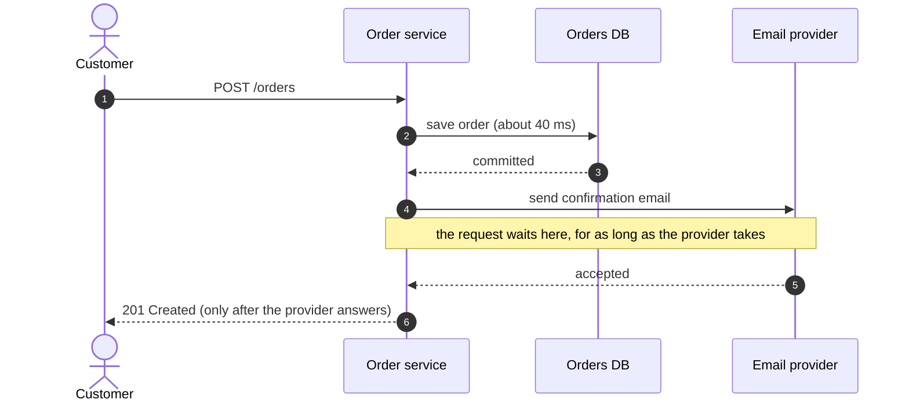
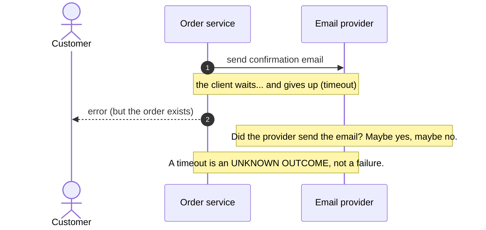
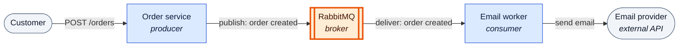
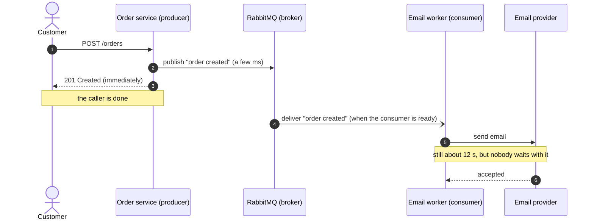
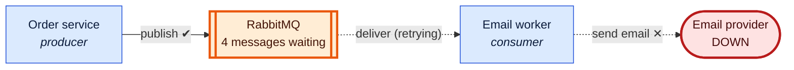
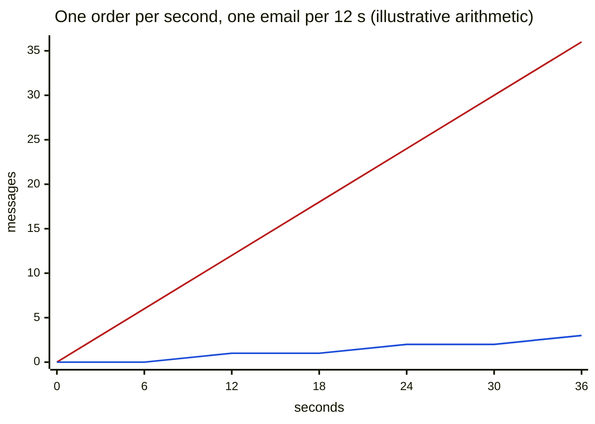
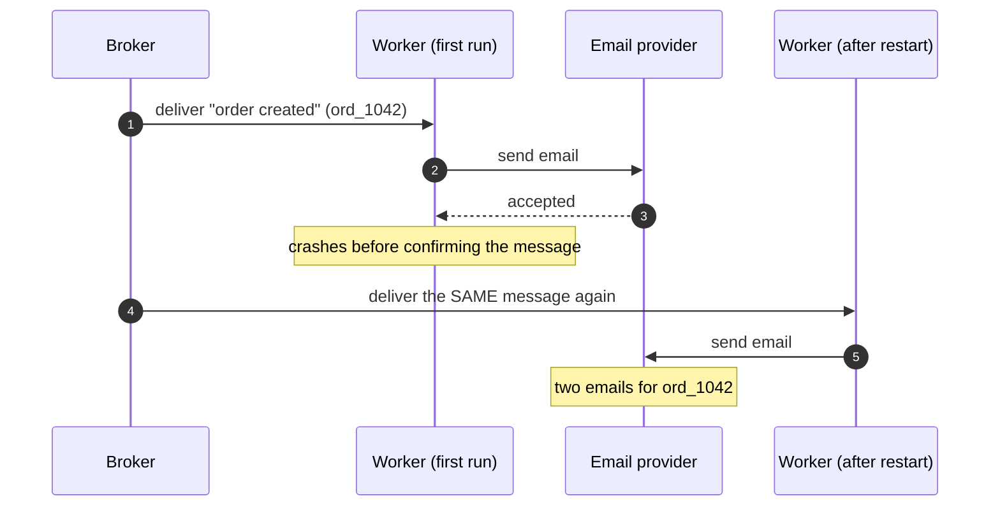
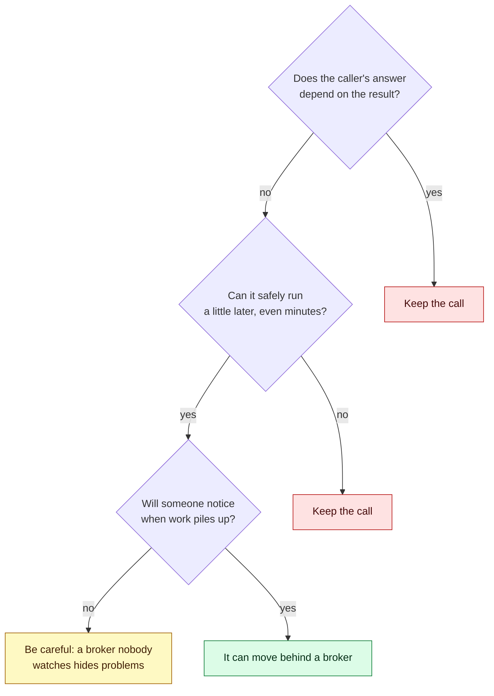

# 01 — Why a message broker? Stop making checkout wait

**Level:** Engineer  
**Episode:** Why a message broker? Stop making checkout wait  
**Language:** English  
**Code:** Java 21 · Maven · RabbitMQ Java client · Docker Compose

## YouTube

[Watch this episode]({{youtubeUrl}})

This folder is the companion project for the first episode of the course. The README is the **written version of the lesson**: together with the video it should leave the concept complete. Read it to review the ideas, follow the diagrams, and then run the experiments yourself.

> **The one sentence of this episode**
>
> **A broker lets the caller answer now and leave slow work for a consumer to do later.**

> **Learning-project disclaimer:** nothing here sends a real email. The email provider is a small fake HTTP server that waits for a configurable time, and the order "database" only waits 40 ms and hands out the next ID. The three terminal demos in the video (inline timeout, async publishing, consumer backlog) are **real recordings** of this project. The code is illustrative, not production-ready: publisher confirms, bounded retries, dead-lettering, idempotency and high availability are covered in later episodes (see [What this project does not cover](#what-this-project-does-not-cover)).

## Learning objectives

After this episode you should be able to:

- Explain why a slow inline call couples a request to a slow provider in three ways: speed, availability and capacity.
- Define **producer**, **broker** and **consumer**, and say which part of an example plays each role.
- Say what the caller gains when work moves behind a broker, and what it **gives up**: it no longer learns the result, and it accepts delay, duplicates and backlog.
- Explain why a broker makes the *caller* faster but does not make the *work* cheaper, and what happens when the work arrives faster than it is consumed.
- Decide whether a piece of work can move behind a broker, using three questions.

New terms in this episode (and nothing else): *broker*, *producer*, *consumer*. Queues, exchanges, bindings and acknowledgements get their own episodes. Where this project needs one of them, it is plumbing, and it is flagged as such.

## From the video to the code

| In the video | In this project |
|---|---|
| Checkout calls the email provider inline (flow, timeline, `compare` left side) | `mode inline`: `OrderService` runs `HttpEmailClient::sendConfirmation` before answering |
| `publisher.orderCreated(order)` (`compare` right side) | `mode broker`: `OrderService` runs `RabbitOrderEventPublisher::orderCreated`. The only difference between the two modes is one line in `App.java` |
| Producer → broker → consumer (flow, sequence) | `order-service` → RabbitMQ → `worker` |
| "What actually travels" (`order-created.json`) | `OrderCreated` and [`examples/order-created.json`](examples/order-created.json) |
| "The provider is down: orders keep succeeding" | `POST /admin/down` on the fake provider, then keep creating orders in `broker` mode |
| "The work did not get cheaper" (one order per second, one email per twelve seconds) | [Experiment 4](#experiment-4-the-backlog-grows-when-the-work-is-slower-than-the-arrivals) |
| Terminal demos: inline timeout, async publishing, consumer backlog | Real recordings of this project, made by the scripts in [`recordings/`](recordings/README.md). You can reproduce them with [Experiments 1, 2 and 4](#hands-on-experiments) |
| Challenge answers | [The decision](#8-the-decision-can-this-work-move-behind-a-broker) |
| Slides excerpt | [`examples/inline-vs-publish.java.txt`](examples/inline-vs-publish.java.txt). An excerpt, not a compilable source |

---

## 1. The problem: checkout waits for the email

A customer clicks **Place order**. The order service saves the order in about 40 ms, and then, **before answering**, it calls an external email provider and waits for it. Today the provider needs about twelve seconds to answer, and our client gives up after eight, so the customer stares at a spinner for eight seconds.

Nothing is broken. The customer simply does not need the email to be *sent* before seeing the order confirmed, yet the request waits for it.



The diagram is the whole problem. The customer's wait is the provider's wait.

### What the inline call couples together

| Coupling | What it means | Why it hurts |
|---|---|---|
| **Speed** | Your latency *includes* theirs | A slow provider makes your checkout slow |
| **Availability** | Their outage is your outage | If the provider is down, the request fails even though your own code is fine, and even though the order **is already saved** |
| **Capacity** | A waiting request holds a resource | In a typical *thread-per-request* server (for example a servlet container) a waiting request still holds one of your threads, so enough slow requests use up the whole pool |

The last row is stated for thread-per-request servers. A non-blocking server does not hold a thread while it waits, but it still holds the connection and the customer's patience.

### A timeout is not a failure

Suppose the call to the provider times out after a while:



A timeout tells you that *you* stopped waiting. It does not tell you whether the other side did the work. Keep that idea: it comes back whenever a caller no longer sees the result. ([Experiment 3](#experiment-3-a-timeout-is-an-unknown-outcome) shows it happening.)

---

## 2. The idea: do the slow part later

Compare the two versions of the controller. They differ by **one line**:

| Today: inline call | Tomorrow: publish a message |
|---|---|
| `Order order = orders.save(request);` | `Order order = orders.save(request);` |
| `// the customer waits here` | `// the customer does not wait` |
| `emailClient.sendConfirmation(order);` | `publisher.orderCreated(order);` |
| `return ResponseEntity.status(201).body(order);` | `return ResponseEntity.status(201).body(order);` |

The email is not part of the answer. The customer needs to know the order exists; the email can follow a moment later. So instead of sending the email, the controller **hands the work over** by publishing a message that says *an order was created*, and answers right away. Whoever listens for that message sends the email, in their own time.

The code change is tiny. The cost is not in this code: it is in everything that one line sets in motion.

In this project that is literally the whole difference between the two modes (simplified from `App.java`):

```java
OrderFollowUp followUp;
if (mode.equals("inline")) {
    followUp = email::sendConfirmation;     // the customer waits for the provider
} else {
    followUp = publisher::orderCreated;     // the customer waits for a publish only
}
OrderService orders = new OrderService(repository, followUp);
```

---

## 3. The model: producer, broker, consumer

Think of a restaurant. The waiter writes your order on a ticket. He does not stand at the kitchen door until your food is ready.

| In the restaurant | In messaging | Role |
|---|---|---|
| The waiter writes a ticket and walks away | **Producer** | Creates a message and sends it |
| The ticket rail between waiter and kitchen | **Broker** | Holds the message in the middle until someone is ready for it |
| The cook takes a ticket when ready and cooks | **Consumer** | Takes a message when it is ready and does the work |
| The waiter is free to serve the next table | The caller answers now | |

Because the rail holds the ticket, the waiter is free to serve the next table. There is a price: the waiter no longer knows the moment the dish is ready, or whether the kitchen managed to cook it.

**RabbitMQ is a broker.** In this episode it is one box in the middle; how it works inside is the subject of the next episodes.



*Colour convention used in the course: orange is for RabbitMQ objects only; services are blue.*

---

## 4. Who waits for what, now



The wait did not disappear. It **moved**: from the customer's request to a worker that nobody is waiting for.

```mermaid
gantt
    title Where the time goes (illustrative, to scale: 1 s = 1000 units)
    dateFormat  x
    axisFormat  %S s
    section Inline call
    Save order                              :a1, 0, 40
    Email provider (customer still waiting) :crit, a2, 40, 12040
    section With a broker
    Save order                              :b1, 0, 40
    Publish, then the customer is answered  :b2, 40, 47
    Email (off the customer's time)         :done, b3, 47, 12047
```



### What the caller gives up first: the result

After publishing, the order service **does not know** when the email is sent, or **whether** it was sent. That is the first thing you give up: the caller no longer learns the result. If the caller needs the result to build its answer, the work cannot move (see [the decision](#8-the-decision-can-this-work-move-behind-a-broker)).

### What actually travels

A message is just data. To the broker the body is opaque bytes; here the application chooses UTF-8 JSON.

```json
{
  "eventId": "evt_5C20",
  "type": "order.created",
  "orderId": "ord_1042",
  "customerId": "cus_88"
}
```

- `eventId` is a **stable identity for this event**, so the same event can always be recognised. (Later episodes explain why this matters. Do not confuse it with anything the broker assigns at delivery time.)
- `type` and `orderId` say what happened and to which order.
- `customerId` is enough to find the customer. The message carries what the consumer needs, nothing more; the consumer looks up the rest.

The consumer is a separate program. It reads this message, looks up whatever else it needs, and sends the email.

---

## 5. When the provider is down: orders keep succeeding

Break it on purpose. With the inline design an outage of the provider fails every checkout. With a broker in the middle, the order service only publishes, and publishing works whether or not the provider is up.



| Moment | What the customer sees | Where the work is |
|---|---|---|
| Provider goes down | Nothing: checkout still answers `201` | The consumer cannot send; it keeps the message |
| More orders arrive | `201` each time | Messages wait in the broker |
| Provider comes back | Nothing | The consumer works through the backlog; the emails go out, **late, but they go out** |

The outage moved from the customer's screen to a **backlog**. That assumes the broker itself stays up, which is a topic of its own.

---

## 6. The misconception: "the broker made it faster"

A common belief: putting a broker in the middle makes the system faster.

It is easy to see why it feels that way. The customer's wait fell from eight seconds and an error to a fraction of a second and a success. But look at the work:

| | Caller waits | Result | Email work |
|---|---|---|---|
| Inline | 8 s, then it gives up | `502` | 12 s |
| With a broker | less than 0.1 s | `201` | 12 s |

The email still takes twelve seconds. The total work has not shrunk at all.

### The part people miss: the backlog

Say **one order arrives every second**, and **one consumer sends one email at a time, twelve seconds each**.

| After | Orders arrived | Emails sent | Behind |
|---|---|---|---|
| 0 s | 0 | 0 | 0 |
| 12 s | 12 | 1 | **11** |
| 24 s | 24 | 2 | **22** |
| 36 s | 36 | 3 | 33 |



*Red: orders arrived. Blue: emails sent. The gap between the lines is the backlog.*

The backlog grows **every second**, because the work did not get cheaper. The numbers assume a single consumer that processes one email at a time. The remedy is more consumers, or a faster provider. To keep up with this arrival rate you need about `arrival rate × time per email` = 1 per second × 12 s = **12 consumers** working in parallel.

**The corrected model:** a broker makes the *caller* faster. It does not make the *work* cheaper. It only moves where the waiting happens, and it adds the costs below.

---

## 7. What you give up: delay, duplicates, backlog

| Cost | What it means | What to do about it |
|---|---|---|
| **Delay** | The work still happens, but later. | If anyone needs it done *before they continue*, this is the wrong tool. |
| **Duplicates** | The same message can be delivered more than once, for example when a consumer dies before it confirms the work was done. | The consumer must be ready to cope with seeing the same message twice. (Later episodes: acknowledgements, idempotent consumers.) |
| **Backlog** | If nobody is consuming, or consumers are slower than the arrivals, messages pile up silently, and the caller never finds out. | Somebody has to watch the waiting work. |

Duplicates, in one picture: the consumer sent the email, but died before telling the broker.



[Experiment 5](#experiment-5-duplicates-a-message-can-be-delivered-twice) reproduces this.

---

## 8. The decision: can this work move behind a broker?

Three questions decide it:



Applied to three jobs in a checkout (these are the video's two challenges, with their answers):

| Job | Answer depends on it? | Can wait? | Verdict |
|---|---|---|---|
| Check the card balance before accepting the payment | Yes: the caller needs the result to decide | No | **Keep the call** |
| Send the receipt after the order is confirmed | No | Yes, a little later is fine | **Can move behind a broker** |
| Reserve the last item in stock before confirming | Yes: the answer depends on the reservation succeeding now | No | **Keep the call** |

And the first challenge: *the email provider is down for ten minutes; with the publish-an-event design, what does the customer see?* **The order succeeds, and the emails are sent later when the work can run again.** The caller no longer calls the provider, so its outage cannot fail the request, and publishing does not wait for the consumer.

### When a broker is the wrong tool

| Use a broker for... | Avoid it when... |
|---|---|
| Slow side effects: emails, notifications, reports | The caller needs the result in the same response (a balance, a price, a stock check) |
| A slow or flaky system you want to isolate from your request | A plain in-process call is enough and nobody needs failure isolation |
| Work whose result the answer does not depend on | The team cannot yet run one more system: monitoring, upgrades, an on-call rotation |

---

## Hands-on experiments

### Prerequisites

- Java 21 or newer and Apache Maven 3.9 or newer.
- Docker with the Docker Compose plugin (for the RabbitMQ experiments).
- `curl`.
- Experiments 1, 3 and 6 need **no RabbitMQ**; the others do.

Everything runs on `localhost`. Ports used: `9090` (fake email provider), `8080` (order service), `5672` (RabbitMQ), `15672` (RabbitMQ management UI, `guest` / `guest`).

Build once (this also runs the unit tests, which do not need RabbitMQ):

```bash
mvn clean verify
```

All commands below are run from this directory. You need up to four terminals; each of the three Java programs stays in the foreground. They all start through one entry point:

```bash
mvn -q compile exec:java -Dexec.args="<command> [--option value ...]"
```

| Command | What it is | Useful options (defaults) |
|---|---|---|
| `provider` | The fake email provider | `--port 9090`, `--latency-ms 12000` |
| `order-service` | `POST /orders` | `--mode inline\|broker` (`inline`), `--port 8080`, `--threads 16`, `--db-ms 40`, `--email-timeout-ms 8000` |
| `worker` | The consumer. Needs RabbitMQ | `--retry-ms 2000`, `--email-timeout-ms 30000` |

The fake provider can be controlled while it runs:

```bash
curl -X POST localhost:9090/admin/down            # every email request now answers 503
curl -X POST localhost:9090/admin/up              # back to normal
curl -X POST localhost:9090/admin/latency/3000    # each email now takes 3 s
curl localhost:9090/admin/stats                   # emails accepted per order; more than 1 = duplicate
```

> Output blocks below are **illustrative**: they show the shape of what you should see, not captured output. Your timestamps and exact timings will differ.

### Experiment 1: the inline call makes the customer wait

```bash
# terminal 1
mvn -q compile exec:java -Dexec.args="provider"
# terminal 2
mvn -q compile exec:java -Dexec.args="order-service --mode inline"
# terminal 3
curl -s -o /dev/null -w '%{http_code}  %{time_total}s\n' -X POST localhost:8080/orders
```

Expected: the provider needs twelve seconds and the client gives up after eight, so the customer waits about **8 seconds and gets a `502`**, even though the order was saved (the body says `"orderSaved":true`). This is the timeout from the video.

```text
502  8.1s
```

To see the slow *success* instead, make the provider faster while it runs: `curl -X POST localhost:9090/admin/latency/5000`, then repeat the request: `201` after a little more than 5 seconds.

Now take the provider down and try again:

```bash
curl -X POST localhost:9090/admin/down
curl -s -w '%{http_code}  %{time_total}s\n' -X POST localhost:8080/orders
```

Expected: `502` almost immediately (the provider answers `503` at once), again with `"orderSaved":true`. The customer sees an error for an order that exists.

### Experiment 2: with a broker the caller answers now

```bash
docker compose up -d            # wait until the container is healthy: docker compose ps
# stop the order service from experiment 1, then:
# terminal 2
mvn -q compile exec:java -Dexec.args="order-service --mode broker"
# terminal 4
mvn -q compile exec:java -Dexec.args="worker"
# terminal 3 (bring the provider back first if you took it down)
curl -X POST localhost:9090/admin/up
curl -s -o /dev/null -w '%{http_code}  %{time_total}s\n' -X POST localhost:8080/orders
```

Expected: status `201` after a few tens of milliseconds, **while the provider still takes 12 seconds**. About twelve seconds later, the worker logs that the email was sent:

```text
12:00:00.050 [order-service] published evt_5C20A91F (order.created, ord_1042)
12:00:00.051 [order-service] ord_1042 created, answering 201 after 48 ms
12:00:00.060 [email-worker] received evt_5C20A91F for ord_1042
12:00:12.060 [email-worker] email sent for ord_1042 (event evt_5C20A91F)
```

Same result for the customer, much faster: the wait moved to the worker. (The order service in this project publishes without waiting for the broker to confirm: publisher confirms are a later episode.)

What is in the queue? The queue is plumbing here (`notifications.email`, reached through the default exchange); you can watch it without knowing more:

```bash
docker compose exec rabbitmq rabbitmqctl list_queues name messages_ready messages_unacknowledged
```

or open <http://localhost:15672> (`guest` / `guest`).

### Experiment 3: a timeout is an unknown outcome

This one needs no RabbitMQ, and it continues Experiment 1: right after the `502` that took about 8 seconds, wait a few more seconds and ask the provider what it did:

```bash
sleep 6
curl localhost:9090/admin/stats
```

Expected: the customer got an error after eight seconds, and yet the provider's stats show that it **accepted the email anyway** (its twelve seconds finished after the client stopped waiting). The caller saw a failure; the work happened. The provider log also says that the caller had already stopped waiting.

### Experiment 4: the backlog grows when the work is slower than the arrivals

With the broker setup of experiment 2 running (provider at its default 12 s, one worker), create one order per second for 24 seconds and look at the queue:

```bash
for i in $(seq 1 24); do curl -s -o /dev/null -X POST localhost:8080/orders; sleep 1; done
docker compose exec rabbitmq rabbitmqctl list_queues name messages_ready messages_unacknowledged
```

Expected, from the arithmetic in [section 6](#the-part-people-miss-the-backlog): 24 orders have arrived and about two emails have gone out, so roughly **22 are behind**. They show up as about 21 `messages_ready` plus 1 `messages_unacknowledged` (the one the worker is working on). The exact numbers depend on timing. Keep creating orders and the backlog keeps growing.

Then start a second worker (another terminal, `... -Dexec.args="worker"`): RabbitMQ shares the messages between the two, and the backlog shrinks about twice as fast. You need roughly twelve workers to keep up with one order per second.

### Experiment 5: duplicates, a message can be delivered twice

```bash
# broker setup running; send one order, and as soon as the worker logs "received ...", stop the worker with Ctrl+C
curl -s -o /dev/null -X POST localhost:8080/orders
# restart the worker
mvn -q compile exec:java -Dexec.args="worker"
curl localhost:9090/admin/stats
```

Expected: the worker never acknowledged the message, so the broker delivers it again to the restarted worker. The provider accepts the email a second time:

```text
12:05:09.000 [provider] accepted email for ord_1042
12:05:21.000 [provider] accepted email for ord_1042  <-- DUPLICATE (#2)
```

The provider already accepted the first request that the dead worker had started, and the new worker asks again. Two emails for one order. This is why a consumer must be ready to cope with a message it has already handled. The mechanism is the subject of the acknowledgement and idempotency episodes; here you only need to *see* the cost.

### Experiment 6: waiting requests hold your threads (capacity)

This one needs no RabbitMQ either. Use a tiny thread pool and a faster provider:

```bash
# terminal 1
mvn -q compile exec:java -Dexec.args="provider --latency-ms 3000"
# terminal 2
mvn -q compile exec:java -Dexec.args="order-service --mode inline --threads 2"
# terminal 3: four customers at once
for i in 1 2 3 4; do curl -s -o /dev/null -w '%{time_total}s\n' -X POST localhost:8080/orders & done; wait
```

Expected: two requests finish after about 3 seconds and the other two after about 6, because only two requests can be served at a time while the others wait for a free thread. The provider is not slower; your capacity ran out. Repeat with `--mode broker`: all four answer in a few milliseconds.

---

## Project structure

```text
01-rabbitmq-why-a-broker/
├── README.md
├── pom.xml
├── docker-compose.yml
├── .gitignore
├── LICENSE
├── recordings/                         scripts that record the demos shown in the video (macOS, maintainers)
├── examples/
│   ├── inline-vs-publish.java.txt     teaching excerpt from the video
│   └── order-created.json             the message that travels
└── src/
    ├── main/java/com/fromdevtodev/rabbitmq/whyabroker/
    │   ├── App.java                       entry point: provider | order-service | worker
    │   ├── OrderService.java              save the order, run the follow-up, answer
    │   ├── OrderFollowUp.java             the one line that differs: inline call vs publish
    │   ├── OrderRepository.java           stand-in for the 40 ms database commit
    │   ├── OrderServer.java               POST /orders on a fixed thread pool
    │   ├── HttpEmailClient.java           the slow inline call (and the timeout)
    │   ├── FakeEmailProvider.java         the slow, switchable provider
    │   ├── EmailJob.java                  the consumer's work for one message
    │   ├── OrderCreated.java              the message
    │   ├── RabbitOrderEventPublisher.java the producer (RabbitMQ client)
    │   ├── RabbitEmailWorker.java         the consumer (RabbitMQ client)
    │   ├── Topology.java                  connection settings, the queue (plumbing)
    │   ├── EventJson.java                 message body <-> bytes
    │   └── ...                            small value types and helpers
    └── test/java/com/fromdevtodev/rabbitmq/whyabroker/
        ├── WhyABrokerTest.java            the episode's claims, as tests
        ├── InMemoryBroker.java            stand-in broker, tests only
        └── Eventually.java                polling helper
```

Only `RabbitOrderEventPublisher`, `RabbitEmailWorker`, `Topology` and `EventJson` use the RabbitMQ client or JSON libraries. Everything else uses only the JDK, so the idea (the caller answers now) is visible without any messaging code.

### Tests

```bash
mvn test
```

`WhyABrokerTest` turns the episode's claims into tests, with timings scaled down (a 500 ms provider instead of 12 s) and wide margins:

| Test | Claim |
|---|---|
| `inlineCallMakesTheCustomerWaitForTheProvider` | The caller's wait includes the provider's wait |
| `publishingLetsTheCallerAnswerNowAndTheEmailGoesOutLater` | The caller answers now; the email goes out later |
| `providerDownFailsTheInlineCheckoutEvenThoughTheOrderIsSaved` | Their outage is your outage |
| `providerDownDoesNotFailTheCheckoutWhenTheWorkIsPublished` | Orders keep succeeding; the backlog drains when the provider returns |
| `aTimeoutIsAnUnknownOutcomeNotAFailure` | The caller timed out and the provider did the work anyway |
| `theSameMessageHandledTwiceSendsTheEmailTwice` | A duplicate delivery is a duplicate email unless the consumer copes with it |
| `waitingRequestsHoldThreadsAndCapacityRunsOut` | A waiting request holds one of your threads |

These tests use an in-memory stand-in for the broker (`InMemoryBroker`), so they check the *design argument*, not RabbitMQ itself. Experiments 2, 4 and 5 are how you check the real thing.

---

## What this project does not cover

This is deliberately the smallest thing that shows the idea. In particular:

- **RabbitMQ internals.** The broker is one box. The queue `notifications.email` and the default exchange are plumbing the code needs; queues, exchanges, bindings and routing are the next episodes.
- **Publisher confirms and durability.** The producer does not wait for the broker to confirm, and the project says nothing about what survives a broker restart. The episode assumes the broker stays up.
- **Acknowledgement mechanics.** The worker acknowledges after the email was accepted and processes one message at a time (`basicQos(1)`). Why and how is a later episode. Never acknowledge *before* the work is durably done.
- **Bounded retries and dead-letter queues.** When the provider fails, `EmailJob` keeps retrying for as long as it takes and holds the message unacknowledged. That is fine to show a backlog, and wrong for production, where retries must be bounded and observable. A malformed message is rejected without requeue, which drops it.
- **Idempotent consumers.** Experiment 5 shows the duplicate; it does not fix it.
- **Exactly-once.** Nothing here provides it. The honest description is *at-least-once delivery*, and a consumer whose effects tolerate duplicates.
- **Operating the broker.** Monitoring, upgrades and high availability. "One more system to run" is part of the cost of a broker.

## Recap

- A broker lets the caller answer now and leave slow work for a consumer to do later.
- The caller answers now; the slow work waits in the middle.
- You give up three things: **delay**, **duplicates**, and a **backlog** that nobody notices. The caller also stops learning the result.
- A broker speeds up the caller, **never the work itself**.
- Before moving work, ask: does the answer depend on it? Can it wait? Will someone watch it?

**Next episode:** RabbitMQ queues, the buffer between producer and consumer. We open the box and look inside, starting with the first thing in it: the queue.

## Sources

- RabbitMQ documentation: [AMQP 0-9-1 Model Explained](https://www.rabbitmq.com/tutorials/amqp-concepts), for brokers, publishers (producers), consumers, queues and message acknowledgements.
- The course's own reasoning for the timeout, thread-per-request and backlog arithmetic; see the episode sources file in the video repository (`docs/sources/rabbitmq-why-a-broker-sources.md`).
