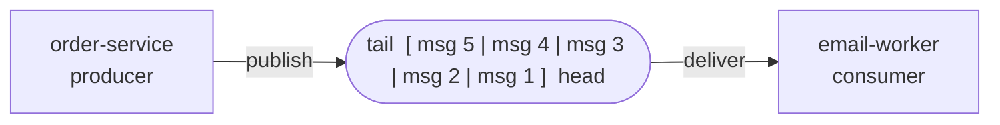

# 02 — RabbitMQ queues: the buffer between producer and consumer

**Level:** Engineer  
**Episode:** RabbitMQ queues: the buffer between producer and consumer  
**Language:** English  
**Code:** Java 21 · Maven · RabbitMQ Java client · Docker Compose  
**Requires:** [01 — Why a message broker?](../01-rabbitmq-why-a-broker/README.md)  
**Reading time:** about 12 minutes, plus the experiment

## YouTube

The video link will be added here when the episode is published.

This README is the **written version of the lesson**. It tells the same story as the video, with more room for the reasoning and for the code. You can read it before the video, after it, or instead of it. Everything it describes can be run on your machine with `./run.sh`.

> **The one sentence of this episode**
>
> **A queue is a buffer: it holds messages until a consumer takes them.**

> **Learning-project disclaimer:** no email is sent. A consumer "handles" a message with a pause (`--delay-ms`) and a log line. The terminal demo in the video runs this project against a real RabbitMQ. The code is illustrative, not production-ready (see [What this project does not cover](#what-this-project-does-not-cover)).

## Learning objectives

After this episode you should be able to:

- Define **queue**, **ready message** and **queue length**.
- Explain why messages come out in the order they went in (first in, first out) and why a queue is not a database.
- Read `messages_ready` and `consumers` for a queue, and say what a length that grows means with zero consumers and with connected consumers.
- Predict how the queue length changes when messages arrive faster than a consumer takes them.
- Read the code of the demo and say which lines put a message into the queue and which take it out.

## Contents

1. [The problem: a number on a screen](#the-problem-a-number-on-a-screen)
2. [The vocabulary](#the-vocabulary)
3. [The model](#the-model)
4. [A queue is not a small database](#a-queue-is-not-a-small-database)
5. [The experiment](#the-experiment)
6. [Arrival and speed](#arrival-and-speed)
7. [Reading the queue](#reading-the-queue)
8. [The rule](#the-rule)
9. [Read the code](#read-the-code)
10. [Try it yourself](#try-it-yourself), [where it fits](#where-it-fits), [summary](#summary) and [what this project does not cover](#what-this-project-does-not-cover)

| Video scene | Where it is in this README |
|---|---|
| Cold open, "Is this an emergency?" | [The problem](#the-problem-a-number-on-a-screen) |
| "A queue is a buffer", "A queue, drawn step by step" | [The vocabulary](#the-vocabulary), [The model](#the-model) |
| Challenge: faster in than out | [Arrival and speed](#arrival-and-speed) |
| "A queue is not a small database" | [A queue is not a small database](#a-queue-is-not-a-small-database) |
| Board and live demo | [The experiment](#the-experiment) |
| "The command behind the right terminal", challenge: back to the number | [Reading the queue](#reading-the-queue) |
| "A queue: when it fits" | [Where it fits](#where-it-fits) |
| Recap | [Summary](#summary) |

## The problem: a number on a screen

You open the broker's management page and one queue says:

```text
queue:     notifications.email
ready:     12000
consumers: 0
```

Is that an emergency, or perfectly normal?

The honest answer is: it depends. To decide, you need two things: what a queue is, and what its numbers mean. By the end of this README you will be able to read that screen, and you will see why the right first move is *not* the one that feels most urgent.

## The vocabulary

| Term | Meaning | In this project |
|---|---|---|
| **Queue** | A buffer that holds messages, in the order they arrived, until a consumer takes them. | `notifications.email` |
| **Ready message** | A message that is waiting in the queue to be delivered to a consumer. | The `ready` counter |
| **Queue length** | The number of ready messages. RabbitMQ's documentation defines queue length exactly like this ("the number of messages ready for delivery"). | `messages_ready` in `rabbitmqctl` |

> **A note on "depth".** You will also hear *queue depth*. RabbitMQ's `rabbitmqctl` uses it for the **sum** of ready and unacknowledged messages (the `messages` column). This course uses *queue length*, the number of ready messages, and does not need the unacknowledged part: that is the subject of the acknowledgements episode.

## The model



Think of the queue as a pipe with two ends. A producer hands messages to the queue, and they join at the **tail**, the end of the line. A consumer takes messages from the **head**, the other end, and the oldest message always goes first: **first in, first out**.

Three messages arrive and wait in the order they arrived. Each of them is a *ready* message, so the queue length is three. When a consumer takes one, the length falls to two.

Notice who is *not* in the picture: the producer and the consumer never talk to each other. The queue is all that is between them, so either side can pause, crash or run late without the other noticing. That independence is what episode 1 used to keep the provider's outage away from checkout, and the queue is the part that makes it possible.

## A queue is not a small database

A common belief is that a queue is a small database: the messages stay there and you can look them up. It works the other way.

| A database | A queue |
|---|---|
| Rows stay after you read them | A message is taken, then it is gone |
| You can look up row 42 | No lookup: only the head is served |
| You can read the same row twice | No second read of a taken message |
| Nothing leaves until you delete it | The length rises and falls |

The queue length rises when messages arrive and falls when consumers take them. That is the whole life of a queue. The experiment below makes the difference visible.

## The experiment

You need **Java 21**, **Maven** and **Docker** (with Docker Compose v2). Then:

```bash
./run.sh up
```

This starts RabbitMQ in a container, compiles the project and declares the queue `notifications.email`. The management page is at <http://localhost:15672> (user `guest`, password `guest`; local use only). Open a second terminal and leave the counters running:

```bash
./run.sh watch
```

That prints two numbers twice a second: **ready** (the queue length) and **consumers** (programs connected to take messages). In the video, this is the right-hand terminal.

> **About the output blocks below.** They show the *shape* of what the program prints. The timestamps (`12:00:00.043`) are illustrative: yours will differ. The counters and the order of the events are what matter.

**Predict first.** Five messages are published and nobody is consuming. Then consumer A starts and takes them, 2.5 seconds each. Later, consumer B starts. What do the counters read at each moment? Which message does A receive first? What does B receive?

```bash
./run.sh experiment
```

<details>
<summary>The commands behind it</summary>

```bash
mvn -q exec:java -Dexec.args="publish --count 5"                                     # five ready messages, no consumer
mvn -q exec:java -Dexec.args="consume --name consumer-a --delay-ms 2500 --limit 5"   # takes them one at a time, oldest first
mvn -q exec:java -Dexec.args="consume --name consumer-b"                             # starts later: receives nothing
```

</details>

**Step 1: publish.** The producer sends five messages, numbered one to five, and exits:

```text
12:00:00.101 [order-service] published evt_0001 (ord_1001)
12:00:00.103 [order-service] published evt_0002 (ord_1002)
...
12:00:00.108 [order-service] published evt_0005 (ord_1005)
```

The counters now read `ready 5`, `consumers 0`. Nothing is wrong: the queue is a buffer, and it simply holds the messages. The queue length is five.

**Step 2: consumer A.** It takes the messages one at a time, and "handling" each one takes about two and a half seconds:

```text
12:00:10.002 [consumer-a] waiting for messages on 'notifications.email' (Ctrl+C to stop)
12:00:10.015 [consumer-a] received evt_0001 (ord_1001), message 1 for this consumer
12:00:12.516 [consumer-a] handled evt_0001
12:00:12.518 [consumer-a] received evt_0002 (ord_1002), message 2 for this consumer
...
```

While it runs, `ready` falls with every message A takes, and the log lists `evt_0001` first and `evt_0005` last: first in, first out.

**Step 3: the queue is empty.** `ready` reads 0. The five messages are gone: once a consumer has dealt with a message, the queue does not keep it.

**Step 4: consumer B.** It starts after all that. It connects and waits:

```text
12:00:30.002 [consumer-b] waiting for messages on 'notifications.email' (Ctrl+C to stop)
```

The counters read `ready 0`, `consumers 1`. There is nothing to receive, and there is no way to ask the queue for the old messages.

**Why.** The queue holds a message only until a consumer takes it. A is the only one that ever saw those five messages; B arrived too late, and the queue does not remember what it delivered. **A queue is not a database.** You cannot look a message up, and you cannot read it twice. To replay old messages you need a different tool, and a later episode covers it.

When you finish, `./run.sh down` stops RabbitMQ and deletes its data.

## Arrival and speed

Here is a prediction you can do on paper. Publishers send 100 messages per second, and the consumer handles 60 per second. After one minute, what has happened to the queue?

```text
publishers:  100 messages / second
consumer:     60 messages / second
time:         one minute
```

Forty more messages arrive every second than the consumer takes. Over sixty seconds that is 40 × 60 = **2,400 ready messages**. The queue did not become empty (nothing consumes fast enough), and it did not discard the extras: **a queue never drops messages just because the consumer is behind.** It keeps them, and the length grows.

The reverse is just as true. If the consumer were faster than the arrivals, the length would stay near zero. The length is the *difference* between how fast messages come in and how fast they go out, accumulated over time. Episode 1 showed the same thing with one order per second against one email every three seconds.

## Reading the queue

The command behind the right-hand terminal asks the broker for three columns:

```bash
rabbitmqctl list_queues name messages_ready consumers
```

| Column | Meaning |
|---|---|
| `name` | The queue |
| `messages_ready` | The queue length: the ready messages |
| `consumers` | How many consumers are connected |

Read the two numbers **together**:

- A length that **grows while `consumers` is 0** means nobody is taking messages. Find out why no consumer is connected before touching the messages.
- A length that **grows while consumers are connected** means they are too slow for the arrival rate.
- A length of 0 with consumers connected is a healthy, idle queue: the consumers are waiting.

Now back to the screen that opened this README: 12,000 ready messages and 0 consumers. The first thing to do is **find out why nobody is consuming**: has the service crashed, been scaled to zero, lost its connection? Purging the queue to get back to zero is dangerous: it deletes real business messages (here, orders waiting for their email), and the cause is still there. Adding more publishers only makes the queue longer.

So, is it an emergency? It is a queue doing its job while its consumers are missing. How urgent that is depends on how long the messages can wait.

## The rule

> **A queue is a buffer: it holds messages until a consumer takes them.**

What it promises, and what it does not:

- It promises to **hold** messages in the order they arrived, until a consumer takes them.
- It does **not** promise to keep them afterwards: a taken message is gone.
- It does **not** let you look at the middle of the line, or read a message twice.

## Read the code

The project is small: about 300 lines in 9 files, and the whole lesson lives in four places. This is the path one experiment follows.

| File | Role |
|---|---|
| `App` | Entry point: reads the command (`setup`, `publish`, `consume`, `reset`) and its options |
| `Publisher` | **The producer.** Publishes `--count` messages, `evt_0001`…, and exits |
| `QueueConsumer` | **The consumer.** One message at a time: "handles" it for `--delay-ms`, then acknowledges |
| `Topology`, `Setup` | The one queue `notifications.email`, and the connection settings |
| `OrderEvent`, `EventJson` | The message: an `order.created` event, and its JSON form |
| `Args`, `Log` | Small supporting pieces; you can skip them |

### 1. The commands

<!-- snippet: src/main/java/com/fromdevtodev/rabbitmq/queues/App.java#commands -->
```java
switch (args[0]) {
    case "setup" -> Setup.run();
    case "publish" -> Publisher.publish(options.number("count", 1), options.number("first", 1));
    case "consume" -> QueueConsumer.run(
            options.text("name", "consumer"),
            options.number("delay-ms", 1_500),
            options.number("limit", 0));
    case "reset" -> Topology.reset();
```
<!-- /snippet -->

Each command of the experiment is one line here. `publish` and `consume` are separate commands on purpose: they are two programs that never call each other, exactly the independence described in [The model](#the-model). `--count`, `--delay-ms` and `--limit` are the options you used.

### 2. The producer: into the tail

<!-- snippet: src/main/java/com/fromdevtodev/rabbitmq/queues/Publisher.java#publish -->
```java
/** Publishes messages {@code first .. first + count - 1}, in that order. */
static void publish(long count, long first) throws IOException, TimeoutException {
    try (Connection connection = Topology.connect("order-service");
         Channel channel = connection.createChannel()) {
        Topology.declareQueue(channel);
        for (long seq = first; seq < first + count; seq++) {
            OrderEvent event = OrderEvent.of(seq);
            AMQP.BasicProperties properties = new AMQP.BasicProperties.Builder()
                    .contentType("application/json")
                    .messageId(event.eventId())
                    .deliveryMode(2)
                    .build();
            channel.basicPublish("", Topology.QUEUE, properties, EventJson.toBytes(event));
            Log.info("order-service", "published " + event.eventId() + " (" + event.orderId() + ")");
        }
    }
}
```
<!-- /snippet -->

The loop publishes messages `first .. first + count - 1`, in that order, which is why the queue's order is easy to check: `evt_0001` joins first. The producer does not know whether a consumer exists, and it does not wait for one: after the loop it simply exits. That is the *buffer* at work.

`basicPublish` puts the message into the queue. The exchange is `""` and the routing key is the queue name, which together mean "straight into the queue `notifications.email`". The body is the JSON of the event.

> **Not explained here.** The empty exchange name is the *default exchange*; how messages reach queues through exchanges is the next episode. `deliveryMode(2)` (a persistent message) belongs to the durability episode. And the producer does not ask the broker to confirm anything: that is *publisher confirms*, a later episode.

The queue is declared in one place, `Topology`:

<!-- snippet: src/main/java/com/fromdevtodev/rabbitmq/queues/Topology.java#declare -->
```java
static void declareQueue(Channel channel) throws IOException {
    channel.queueDeclare(QUEUE, true, false, false, null);
}
```
<!-- /snippet -->

Declaring a queue that already exists with the same settings does nothing, so the producer, the consumer and `setup` can all call it, in any order. The `true` is again for the durability episode.

### 3. The consumer: out of the head

<!-- snippet: src/main/java/com/fromdevtodev/rabbitmq/queues/QueueConsumer.java#consumer -->
```java
channel.basicQos(1);
DeliverCallback onMessage = (consumerTag, delivery) -> {
    OrderEvent event = EventJson.fromBytes(delivery.getBody());
    long position = received.incrementAndGet();
    Log.info(name, "received " + event.eventId() + " (" + event.orderId() + "), message " + position + " for this consumer");
    sleep(delayMillis);
    Log.info(name, "handled " + event.eventId());
    channel.basicAck(delivery.getEnvelope().getDeliveryTag(), false);
    if (limit > 0 && position >= limit) {
        stopped.countDown();
    }
};
channel.basicConsume(Topology.QUEUE, false, onMessage, consumerTag -> stopped.countDown());
```
<!-- /snippet -->

When the broker delivers a message, the callback reads the event, logs `received` with its position for *this* consumer, pauses for `--delay-ms` (the pretend work), logs `handled`, and asks for the next one. Because the queue serves its head first, the log shows `evt_0001`, `evt_0002`, … in order.

> **Ignore these for now.** Two lines belong to later episodes. `channel.basicQos(1)` makes the consumer take one message at a time (*prefetch*, episode 10). `channel.basicAck(...)` tells the broker the message was handled, and the `false` in `basicConsume` means the broker waits for that acknowledgement (*acknowledgements*, episode 8). They are what makes the counters easy to read: without the first, the broker would hand every waiting message to the consumer at once and `ready` would fall to zero before any of them was handled.

### 4. The test: how you know the numbering is right

<!-- snippet: src/test/java/com/fromdevtodev/rabbitmq/queues/QueuesTest.java#test -->
```java
@Test
void messagesAreNumberedInPublishingOrder() {
    assertEquals("evt_0001", OrderEvent.of(1).eventId());
    assertEquals("ord_1001", OrderEvent.of(1).orderId());
    assertEquals("evt_0005", OrderEvent.of(5).eventId());
    assertEquals(OrderEvent.TYPE, OrderEvent.of(3).type());
}
```
<!-- /snippet -->

The tests need no RabbitMQ: they cover the pieces that do not talk to the broker. This one fixes the naming the whole course relies on: message *n* is event `evt_000n` and order `ord_100n`, so you can follow one message from the producer's log to the consumer's. Run all of them with:

```bash
./run.sh test
```

## Try it yourself

Each exercise has a prediction first. Write your answer down, then run it, then open the answer. All of them start from an empty queue (`./run.sh reset`, then `./run.sh app setup`).

**1. A burst and a slow consumer.** Publish 200 messages at once, then start one consumer that handles one message per second:

```bash
./run.sh app publish --count 200
./run.sh app consume --delay-ms 1000
```

What does `ready` read once the consumer has been running for 30 seconds?

<details>
<summary>Answer</summary>

About 170. All 200 messages are in the queue at the start; the consumer clears one per second, so after 30 seconds of work about 30 have been taken, and the one it is working on is no longer *ready*. It is arithmetic, not a measurement: expect 169 or 170. Nothing was lost; the queue simply holds what the consumer has not reached.

</details>

**2. Consumer first.** Start the consumer *before* the producer, then publish five messages:

```bash
./run.sh app consume --delay-ms 1500                    # terminal 1
./run.sh app publish --count 5                          # terminal 2
```

Does the order of starting matter? What do the counters read right after the publish?

<details>
<summary>Answer</summary>

It does not matter: the queue is declared by both sides, and the producer and the consumer never talk to each other. The consumer takes the first message at once, so right after the publish you should see `consumers 1` and `ready` at about 4, which then falls by one every 1.5 seconds.

</details>

**3. Read these three snapshots.** For each, what is going on, and what do you check first?

- (a) `ready 0`, `consumers 2`
- (b) `ready 3000` and rising, `consumers 0`
- (c) `ready 3000` and rising, `consumers 3`

<details>
<summary>Answer</summary>

(a) A healthy, idle queue: two consumers are connected and waiting, and nothing is piling up. (b) Nobody is taking messages: check why no consumer is connected (crashed, scaled to zero, wrong queue name). (c) Consumers are connected, so they are too slow for the arrival rate: check how long one message takes to handle, and whether the arrivals have a spike. Purging is the answer to none of them.

</details>

**4. Queue or not?** For each need, is a queue the right tool?

- (a) Process uploaded images one at a time, in the order they arrive.
- (b) Show a customer the current status of their order 42 at any time.
- (c) Let a brand-new service read every message published last week.

<details>
<summary>Answer</summary>

Only (a). In (b) you need to look up one item by its key, which is a database's job. In (c) you need to read old messages that consumers already took, which is a log's job, not a queue's.

</details>

## Where it fits

**Use a queue when:**

- the work can wait for a consumer;
- producer and consumer run at different speeds;
- the order of arrival is what matters (first in, first out).

**Do not use one when:**

- you need to look up an old message;
- you need to read a message twice;
- you need to look at the middle of the line without taking it.

That is a log, not a queue: a later episode covers it.

## Things that surprise people

- **A non-empty queue is not an error.** A queue with ready messages is a buffer doing its job. What matters is whether the length is stable, falling or growing, and whether consumers are connected.
- **The length is a rate difference, not a size limit.** It grows when messages arrive faster than they go out, however fast each side is.
- **A taken message is gone.** If a consumer needs a message again, someone has to publish it again.
- **Troubleshooting.**
  - *Connection refused when you run the program:* RabbitMQ is not up yet. Run `./run.sh up` and wait for it to finish.
  - *Port 5672 or 15672 already in use:* another RabbitMQ owns it, for example the one of episode 1. Run `./run.sh down` in that episode's folder, or change the ports in `docker-compose.yml` and set `RABBITMQ_PORT` for the program.
  - *`unknown flag: --wait`:* your Docker Compose is older than v2.1. Use `docker compose up -d`, wait ten seconds, then `./run.sh app setup`.

## Summary

1. A queue is a buffer: it holds messages until a consumer takes them, oldest first.
2. The queue length is the number of ready messages. It grows when messages arrive faster than consumers take them, and it falls when they catch up.
3. Read `ready` and `consumers` together. It is not a database: no lookup, no second read.

**Next:** 03 — Exchanges and bindings: how a message finds its queue. The messages are in the queue, but how did they choose this queue and not another one?

## What this project does not cover

- Exchanges, routing and bindings: episode 3. Messages go straight to the queue.
- Acknowledgements and prefetch (episodes 8 and 10): the consumer acknowledges after handling and takes one message at a time, and the video does not explain either.
- Durability, queue types, length limits, TTLs and priorities.
- Reading message contents without consuming them, and replaying old messages (Streams episode).
