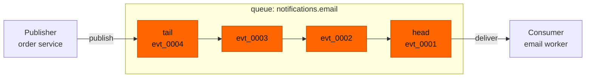
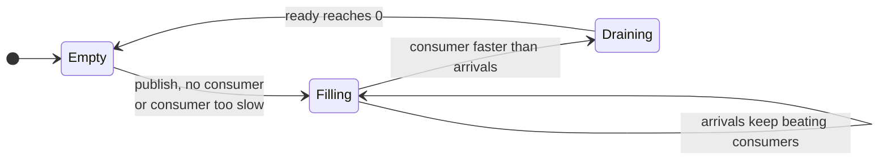
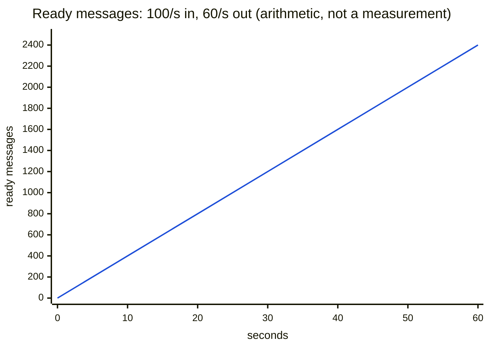
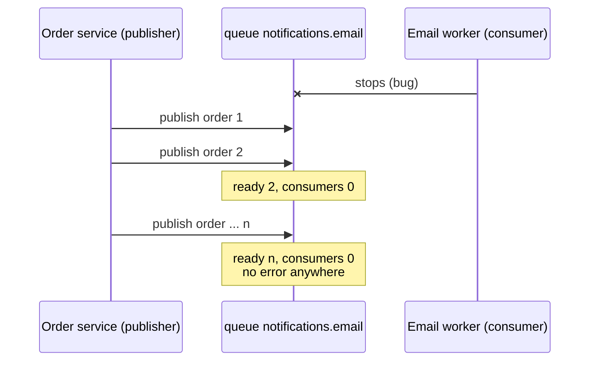

# 02 — RabbitMQ queues: the buffer between producer and consumer

**Level:** Engineer  
**Episode:** RabbitMQ queues: the buffer between producer and consumer  
**Language:** English  
**Code:** Java 21 · Maven · RabbitMQ Java client · Docker Compose  
**Requires:** [Episode 01 — Why a message broker?](../01-rabbitmq-why-a-broker/)

## YouTube

[Watch this episode](https://www.youtube.com/watch?v=z59t9pLGi4g)

This folder is the companion project for the second episode of the course. The README is the **written version of the lesson**: together with the video it should leave the concept complete. Read it to review the ideas, follow the diagrams, and then run the experiments yourself.

> **The one sentence of this episode**
>
> **A queue is a buffer: it holds messages until a consumer takes them.**

> **Learning-project disclaimer:** the "email worker" in this project sends nothing. A consumer only waits for its turn at a configurable rate and then acknowledges the message, so that you can control exactly how fast messages leave the queue. The three terminal demos in the video are **real recordings** of this project. The code is illustrative, not production-ready (see [What this project does not cover](#what-this-project-does-not-cover)).

## Learning objectives

After this episode you should be able to:

- Define a **queue**, a **ready message** and the **queue depth**.
- Read a queue's state from two numbers: how many messages are ready, and how many consumers are connected.
- Predict what the depth does when consumers stop, slow down or come back, using `arrival rate − consumption rate`.
- Explain why a queue is not a database, and say when you need a log instead.
- Say what to do (and what not to do) when a queue shows `ready 12000` and `consumers 0`.

## From the video to the code

| Video scene | Concept | Where to see it |
|---|---|---|
| Cold open | A stopped consumer is silent | [Experiment 3](#experiment-3-the-consumer-is-gone-and-nothing-errors) |
| What a queue is | Buffer with a head and a tail | [1. What a queue is](#1-what-a-queue-is) |
| Four messages, no consumer | Ready messages | [Experiment 1](#experiment-1-a-queue-holds-messages-while-nobody-consumes) |
| 100 in, 60 out | Queue depth | [Experiment 2](#experiment-2-the-depth-grows-by-arrival-minus-consumption) |
| Misconception | Not a database | [4. The misconception](#4-the-misconception-a-queue-is-a-small-database) |
| Code | Declare and publish | [`Publisher.java`](src/main/java/com/fromdevtodev/rabbitmq/queues/Publisher.java) |
| Stalled consumer | Ready up, consumers zero | [Experiment 3](#experiment-3-the-consumer-is-gone-and-nothing-errors) |

## 1. What a queue is

A **queue** is where RabbitMQ keeps messages between the producer that published them and the consumer that will handle them. Think of a conveyor belt: parcels go on at the **tail**, the oldest parcel is at the **head**, and a worker takes parcels from the head.



Three things follow from "buffer":

- The publisher does not look for a consumer and does not wait for one. Publishing works with **zero** consumers.
- Messages from one queue are delivered **first in, first out**, in general. (Ordering has caveats; they get their own episode.)
- A message that has been taken leaves the queue. The queue is not a record of what happened.

In this project the path into the queue is plumbing: messages go through the **default exchange**, which delivers a message straight to the queue whose name equals the routing key. Exchanges and bindings are the next episode.

## 2. Reading a queue: ready messages and depth

Two more terms:

- A **ready message** is a message sitting in the queue, waiting for a consumer to take it.
- The **queue depth** is how many messages the queue holds.

A message that has been handed to a consumer but not yet acknowledged is no longer *ready*, though it still counts toward the depth. Acknowledgements are episode 8; here a consumer acknowledges each message right after its turn, so the depth is almost entirely ready messages.

To read a queue you need two numbers:

| `ready` | `consumers` | What it means |
|---|---|---|
| 0 | 1 or more | Healthy and idle, or keeping up |
| rising | 1 or more | Messages arrive faster than they are handled |
| rising | 0 | Nobody is working on this queue |
| high and flat | 1 or more | A backlog that is not draining |



## 3. Depth over time: arrival minus consumption

The queue absorbs the difference between how fast work arrives and how fast it is done:

```
depth change per second = arrival rate − consumption rate
```

With 100 messages per second in and 60 out, the queue gains 40 per second: 40 × 60 = **2,400 per minute**. The queue does not slow the producer down and, by default, it does not discard messages for being behind. It just gets deeper. (Limits and expiry exist as settings, but you have to choose them; they are not part of this episode.)



The chart is the arithmetic. The video shows the **measured** version of the first 30 seconds of the same experiment, recorded from this project.

## 4. The misconception: "a queue is a small database"

The belief: messages stay in the queue and you can look them up. The reality: a queue has a head and a tail and nothing else.

| | Database table | Queue |
|---|---|---|
| Read a record in the middle | Yes (`WHERE id = ...`) | No |
| Reading removes the record | No | Yes: a consumed message leaves |
| Read the same record again later | Yes | No |

If you need to keep messages and read them again later, you need a **log**. RabbitMQ Streams and Kafka are logs; later episodes compare them with queues.

## 5. When consumers stop

A consumer stops. The producer is not told: publishing to a queue succeeds whether or not anyone consumes. The only signs are the two numbers.



What to do when you see `ready 12000, consumers 0`:

1. **Do not purge.** Those are real messages (here, orders waiting for an email). Purging deletes them.
2. **Do not add publishers.** They only make the backlog grow faster.
3. **Find out why no consumer is connected**, fix it, and let it drain.

## When a queue is the wrong tool

- You need to **query or re-read** old messages: that is a log, not a queue.
- You need to **look at a message in the middle** without consuming it.
- The caller needs the answer **right now**: a queue only moves the work somewhere else.

## Hands-on experiments

### Prerequisites

- Java 21, Maven, Docker with Compose.
- Start RabbitMQ and build the project:

```bash
docker compose up -d rabbitmq
mvn -q -DskipTests compile
```

The management UI is at <http://localhost:15672> (`guest` / `guest`). Every command below is `mvn -q exec:java -Dexec.args="..."`; the examples abbreviate it to `App ...`.

Commands:

| Command | What it does |
|---|---|
| `App publish --count N [--rate R] [--first 1]` | Puts N numbered messages at the tail; `--rate 0` (default) means as fast as possible |
| `App consume [--rate R] [--prefetch 1] [--log-every 1]` | Takes messages from the head, R per second |
| `App status [--samples 1] [--interval-ms 1000]` | Prints `ready` and `consumers`; `--samples 0` keeps going |
| `App reset` | Deletes the queue and its messages |

### Experiment 1: a queue holds messages while nobody consumes

```bash
App reset
App publish --count 4          # no consumer is connected
App status                     # ready 4 | consumers 0
App consume --rate 1           # evt_0001 ... evt_0004, in order
App status --samples 0         # in another terminal: ready counts down to 0
```

Expected: publishing succeeds with no consumer; the queue shows `ready 4`; the consumer receives `evt_0001` to `evt_0004` in publish order.

### Experiment 2: the depth grows by arrival minus consumption

```bash
App reset
App status --samples 0 --interval-ms 1000      # terminal 1
App consume --rate 60 --prefetch 20 --log-every 60   # terminal 2
App publish --count 3000 --rate 100            # terminal 3: 30 s at 100 per second
```

Expected: `ready` climbs by roughly 40 per second while the publisher runs (about 1,200 after 30 s), then drains once it stops. The exact figures depend on your machine; the shape does not. Try `--rate 40` on the consumer and the depth stays flat near zero.

### Experiment 3: the consumer is gone and nothing errors

```bash
App reset
App publish --count 12000                      # the "two hours later" backlog
App status                                     # ready 12000 | consumers 0
App publish --count 300 --rate 50 --first 12001   # the publisher still succeeds
docker compose exec rabbitmq rabbitmqctl list_queues name messages_ready consumers
App consume --rate 500 --prefetch 50 --log-every 500   # a consumer reconnects
```

Expected: no error anywhere on the publisher side; `list_queues` shows the queue with a large `messages_ready` and `consumers` 0; once the consumer connects the number goes down.

## Project structure

```text
02-rabbitmq-queues/
├── docker-compose.yml
├── pom.xml
├── recordings/               # scripts that record the video demos (maintainers)
└── src/
    ├── main/java/com/fromdevtodev/rabbitmq/queues/
    │   ├── App.java          # command line: publish, consume, status, reset
    │   ├── Publisher.java    # numbered messages at the tail, optionally at a rate
    │   ├── Consumer.java     # takes from the head at a rate, acknowledges
    │   ├── QueueStatus.java  # passive declare: ready count and consumer count
    │   ├── Topology.java     # the queue name and the connection settings
    │   ├── RatePacer.java    # steady "N per second" without drift (no RabbitMQ)
    │   ├── OrderCreated.java # the message
    │   └── ...               # Args, EventJson, Log, StatusLine
    └── test/java/...         # tests for the parts that need no broker
```

### Tests

```bash
mvn test
```

The tests cover the parts that need no running broker: the rate pacing (with a fake clock, so they take no real time), message numbering, the status line and argument parsing.

## What this project does not cover

- **Exchanges, bindings and routing:** episode 3. Here the default exchange is plumbing.
- **Acknowledgements and what happens when a consumer dies mid-message:** episode 8.
- **Publisher confirms, durability, retries and dead-lettering:** later episodes. The publisher here does not confirm that the broker accepted a message.
- **Queue limits, expiry and queue types** (classic, quorum): later episodes.
- **Message ordering with several consumers:** the ordering episode.

## Recap

- **A queue is a buffer: it holds messages until a consumer takes them.**
- Ready messages wait in the queue; the depth is how many it holds.
- The depth changes by `arrival rate − consumption rate` every second.
- `ready` rising with `consumers 0` means nobody is working: find out why, do not purge.
- A queue is not a database: you cannot query or re-read it. For that, you need a log.

## Sources

The claim-by-claim verification notes live in the video repository (`docs/sources/rabbitmq-queues-sources.md`). Official references:

- [RabbitMQ: Queues](https://www.rabbitmq.com/docs/queues)
- [RabbitMQ: AMQP 0-9-1 concepts](https://www.rabbitmq.com/tutorials/amqp-concepts)
- [rabbitmqctl reference](https://www.rabbitmq.com/docs/man/rabbitmqctl.8)
