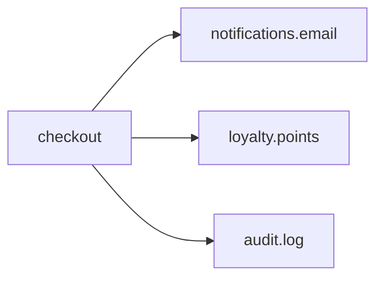

# 03 — Exchanges and bindings: how a message finds its queue

**Level:** Engineer  
**Episode:** Exchanges and bindings: how a message finds its queue  
**Language:** English  
**Code:** Java 21 · Maven · RabbitMQ Java client · Docker Compose  
**Requires:** [02 — RabbitMQ queues](../02-rabbitmq-queues/README.md)  
**Reading time:** about 12 minutes, plus the experiment

## YouTube

https://www.youtube.com/watch?v=gieDU4dUXLA

This README is the **written version of the lesson**. It tells the same story as the video, with more room for the reasoning and for the code. You can read it before the video, after it, or instead of it. Everything it describes can be run on your machine with `./run.sh`.

> **The one sentence of this episode**
>
> **A producer publishes to an exchange, and bindings decide which queues receive a copy.**

> **Learning-project disclaimer:** no email is sent, no points are counted and nothing is audited. The messages only wait in the queues, so that you can count them. The terminal demo in the video runs this project against a real RabbitMQ. The code is illustrative, not production-ready (see [What this project does not cover](#what-this-project-does-not-cover)).

## Learning objectives

After this episode you should be able to:

- Define **exchange**, **routing key** and **binding**.
- Trace the path of a message to every queue that receives a copy, given a table of bindings.
- Add a consumer to a running system without changing the producer.
- Explain why a queue bound later does not receive the messages published before the binding.
- Read the code of the demo and say which line names an exchange, which line sets a routing key and which line creates a binding.

## Contents

1. [The problem: one more consumer, one more deploy](#the-problem-one-more-consumer-one-more-deploy)
2. [The vocabulary](#the-vocabulary)
3. [A producer does not send to a queue](#a-producer-does-not-send-to-a-queue)
4. [The experiment](#the-experiment)
5. [The rule](#the-rule)
6. [Read the code](#read-the-code)
7. [Try it yourself](#try-it-yourself), [where it fits](#where-it-fits), [things that surprise people](#things-that-surprise-people), [summary](#summary) and [what this project does not cover](#what-this-project-does-not-cover)

| Video scene | Where it is in this README |
|---|---|
| Cold open, "Checkout, one request at a time" | [The problem](#the-problem-one-more-consumer-one-more-deploy) |
| "Publish to an exchange", "A sorting office, not a letterbox" | [The vocabulary](#the-vocabulary) |
| "A producer does not send to a queue" | [A producer does not send to a queue](#a-producer-does-not-send-to-a-queue) |
| "From one publish to the queues", challenge: which queues get a copy | [The experiment](#the-experiment) |
| Board and live demo | [The experiment](#the-experiment) |
| "What the points service adds" | [Read the code](#read-the-code) |
| Challenge: marketing wants every new order, "A queue gets nothing: check this" | [Try it yourself](#try-it-yourself), [Things that surprise people](#things-that-surprise-people) |
| "Exchanges and bindings: when they fit" | [Where it fits](#where-it-fits) |
| Recap | [Summary](#summary) |

## The problem: one more consumer, one more deploy

Checkout publishes an order to a queue, `notifications.email`, and that works. Then the loyalty team wants points for every order: a second publish call. Then compliance wants an audit log: a third. Each call lives in checkout, a service that has nothing to do with points or audits, and each one means deploying checkout again.



The producer knows every consumer. That is the coupling the broker was supposed to remove. The way out is to change **where the producer publishes**.

## The vocabulary

Three terms, each tied to a line of the project.

- **Exchange.** The place where producers publish messages. It holds nothing: it only routes each message to queues. In this project it is `orders`, declared in `Topology.declareExchange`.
- **Routing key.** A short text the producer sets on each message it publishes, such as `order.created`. It is the argument of `basicPublish` in `Publisher`.
- **Binding.** A rule that links an exchange to a queue, with a key that decides which messages the queue takes. It is created by `queueBind` in `Topology.declareAndBind`.

A sorting office is a good picture. You hand the parcel to the sorting office (the exchange). The parcel has a postcode on its label (the routing key). Each shelf has a rule: "parcels with this postcode go here" (the binding). The shelf is the queue of episode 2. **Every shelf whose rule matches gets its own copy.**

## A producer does not send to a queue

The first publish call most people write looks like this:

```java
channel.basicPublish("", "notifications.email", props, body);
```

It looks like "send this to the queue `notifications.email`". It is not. The first argument is an **exchange**, and the empty name is a built-in exchange that passes the message to the queue with the name you gave as the key. Episode 4 explains it. The point for now: a producer always publishes to an exchange, with a routing key, and **bindings** decide which queues get a copy.

In this project the producer says what it really does:

```java
channel.basicPublish("orders", "order.created", props, body);
```

It names the exchange `orders` and the routing key `order.created`. It does not name any queue, and it does not know how many queues exist.

## The experiment

The starting point is an exchange `orders` with two queues bound to it:

| Queue | Bound to `orders` with the key |
|---|---|
| `notifications.email` | `order.created` |
| `audit.log` | `order.cancelled` |

**Predict first.** `loyalty.points` does not exist yet. Three events will be published: `evt_0001` and `evt_0002` with `order.created`, `evt_0003` with `order.cancelled`. The points team will bind `loyalty.points` with `order.created` **after** `evt_0001` and before `evt_0002`. How many messages will each queue hold at the end?

```bash
./run.sh up          # RabbitMQ in Docker, plus the exchange and the first two queues
./run.sh experiment  # the whole experiment, step by step
```

<details>
<summary>The raw commands behind <code>./run.sh experiment</code></summary>

```bash
./run.sh app publish --key order.created --first 1     # evt_0001
./run.sh app bind-points                                # the points service adds loyalty.points
./run.sh app publish --key order.created --first 2     # evt_0002
./run.sh app publish --key order.cancelled --first 3   # evt_0003
./run.sh counters
./run.sh bindings
```

</details>

What the experiment checks, step by step (these are the numbers the experiment is built around: ready messages in `notifications.email`, `loyalty.points`, `audit.log`; a dash means the queue does not exist yet):

| After | email | points | audit |
|---|---|---|---|
| start | 0 | – | 0 |
| `evt_0001` (`order.created`) | 1 | – | 0 |
| the points queue is bound | 1 | 0 | 0 |
| `evt_0002` (`order.created`) | 2 | 1 | 0 |
| `evt_0003` (`order.cancelled`) | 2 | 1 | 1 |

**Why.**

- `evt_0001` matches only the email binding. Audit is bound with `order.cancelled`, so the keys differ and it gets no copy.
- Binding `loyalty.points` creates an **empty** queue. `evt_0001` was published before the binding existed, and **a binding only affects messages published after it exists**. The exchange holds nothing, so there is nothing to copy from.
- `evt_0002` matches two bindings, and the exchange makes **one copy per match**: one publish, two copies.
- `evt_0003` matches only the audit binding.

The producer was the same code in every step. A new consumer cost one new queue and one new binding.

## The rule

> **A producer publishes to an exchange, and bindings decide which queues receive a copy.**

What the rule does **not** promise: that a message reaches any queue at all (if no binding matches, it is dropped or returned to the publisher, depending on the publisher's settings: a later episode covers that), that a queue bound later sees old messages (it does not), or how the keys are compared in every kind of exchange (the next episodes).

## Read the code

| File | Role |
|---|---|
| `App.java` | Entry point: one command per step of the experiment |
| `Topology.java` | The exchange, the three queue names and the two calls that declare and bind |
| `Publisher.java` | The producer: publishes to the exchange with a routing key |
| `PointsWorker.java` | The points service adding its own queue and binding |
| `Setup.java` | Declares the starting point (exchange, email and audit queues) |
| `OrderEvent.java`, `EventJson.java`, `Args.java`, `Log.java` | Small supporting pieces; you can skip them |

Follow the execution:

**1. The entry point** maps each command of the experiment to one class.

<!-- snippet: src/main/java/com/fromdevtodev/rabbitmq/exchanges/App.java#commands -->
```java
switch (args[0]) {
    case "setup" -> Setup.run();
    case "publish" -> Publisher.publish(
            options.text("key", OrderEvent.CREATED),
            options.number("count", 1),
            options.number("first", 1));
    case "bind-points" -> PointsWorker.bind();
    case "reset" -> Topology.reset();
```
<!-- /snippet -->

**2. The exchange.** Everyone who touches `orders` declares it first, so whoever starts first creates it.

<!-- snippet: src/main/java/com/fromdevtodev/rabbitmq/exchanges/Topology.java#exchange -->
```java
static void declareExchange(Channel channel) throws IOException {
    channel.exchangeDeclare(EXCHANGE, BuiltinExchangeType.DIRECT, true);
}
```
<!-- /snippet -->

`DIRECT` is the exchange type: a binding matches when its key equals the routing key. How each type matches is the subject of the next episodes; here only the idea of a binding matters. The `true` makes the exchange durable, which belongs to a later episode.

**3. The publisher.** The line that matters is `basicPublish`: an exchange and a routing key, no queue.

<!-- snippet: src/main/java/com/fromdevtodev/rabbitmq/exchanges/Publisher.java#publish -->
```java
/** Publishes messages {@code first .. first + count - 1} to the exchange, all with the given routing key. */
static void publish(String routingKey, long count, long first) throws IOException, TimeoutException {
    try (Connection connection = Topology.connect("order-service");
         Channel channel = connection.createChannel()) {
        Topology.declareExchange(channel);
        for (long seq = first; seq < first + count; seq++) {
            OrderEvent event = OrderEvent.of(seq, routingKey);
            AMQP.BasicProperties properties = new AMQP.BasicProperties.Builder()
                    .contentType("application/json")
                    .messageId(event.eventId())
                    .deliveryMode(2)
                    .build();
            channel.basicPublish(Topology.EXCHANGE, routingKey, properties, EventJson.toBytes(event));
            Log.info("order-service", "published " + event.eventId() + " (" + event.orderId() + ") to '"
                    + Topology.EXCHANGE + "' with routing key " + routingKey);
        }
    }
}
```
<!-- /snippet -->

> **Ignore these for now.** `deliveryMode(2)` and `messageId` are not needed to understand routing: persistence belongs to the durability episode. There is no publisher confirm here either: that is a different mechanism, with its own episode.

**4. The binding.** This is what the points service adds, and the only thing it adds.

<!-- snippet: src/main/java/com/fromdevtodev/rabbitmq/exchanges/Topology.java#bind -->
```java
static void declareAndBind(Channel channel, String queue, String bindingKey) throws IOException {
    channel.queueDeclare(queue, true, false, false, null);
    channel.queueBind(queue, EXCHANGE, bindingKey);
}
```
<!-- /snippet -->

`queueDeclare` creates the queue (declaring one that already exists with the same settings does nothing), and `queueBind` creates the binding: this queue, this exchange, this key. `PointsWorker.bind()` calls it with `loyalty.points` and `order.created`. The publisher is not touched and not restarted.

**5. The test.** It needs no broker.

<!-- snippet: src/test/java/com/fromdevtodev/rabbitmq/exchanges/ExchangesTest.java#test -->
```java
@Test
void theEventTypeIsTheRoutingKeyItIsPublishedWith() {
    assertEquals("evt_0001", OrderEvent.of(1, OrderEvent.CREATED).eventId());
    assertEquals("ord_1001", OrderEvent.of(1, OrderEvent.CREATED).orderId());
    assertEquals(OrderEvent.CANCELLED, OrderEvent.of(3, OrderEvent.CANCELLED).type());
    assertEquals("evt_0003", OrderEvent.of(3, OrderEvent.CANCELLED).eventId());
}
```
<!-- /snippet -->

The event's `type` is only a label in the body. The broker never reads it: routing uses the key given to `basicPublish`.

## Try it yourself

1. **A fourth queue.** Marketing wants every new order in `marketing.orders`. Which two calls do you make, and does the publisher change? *Answer:* declare the queue and bind it with `order.created` (`Topology.declareAndBind`); the publisher does not change. Add the call to `PointsWorker` (or a copy of it), run it, publish and look at `./run.sh counters`.
2. **A typo in the key.** Publish with `--key order.create` (no `d`). Predict the counters, then check. *Answer:* no binding matches, so no queue gets a copy. The publish call does not fail: nobody tells the producer. A later episode covers what the broker can do about it.
3. **Two bindings, one queue.** What would happen if `audit.log` were bound with both `order.created` and `order.cancelled`? *Answer (arithmetic, not a measurement):* each of the three events matches one of its two bindings, so it would receive all of them.
4. **Old messages.** Publish `evt_0004` and `evt_0005`, then bind a new queue. Does the new queue see them? *Answer:* no. A binding only affects messages published after it exists. A consumer that must read history needs a log, not a queue.

## Where it fits

Use an exchange when several consumers need the same event, when a new consumer must not change the producer, and when who gets a message depends on its routing key. You do not need the idea when one producer feeds one queue for one job: the built-in exchange already does that (episode 4). It does not help when a new consumer must see old messages, and a queue is the wrong tool when the caller needs the result right now.

## Things that surprise people

- **The publish call succeeds even if no queue receives the message.** A routing key that matches nothing is not an error for the producer. Check the bindings first (`./run.sh bindings`).
- **The exchange is not a place where messages wait.** Queues are. After the experiment, the three queues hold messages; the exchange holds none.
- **A key must match exactly.** `order.created` and `order.create` are different keys.
- **Port conflicts.** Another episode's RabbitMQ uses the same ports. Run `./run.sh down` in that episode's folder first.

## Summary

- A producer publishes to an **exchange**, with a **routing key**; it does not name a queue.
- **Bindings** link the exchange to queues, and every matching binding gets its own copy.
- A new consumer is a new queue and a new binding, and a binding only affects messages published after it.

**Next episode:** *Direct exchange*, how an exchange compares keys, and what the built-in exchange with the empty name really is.

## What this project does not cover

- How topic patterns, fanout or headers exchanges match (later episodes), and the built-in default exchange beyond the one fact above.
- What happens to a message that matches no binding (episode 7).
- Consuming: taking messages from these queues works as in episode 2, and acknowledgements come later.
- Durability, publisher confirms, queue types and any RabbitMQ version-specific behaviour.
- Production concerns: security, configuration and error handling are minimal on purpose.
