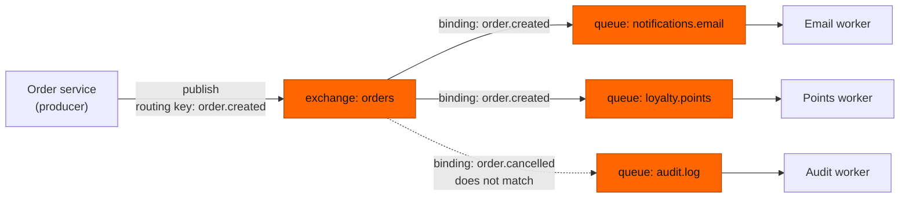
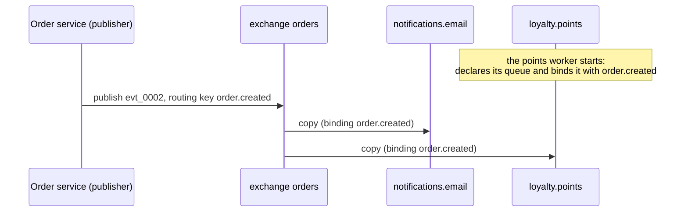

# 03 — Exchanges and bindings: how a message finds its queue

**Level:** Engineer  
**Episode:** Exchanges and bindings: how a message finds its queue  
**Language:** English  
**Code:** Java 21 · Maven · RabbitMQ Java client · Docker Compose  
**Requires:** [Episode 02 — RabbitMQ queues](../02-rabbitmq-queues/)

## YouTube

[Watch this episode](https://www.youtube.com/watch?v=YVXHjeFPqUM)

This folder is the companion project for the third episode of the course. The README is the **written version of the lesson**: together with the video it should leave the concept complete. Read it to review the ideas, follow the diagrams, and then run the experiments yourself.

> **The one sentence of this episode**
>
> **A producer publishes to an exchange, and bindings decide which queues receive a copy.**

> **Learning-project disclaimer:** the "workers" in this project send no emails and award no points. A consumer prints each message it receives and acknowledges it, so that you can see which queue received which copy. The terminal demo in the video is a **real recording** of this project. The code is illustrative, not production-ready (see [What this project does not cover](#what-this-project-does-not-cover)).

## Learning objectives

After this episode you should be able to:

- Define an **exchange**, a **routing key** and a **binding**.
- Follow one published message to **every queue it reaches**, using a table of bindings.
- Add a consumer **without touching the producer**: declare its queue and bind it.
- Explain why a producer never publishes to a queue, and what the empty-named default exchange of the last episode was really doing.
- Say what a new binding does **not** do: copy messages published before it existed.

## From the video to the code

| Video scene | Concept | Where to see it |
|---|---|---|
| Cold open | Every new consumer touches checkout | [1. The problem](#1-the-problem-every-new-consumer-touches-checkout) |
| A sorting office | Exchange, routing key, binding | [2. Three terms](#2-three-terms) |
| One exchange, one queue | The first binding | [`Publisher.java`](src/main/java/com/fromdevtodev/rabbitmq/exchanges/Publisher.java) |
| A second consumer | A new binding, an unchanged producer | [`Topology.bind`](src/main/java/com/fromdevtodev/rabbitmq/exchanges/Topology.java) · [Experiment 1](#experiment-1-add-a-consumer-without-touching-the-producer) |
| Which queues get a copy | The routing key as a filter | [Experiment 2](#experiment-2-the-routing-key-decides) |
| Misconception | A producer sends to a queue | [4. The misconception](#4-the-misconception-a-producer-sends-a-message-to-a-queue) |
| Live demo | Binding added while publishing | [`recordings/bind-a-new-queue.sh`](recordings/bind-a-new-queue.sh) |
| Apply it | A new queue for coupons | [Experiment 4](#experiment-4-your-turn-a-coupons-queue) |

## 1. The problem: every new consumer touches checkout

In the first episodes the order service published straight to `notifications.email`. That works until a second consumer appears:

- Loyalty points need a new worker and a new queue, **and one more publish call** in the order service.
- An audit log needs a third publish call.
- The order service now knows the name of every queue behind it, and every new consumer is a change and a deploy of checkout.

The producer should not have to know who is listening. Something has to sit in the middle and decide where each message goes.

## 2. Three terms

| Term | Meaning |
|---|---|
| **Exchange** | The place a producer publishes to. It does not hold messages; it routes each one to zero or more queues. |
| **Routing key** | A short label the producer puts on each message, such as `order.created`. |
| **Binding** | A rule that links an exchange to a queue: messages with this routing key go to that queue. |

Think of a sorting office: you drop the letter at the office, the address on the envelope is the routing key, and each delivery rule is a binding. If two rules match, the office makes two copies, one for each mailbox.



In this project the exchange `orders` is a **direct** exchange: a binding matches when its routing key is *equal* to the message's routing key. Other exchange types match differently, and the next episodes cover them. The idea of this episode holds for all of them.

## 3. One message, one copy per matching binding

The bindings used throughout the project:

| Queue | Bound to `orders` with routing key | When it is added |
|---|---|---|
| `notifications.email` | `order.created` | `App setup` |
| `audit.log` | `order.cancelled` | `App setup` |
| `loyalty.points` | `order.created` | `App bind`, **while the publisher keeps running** |

What happens to each message:

| Published with routing key | Matching bindings | Queues that receive a copy |
|---|---|---|
| `order.created` (before the points binding) | email | `notifications.email` |
| `order.created` (after the points binding) | email, points | `notifications.email`, `loyalty.points` |
| `order.cancelled` | audit | `audit.log` |



The publisher's code is the same before and after. The publisher does not know that a second queue exists:

```java
channel.basicPublish(
    "orders",          // the exchange
    "order.created",   // the routing key
    properties,
    body);
```

And the points worker owns its own binding:

```java
channel.queueDeclare("loyalty.points", true, false, false, null);
channel.queueBind("loyalty.points", "orders", "order.created");
```

A binding is a rule about the **future**: it affects messages published after it exists. Messages published before the binding are not copied into the new queue.

## 4. The misconception: "a producer sends a message to a queue"

The last episode published with the name of the queue, so it looked like we were addressing the queue. We were not: that call went to the **default exchange**, the exchange with the empty name. RabbitMQ binds every queue to it using the queue's own name as the routing key, which makes it *seem* possible to deliver messages straight to a queue, even though that is not what happens (see the [AMQP 0-9-1 model guide](https://www.rabbitmq.com/tutorials/amqp-concepts)).

| | Belief | Reality |
|---|---|---|
| The producer names | a queue | an exchange and a routing key |
| Adding a consumer | one more publish call per queue | one more binding |
| Who decides the destination | the producer | the bindings |

The default exchange has its own episode (episode 4).

## 5. When an exchange is more than you need

Use exchanges and bindings when:

- Several consumers need the same event.
- New consumers will keep appearing.
- The producer should not know who is listening.

Skip the extra machinery when:

- There is one producer, one queue and one job: the default exchange already does that.
- A new consumer must see **old** messages: a binding only affects what is published after it. Replaying history needs a log, not a queue.
- The caller needs the result right now: routing to more queues does not help.

## Hands-on experiments

### Prerequisites

- Java 21, Maven, Docker with Compose.
- Start RabbitMQ and build the project:

```bash
docker compose up -d rabbitmq
mvn -q -DskipTests compile
```

The management UI is at <http://localhost:15672> (`guest` / `guest`). Every command below is `mvn -q exec:java -Dexec.args="..."`; the examples abbreviate it to `App ...`.

> Every episode project uses the same ports. If another episode's RabbitMQ is running, stop it first (`docker compose down` in its folder).

Commands:

| Command | What it does |
|---|---|
| `App setup` | Declares the exchange `orders`, the queues `notifications.email` and `audit.log`, and their two bindings |
| `App publish [--key order.created] [--count 1] [--first 1]` | Publishes numbered messages to the **exchange**, with a routing key |
| `App bind --queue Q --key K` | Declares the queue (if needed) and binds it to `orders` with routing key `K` |
| `App unbind --queue Q --key K` | Removes one binding; the queue and its messages stay |
| `App consume --queue Q [--limit 0]` | Takes messages from one queue and prints them |
| `App status [--samples 1] [--interval-ms 1000]` | Prints the ready messages of the three queues |
| `App reset` | Deletes the exchange and the three queues |

To list the bindings of the exchange straight from the broker (rows with an empty source name belong to the default exchange and are filtered out):

```bash
docker compose exec rabbitmq rabbitmqctl list_bindings source_name routing_key destination_name | grep '^orders'
```

### Experiment 1: add a consumer without touching the producer

```bash
App reset
App setup                                  # exchange orders, email <- order.created, audit <- order.cancelled
App publish --key order.created --first 1  # evt_0001
App status                                 # email 1, loyalty.points does not exist yet, audit 0
App bind --queue loyalty.points --key order.created   # the points worker starts
App status                                 # loyalty.points exists and is empty
App publish --key order.created --first 2  # evt_0002: the publisher is the same program
App status                                 # email 2, loyalty.points 1
App consume --queue loyalty.points --limit 1          # receives evt_0002, not evt_0001
```

Expected: the new queue starts **empty**, because `evt_0001` was published before its binding existed. `evt_0002` reaches both `notifications.email` and `loyalty.points`.

### Experiment 2: the routing key decides

```bash
App publish --key order.cancelled --first 3
App status
```

Expected: only `audit.log` receives a copy; the counts of the other two queues do not move.

### Experiment 3: a queue that nobody bound receives nothing

```bash
App unbind --queue loyalty.points --key order.created
App publish --key order.created --first 4
App status
```

Expected: `notifications.email` grows, `loyalty.points` does not, even though the queue still exists. Bind it again and publish once more to see it receive messages again.

### Experiment 4: your turn, a coupons queue

Marketing wants every new order in a queue called `coupons.issue`. Without changing any publisher code:

```bash
App bind --queue coupons.issue --key order.created
App publish --key order.created --first 5
App consume --queue coupons.issue --limit 1
```

Expected: `coupons.issue` receives `evt_0005`. `App reset` does not delete this queue (it only knows the three queues of the episode); remove it in the management UI or with `docker compose down -v`.

> What if the routing key matches **no** binding? Try `App publish --key order.shipped` and look at `App status`: nothing changes, and the publisher reports no error. Why that happens is episode 7.

## Project structure

```text
03-rabbitmq-exchanges-and-bindings/
├── docker-compose.yml
├── pom.xml
├── examples/                 # sample message bodies
├── recordings/               # script that records the video demo (maintainers)
└── src/
    ├── main/java/com/fromdevtodev/rabbitmq/exchanges/
    │   ├── App.java          # command line: setup, publish, bind, unbind, consume, status, reset
    │   ├── Publisher.java    # publishes to the exchange with a routing key; never names a queue
    │   ├── Bindings.java     # setup, bind, unbind, reset
    │   ├── Consumer.java     # takes messages from one named queue
    │   ├── QueueStatus.java  # passive declare: ready messages of each queue
    │   ├── Topology.java     # exchange, queue names, starting bindings, connection settings
    │   ├── OrderEvent.java   # the message
    │   └── ...               # Args, EventJson, Log, StatusLine
    └── test/java/...         # tests for the parts that need no broker
```

### Tests

```bash
mvn test
```

The tests cover the parts that need no running broker: message numbering and JSON, the status line, the starting bindings of the story and argument parsing. Routing itself is the broker's job, so it is demonstrated by the experiments, not by unit tests.

## What this project does not cover

- **How each exchange type matches** (direct in depth, topic patterns, fanout, headers) and the default exchange: episodes 4 to 6.
- **Messages that match no binding** (unroutable messages): episode 7. The publisher here does not detect them.
- **Acknowledgements:** episode 8. Consumers acknowledge each message right after printing it.
- **Durability, publisher confirms, retries and dead-lettering:** later episodes.

## Recap

- **A producer publishes to an exchange, and bindings decide which queues receive a copy.**
- The producer knows an exchange and a routing key, never a queue.
- Each matching binding gets its own copy of the message.
- To add a consumer, declare its queue and bind it: the producer does not change.
- A new binding only sees messages published after it.

## Sources

The claim-by-claim verification notes live in the video repository (`docs/sources/rabbitmq-exchanges-and-bindings-sources.md`). Official references:

- [AMQP 0-9-1 Model Explained](https://www.rabbitmq.com/tutorials/amqp-concepts)
- [rabbitmqctl reference](https://www.rabbitmq.com/docs/man/rabbitmqctl.8)
