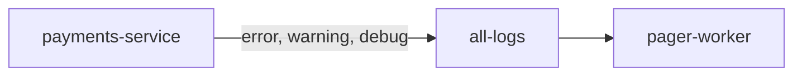

# 04 — Direct exchange: exact-match routing, and the default exchange

**Level:** Engineer  
**Episode:** Direct exchange: exact-match routing, and the default exchange  
**Language:** English  
**Code:** Java 21 · Maven · RabbitMQ Java client · Docker Compose  
**Requires:** [03 — Exchanges and bindings](../03-rabbitmq-exchanges-and-bindings/README.md)  
**Reading time:** about 14 minutes, plus the experiments

## YouTube

https://www.youtube.com/watch?v=lRUOyxVdgxI

This README is the **written version of the lesson**. It tells the same story as the video, with more room for the reasoning and for the code. You can read it before the video, after it, or instead of it. Everything it describes can be run on your machine with `./run.sh`.

> **The one sentence of this episode**
>
> **A direct exchange copies a message to every queue whose binding key exactly equals the routing key.**

> **Learning-project disclaimer:** nothing here pages anyone, writes a real log or stores a metric. The messages only wait in the queues, so that you can count them. The terminal demos in the video run this project against a real RabbitMQ. The code is illustrative, not production-ready (see [What this project does not cover](#what-this-project-does-not-cover)).

## Learning objectives

After this episode you should be able to:

- Define **direct exchange**, **binding key** and **default exchange**.
- Given a table of bindings and a routing key, say which queues receive a copy, and which receive nothing.
- Explain why a queue bound with three keys still gets only one copy of each message.
- Explain what the empty exchange name in `basicPublish("", queueName, ...)` really is, and why you cannot bind to it.
- Read the code of the demos and say which line is the exact comparison, which line creates a binding and which line publishes to the default exchange.

## Contents

1. [The problem: a pager that rings for everything](#the-problem-a-pager-that-rings-for-everything)
2. [The vocabulary](#the-vocabulary)
3. [A direct exchange does not pick one queue](#a-direct-exchange-does-not-pick-one-queue)
4. [Experiment 1: the routing key decides](#experiment-1-the-routing-key-decides)
5. [The default exchange, and experiment 2](#the-default-exchange-and-experiment-2)
6. [The rule](#the-rule)
7. [Read the code](#read-the-code)
8. [Try it yourself](#try-it-yourself), [where it fits](#where-it-fits), [things that surprise people](#things-that-surprise-people), [summary](#summary) and [what this project does not cover](#what-this-project-does-not-cover)

| Video scene | Where it is in this README |
|---|---|
| Cold open, "Everything lands in one queue" | [The problem](#the-problem-a-pager-that-rings-for-everything) |
| "Match the key exactly", "From a routing key to the queues" | [The vocabulary](#the-vocabulary) |
| "Does it pick one queue?" | [A direct exchange does not pick one queue](#a-direct-exchange-does-not-pick-one-queue) |
| Challenge: which queues get a copy, board and demo "The routing key decides" | [Experiment 1](#experiment-1-the-routing-key-decides) |
| "The same call, two exchanges", board and demo "The default exchange" | [The default exchange, and experiment 2](#the-default-exchange-and-experiment-2) |
| Challenge: the capacity team wants every warning, "Named exchange, default exchange" | [Read the code](#read-the-code), [Try it yourself](#try-it-yourself) |
| "Direct exchange: when it fits" | [Where it fits](#where-it-fits) |
| Recap | [Summary](#summary) |

## The problem: a pager that rings for everything

A service writes every log line to **one** queue, and a worker reads that queue and pages the person on call. Then the pager rings three times in two minutes: an info line, a debug line and, at last, one real error. Two of the three pages were noise.



The worker has to read every line and decide for itself which ones matter. What we want is for the **errors** to reach the pager and the rest to go elsewhere, without teaching the service who reads what. That is the job of an exchange, and the simplest kind is the direct exchange.

## The vocabulary

Three terms, each tied to a place in the project. (Exchange, routing key and binding come from episode 3.)

- **Direct exchange.** An exchange that compares the routing key of a message with the key of each binding, and delivers a copy to every queue where the two are **equal**. In this project it is `logs`, declared in `Topology.declareExchange` with `BuiltinExchangeType.DIRECT`.
- **Binding key.** The key a queue is bound with. The producer sets a *routing key* on the message; each binding carries a *binding key*; a direct exchange compares one with the other. `queueBind(queue, exchange, bindingKey)` in `Topology.declareAndBind` creates a binding.
- **Default exchange.** A direct exchange with **no name** (the empty string), declared by the broker itself. Every queue is bound to it automatically, with the name of the queue as the binding key.

The bindings used in the first experiment:

| Queue | Bound to `logs` with the binding keys |
|---|---|
| `errors-pager` | `error` |
| `audit` | `info`, `warning`, `error` |
| `metrics` | `warning` |

## A direct exchange does not pick one queue

A common belief is that a direct exchange chooses **one** queue: the one that matches best. It does not.

- There is **no best match** and **no partial match**. `error` does not match `errors`, `Error` or `err`.
- The exchange compares each binding key with the routing key, and **every** queue with an equal binding key gets its own copy.
- A message whose key matches **no** binding goes nowhere.

With the table above, a message with routing key `error` is copied to `errors-pager` **and** `audit`: two queues, not one.

## Experiment 1: the routing key decides

**Predict first.** Three messages will be published: `log_0001` with the routing key `error`, `log_0002` with `warning` and `log_0003` with `debug`. How many messages will `errors-pager`, `audit` and `metrics` hold at the end? Write it down before you run anything. (If you want to check your reasoning without a broker, `./run.sh app explain --key warning` prints what the rule predicts. It is the rule written as code, not a measurement.)

```bash
./run.sh up           # RabbitMQ in Docker
./run.sh experiment1  # the whole experiment, step by step
```

<details>
<summary>The raw commands behind <code>./run.sh experiment1</code></summary>

```bash
./run.sh app setup                          # the exchange logs, three queues, five bindings
./run.sh bindings                           # the bindings of logs
./run.sh app publish --key error --first 1      # log_0001
./run.sh app publish --key warning --first 2    # log_0002
./run.sh app publish --key debug --first 3      # log_0003
./run.sh counters
```

</details>

What the experiment checks, step by step (ready messages in `errors-pager`, `audit` and `metrics`):

| After | pager | audit | metrics |
|---|---|---|---|
| start | 0 | 0 | 0 |
| `log_0001` (`error`) | 1 | 1 | 0 |
| `log_0002` (`warning`) | 1 | 2 | 1 |
| `log_0003` (`debug`) | 1 | 2 | 1 |

**Why.**

- `error` matches the binding keys of `errors-pager` and `audit`. Metrics is bound with `warning`, which is a different key.
- `warning` matches `audit` and `metrics`. Errors pager stays at one: it is bound only with `error`.
- **Audit is bound three times** and received **one** copy per message: a message carries one key, so it equals at most one of audit's three binding keys.
- `debug` matches no binding. Nothing changes, the publish does not fail, and the broker discards the message by default. The producer is not told.

The producer was the same code in every step. The pager now holds only errors.

## The default exchange, and experiment 2

You have already used a direct exchange without knowing it. The first publish call most people write looks like this:

```java
channel.basicPublish("", "notifications.email", props, body);
```

The first argument is an **exchange**, and the empty string is the **default exchange**. The broker declares it and binds **every** queue to it, with the name of the queue as the binding key. So publishing to the empty name with the routing key `notifications.email` reaches the queue called `notifications.email`, and no other one. It *looks* like sending a message straight to a queue, but it is the same exact match.

A named exchange such as `logs` is the same mechanism, with bindings that **you** design. The default exchange has bindings that were made **for** you, and you cannot change them: a binding to the default exchange is refused by the broker. If you want routing of your own, declare your own direct exchange.

**Predict first.** One queue, `notifications.email`, is declared with no binding call of ours. Will the broker list a binding for it? Then two publishes go to the empty name: one with the routing key `notifications.email` and one with `notifications.mail` (a typo). What does the queue hold at the end? And what happens when we try to bind it to the default exchange?

```bash
./run.sh experiment2  # the default exchange, step by step
```

<details>
<summary>The raw commands behind <code>./run.sh experiment2</code></summary>

```bash
./run.sh app declare --queue notifications.email              # a queue, and no binding of ours
docker compose exec -T rabbitmq rabbitmqctl -q list_bindings source_name destination_name routing_key
./run.sh app publish-default --queue notifications.email --first 1   # log_0001, routing key notifications.email
./run.sh app publish-default --queue notifications.mail --first 2    # log_0002, a typo
./run.sh app bind-default --queue notifications.email --key audit    # refused
./run.sh counters
```

</details>

| After | `notifications.email` |
|---|---|
| the queue is declared | 0 (and one binding is listed, with an empty exchange name) |
| `log_0001` to `""` with the key `notifications.email` | 1 |
| `log_0002` to `""` with the key `notifications.mail` | 1 |
| `bind-default` | 1 (the broker refuses the binding) |

**Why.**

- The binding that the broker lists was made by the broker: its exchange name is empty, its destination is the queue and its key is the **name of the queue**.
- `notifications.email` equals the binding key, so the message arrives. `notifications.mail` equals no binding key (no queue has that name), so it is discarded without an error.
- The refusal is the broker's answer to a binding on the default exchange. The exact text of the error comes from the broker; run the experiment to see it.

## The rule

> **A direct exchange copies a message to every queue whose binding key exactly equals the routing key.**

What the rule does **not** promise: that a message reaches any queue at all (a key that matches nothing is discarded by default, and a later episode covers what you can do about it), that a message is routed by a *part* of its key (that needs a topic exchange, episode 5), or that every consumer gets every message regardless of the key (a fanout exchange does that, episode 6).

## Read the code

| File | Role |
|---|---|
| `App.java` | Entry point: one command per step of the experiments |
| `Topology.java` | The exchange, the queue names, the table of five bindings and the two calls that declare and bind |
| `DirectRule.java` | The rule of the exchange written as code, so that you can read and test it (RabbitMQ does the real routing) |
| `Publisher.java` | The producer: publishes to `logs` with a routing key, or to the default exchange with a queue name |
| `DefaultExchange.java` | The attempt to bind to the default exchange |
| `Setup.java` | Declares the starting point of each experiment |
| `Binding.java`, `LogEvent.java`, `EventJson.java`, `Args.java`, `Log.java` | Small supporting pieces; you can skip them |

Follow the execution:

**1. The entry point** maps each command of the experiments to one class.

<!-- snippet: src/main/java/com/fromdevtodev/rabbitmq/direct/App.java#commands -->
```java
switch (args[0]) {
    case "setup" -> Setup.routing();
    case "declare" -> Setup.queueOnly(options.text("queue", Topology.EMAIL));
    case "publish" -> Publisher.publish(
            options.text("key", LogEvent.ERROR),
            options.number("count", 1),
            options.number("first", 1));
    case "publish-default" -> Publisher.publishToDefault(
            options.text("queue", Topology.EMAIL),
            options.number("first", 1));
    case "bind-default" -> DefaultExchange.tryToBind(options.text("queue", Topology.EMAIL), options.text("key", "audit"));
    case "explain" -> explain(options.text("key", LogEvent.WARNING));
    case "reset" -> Topology.reset();
```
<!-- /snippet -->

**2. The exchange.** Everyone who touches `logs` declares it first, so whoever starts first creates it.

<!-- snippet: src/main/java/com/fromdevtodev/rabbitmq/direct/Topology.java#exchange -->
```java
static void declareExchange(Channel channel) throws IOException {
    channel.exchangeDeclare(EXCHANGE, BuiltinExchangeType.DIRECT, true);
}
```
<!-- /snippet -->

`DIRECT` is the exchange type: a binding matches when its key equals the routing key. The `true` makes the exchange durable, which belongs to a later episode.

**3. The table of bindings.** Five bindings, three queues. Audit appears three times: one binding for each key it wants.

<!-- snippet: src/main/java/com/fromdevtodev/rabbitmq/direct/Topology.java#bindings -->
```java
static final List<Binding> BINDINGS = List.of(
        new Binding(PAGER, LogEvent.ERROR),
        new Binding(AUDIT, LogEvent.INFO),
        new Binding(AUDIT, LogEvent.WARNING),
        new Binding(AUDIT, LogEvent.ERROR),
        new Binding(METRICS, LogEvent.WARNING));
```
<!-- /snippet -->

**4. Declaring and binding.** This is what a consumer-side service does for each binding key, and the only thing it adds.

<!-- snippet: src/main/java/com/fromdevtodev/rabbitmq/direct/Topology.java#bind -->
```java
static void declareAndBind(Channel channel, String queue, String bindingKey) throws IOException {
    channel.queueDeclare(queue, true, false, false, null);
    channel.queueBind(queue, EXCHANGE, bindingKey);
}
```
<!-- /snippet -->

`queueDeclare` creates the queue (declaring one that already exists with the same settings does nothing), and `queueBind` creates the binding: this queue, this exchange, this binding key. `Setup.routing()` calls it for every row of the table.

**5. The publisher.** The line that matters is `basicPublish`: an exchange and a routing key, and nothing else that identifies a destination.

<!-- snippet: src/main/java/com/fromdevtodev/rabbitmq/direct/Publisher.java#publish -->
```java
/** Publishes lines {@code first .. first + count - 1} to the exchange logs, all with the given routing key. */
static void publish(String routingKey, long count, long first) throws IOException, TimeoutException {
    try (Connection connection = Topology.connect("log-service");
         Channel channel = connection.createChannel()) {
        Topology.declareExchange(channel);
        for (long seq = first; seq < first + count; seq++) {
            LogEvent event = LogEvent.of(seq, routingKey);
            channel.basicPublish(Topology.EXCHANGE, routingKey, properties(event), EventJson.toBytes(event));
            Log.info("log-service", "published " + event.eventId() + " to '" + Topology.EXCHANGE
                    + "' with routing key " + routingKey);
        }
    }
}
```
<!-- /snippet -->

> **Ignore these for now.** `deliveryMode(2)` and `messageId` are not needed to understand routing: persistence belongs to the durability episode. There is no publisher confirm here either, and no `mandatory` flag: that is why a message with no matching binding vanishes without an error. Both have their own episodes.

**6. The default exchange.** The same publish, with the exchange name empty and a queue name as the routing key.

<!-- snippet: src/main/java/com/fromdevtodev/rabbitmq/direct/Publisher.java#publish-default -->
```java
/** The same publish, to the default exchange: the exchange name is empty and the routing key is the name of a queue. */
static void publishToDefault(String queueName, long first) throws IOException, TimeoutException {
    try (Connection connection = Topology.connect("log-service");
         Channel channel = connection.createChannel()) {
        LogEvent event = LogEvent.of(first, LogEvent.INFO);
        channel.basicPublish("", queueName, properties(event), EventJson.toBytes(event));
        Log.info("log-service", "published " + event.eventId() + " to the default exchange ('') with routing key "
                + queueName);
    }
}
```
<!-- /snippet -->

**7. The binding that is refused.**

<!-- snippet: src/main/java/com/fromdevtodev/rabbitmq/direct/DefaultExchange.java#bind-default -->
```java
/** Tries to bind a queue to the default exchange (the empty name). The broker refuses, and closes the channel. */
static void tryToBind(String queue, String key) throws IOException, TimeoutException {
    try (Connection connection = Topology.connect("log-service");
         Channel channel = connection.createChannel()) {
        channel.queueBind(queue, "", key);
        Log.info("log-service", "binding to the default exchange was accepted");
    } catch (IOException refused) {
        Throwable reason = refused.getCause() == null ? refused : refused.getCause();
        Log.info("log-service", "bind to the default exchange was refused: " + reason.getMessage());
    }
}
```
<!-- /snippet -->

The broker answers a binding on the default exchange with an error, which the client library raises as an `IOException`. The `catch` prints the broker's own reason, and the program ends normally.

**8. The rule, and its tests.** `DirectRule` is the comparison of the whole episode in one `if`. The tests need no broker.

<!-- snippet: src/main/java/com/fromdevtodev/rabbitmq/direct/DirectRule.java#rule -->
```java
/** The queues that receive a copy: every queue with a binding whose key EQUALS the routing key. */
static Set<String> queuesFor(String routingKey, List<Binding> bindings) {
    Set<String> queues = new LinkedHashSet<>();
    for (Binding binding : bindings) {
        if (binding.key().equals(routingKey)) {
            queues.add(binding.queue());
        }
    }
    return queues;
}
```
<!-- /snippet -->

<!-- snippet: src/test/java/com/fromdevtodev/rabbitmq/direct/DirectExchangeTest.java#test -->
```java
@Test
void everyQueueWithAnEqualBindingKeyGetsACopy() {
    assertEquals(Set.of("errors-pager", "audit"), DirectRule.queuesFor("error", Topology.BINDINGS));
    assertEquals(Set.of("audit", "metrics"), DirectRule.queuesFor("warning", Topology.BINDINGS));
}

@Test
void aQueueBoundSeveralTimesStillGetsOneCopyPerMessage() {
    assertEquals(1, DirectRule.queuesFor("info", Topology.BINDINGS).size());
    assertEquals(Set.of("audit"), DirectRule.queuesFor("info", Topology.BINDINGS));
}

@Test
void aKeyThatMatchesNoBindingDeliversNothing() {
    assertTrue(DirectRule.queuesFor("debug", Topology.BINDINGS).isEmpty());
}

@Test
void matchingIsExactNotPartial() {
    List<Binding> bindings = List.of(new Binding("errors-pager", "error"));
    assertTrue(DirectRule.queuesFor("errors", bindings).isEmpty());
    assertTrue(DirectRule.queuesFor("Error", bindings).isEmpty());
    assertTrue(DirectRule.queuesFor("err", bindings).isEmpty());
}
```
<!-- /snippet -->

`equals` is the whole rule: no prefix, no case folding, no pattern. A queue that appears in several bindings is a `Set` entry: it gets one copy per message.

## Try it yourself

1. **A fourth queue.** The capacity team wants every `warning`, starting next week, and the producer must not change. Which calls do you make? *Answer:* `Topology.declareAndBind(channel, "capacity", "warning")`: a new queue and a new binding. The publisher does not change. Add it to a copy of `Setup`, run it, publish a warning and look at `./run.sh counters`.
2. **A typo in the key.** Publish with `--key errors` (an `s` at the end). Predict the counters, then check. *Answer:* no binding has the key `errors`, so no queue gets a copy and the publish does not fail.
3. **Two bindings, the same key.** What would happen if `metrics` were also bound with `error`? *Answer (arithmetic, not a measurement):* `error` would then match `errors-pager`, `audit` and `metrics`, so `log_0001` would be copied three times. Check the rule with `./run.sh app explain --key error` after adding the binding to the table.
4. **Two paths to one queue.** After experiment 1, run `./run.sh app publish-default --queue audit --first 7`. Is that the same as publishing to `logs` with the key `info`? *Answer:* both put one message in `audit`, but by different paths. The first goes through the default exchange, using the name of the queue as the key, and the bindings of `logs` play no part. The second goes through the bindings of `logs`, so any other queue bound with `info` would get a copy too.
5. **Bind to the default exchange.** Why does `bind-default` fail, and what do you do instead if you want `notifications.email` to also receive `warning` messages? *Answer:* the default exchange's bindings are the broker's. Bind `notifications.email` to your own direct exchange, such as `logs`, with the key `warning`.

## Where it fits

Use a direct exchange when the keys are a **short, known list** (log levels, event types, a small set of tenants), when each consumer wants its own subset, and when an exact match is all you need. Use the default exchange when one producer feeds one queue for one job and you are fine with the producer knowing that queue's name.

It is the wrong tool when the keys have structure (`order.us.created`) and you want to match a *part* of them: that needs patterns, and the next episode covers them. And if every queue must get every message whatever the key, binding each key one by one is the wrong tool: another exchange type broadcasts without looking at the key.

## Things that surprise people

- **The publish call succeeds even if no queue receives the message.** A routing key that matches nothing is not an error for the producer. Check the bindings first (`./run.sh bindings`).
- **Keys are exact.** `warning`, `Warning` and `warning ` (with a space) are three different keys.
- **A queue bound several times still gets one copy.** The exchange makes one copy per queue that has a matching binding, not per binding.
- **The empty name is an exchange.** Publishing "to a queue" with `basicPublish("", queue, ...)` goes through the default exchange.
- **Port conflicts.** Another episode's RabbitMQ uses the same ports. Run `./run.sh down` in that episode's folder first.

## Summary

- A **direct exchange** compares the routing key with each **binding key**, and the match must be exact.
- **Every** queue with an equal binding key gets its own copy; a key that matches nothing delivers nothing.
- The **default exchange** is a direct exchange with no name, and every queue is already bound to it with its own name. You cannot add bindings to it.

**Next episode:** *Topic exchange*, routing with patterns: one binding that matches many routing keys.

## What this project does not cover

- How topic patterns, fanout or headers exchanges match (later episodes).
- What happens to a message that matches no binding beyond "it is discarded by default" (episode 7): the `mandatory` flag, returns and alternate exchanges.
- Consuming: taking messages from these queues works as in episode 2, and acknowledgements come later.
- Durability, publisher confirms, queue types and any RabbitMQ version-specific behaviour.
- Production concerns: security, configuration and error handling are minimal on purpose.
