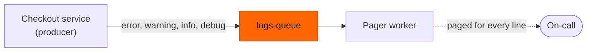
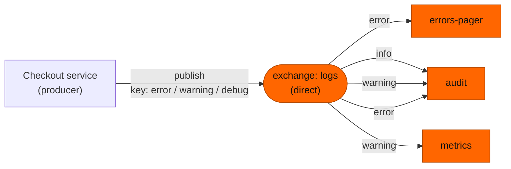
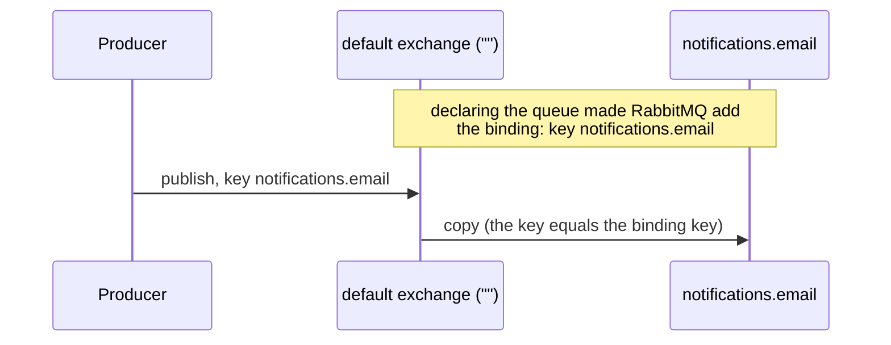

# 04 — Direct exchange: exact-match routing, and the default exchange

**Level:** Engineer  
**Episode:** Direct exchange: exact-match routing, and the default exchange  
**Language:** English  
**Code:** Java 21 · Maven · RabbitMQ Java client · Docker Compose  
**Requires:** [Episode 03 — Exchanges and bindings](../03-rabbitmq-exchanges-and-bindings/)

## YouTube

[Watch this episode]({{youtubeUrl}})

This folder is the companion project for the fourth episode of the course. The README is the **written version of the lesson**: together with the video it should leave the concept complete. Read it to review the ideas, follow the diagrams, and then run the experiments yourself.

> **The one sentence of this episode**
>
> **A direct exchange copies a message to every queue whose binding key exactly equals the routing key.**

> **Learning-project disclaimer:** the three queues are just queues: `errors-pager` does not page anyone, and `audit` and `metrics` store and count nothing. The `consume` command stands in for a consumer so that you can see what each queue holds. The two terminal demos in the video are **real recordings** of this project. The code is illustrative, not production-ready (see [What this project does not cover](#what-this-project-does-not-cover)).

## Learning objectives

After this episode you should be able to:

- Define a **direct exchange**, a **binding key** and the **default exchange**.
- Predict, from a table of bindings, which queues receive a message published with a given routing key.
- Explain why a direct exchange does not send a message to "exactly one queue".
- Explain what the default exchange really is, and why it only *looks* like publishing to a queue.
- Say what happens to a message whose key matches no binding.

## From the video to the code

| Video scene | Concept | Where to see it |
|---|---|---|
| Cold open | One queue for everything pages on-call for noise | [1. The problem](#1-the-problem-one-queue-for-everything) |
| The rule | Exact equality between keys | [2. The rule](#2-the-rule-equal-keys-every-matching-queue) |
| The bindings table | `logs` with three queues | [`Rules.java`](src/main/java/com/fromdevtodev/rabbitmq/direct/Rules.java), [Experiment 1](#experiment-1-which-queues-get-a-copy) |
| Error, warning and debug | Real routing | [Experiment 1](#experiment-1-which-queues-get-a-copy) |
| Exact, not partial | No pattern matching | [3. Exact matching](#3-exact-matching-and-what-it-does-not-do) |
| The default exchange | Automatic binding by queue name | [5. The default exchange](#5-the-default-exchange), [Experiment 3](#experiment-3-the-default-exchange) |
| Misconception | "Exactly one queue" | [4. The misconception](#4-the-misconception-exactly-one-queue) |

## 1. The problem: one queue for everything

Every log line the checkout service writes lands in one queue, and the pager consumes from it. On-call is paged for every `info` line, not only for errors.



Filtering inside the consumer works, but then every consumer receives and throws away what it does not need. With an exchange the **broker** filters: each queue only receives the messages it asked for.

## 2. The rule: equal keys, every matching queue

A **direct exchange** is an exchange type with one rule:

> A message goes to **every queue** that has a binding whose **binding key** is **exactly equal** to the message's **routing key**.

- The **routing key** is the label the producer puts on the message (`error`).
- The **binding key** is the key a queue is bound with. It is the same thing as the routing key of episode 3, seen from the binding's side.

Our exchange is called `logs`. Its bindings:

| Queue | Bound with key |
|---|---|
| `errors-pager` | `error` |
| `audit` | `info`, `warning`, `error` |
| `metrics` | `warning` |



Which queues get a copy for each key?

| Routing key | `errors-pager` | `audit` | `metrics` |
|---|---|---|---|
| `error` | copy | copy | – |
| `warning` | – | copy | copy |
| `info` | – | copy | – |
| `debug` | – | – | – |

The producer's call is the same in every case: an exchange name and a key.

```java
channel.basicPublish("logs", "warning", properties, body);   // audit and metrics get a copy
```

## 3. Exact matching, and what it does not do

"Exactly equal" is meant literally:

- `warning` does **not** match `warn`, `warnings` or `Warning`.
- There is no prefix, no wildcard and no "starts with". Pattern matching (`logs.*.error`) belongs to the **topic** exchange, which is the next episode.
- A queue bound with several keys (`audit` with `info`, `warning` and `error`) receives a copy only for the key the message carries. A message has **one** routing key, so `audit` gets one copy of each message.
- A message whose key matches **no** binding (`debug`) reaches no queue. By default it is discarded, and the publish call does not fail. (A producer can ask to be told, and an exchange can have an alternate exchange; both are later episodes.)

## 4. The misconception: "exactly one queue"

| | Belief | Reality |
|---|---|---|
| Copies | A direct exchange sends each message to **one** queue | One copy to **every** queue with a matching binding key |
| No match | The message goes to some default queue | The message goes nowhere |
| Close keys | `warn` is close enough to `warning` | There is no partial matching |

The word *direct* describes how the key is compared (equality, not patterns), not how many queues receive a copy.

## 5. The default exchange

In episode 2 we published like this:

```java
channel.basicPublish("", "notifications.email", properties, body);
```

The first argument is the exchange, and it is an **empty string**. That is the **default exchange**: a direct exchange with no name, pre-declared by the broker. RabbitMQ binds **every queue** to it automatically, using the queue's own name as the binding key. So the call above is a publish with the routing key `notifications.email`, and the only binding with that key is the one RabbitMQ made.



It makes publishing look like sending straight to a queue, but it is still an exchange. Two consequences:

- You cannot bind queues to it yourself: binding operations on the default exchange result in an error. If you need your own routing, declare your own direct exchange, like `logs`.
- A producer that uses it knows queue names. Every new consumer means a change in the producer, which is the problem episode 3 solved.

## When *not* to use it

- You need **pattern matching** (`orders.*.created`): use a **topic** exchange.
- You need **broadcast** regardless of the key: use a **fanout** exchange.
- You have **one queue and one consumer** and no plans for more: the default exchange is enough.

## Hands-on experiments

### Prerequisites

- Java 21, Maven, Docker with Compose.
- Start RabbitMQ and build the project:

```bash
docker compose up -d rabbitmq
mvn -q -DskipTests compile
```

The management UI is at <http://localhost:15672> (`guest` / `guest`). Every command below is `mvn -q exec:java -Dexec.args="..."`; the examples abbreviate it to `App ...`.

| Command | What it does |
|---|---|
| `App setup` | Declares the exchange `logs`, the queues `errors-pager`, `audit`, `metrics` and the five bindings |
| `App publish --key K [--count 1] [--first 1]` | Publishes to the exchange `logs` with routing key `K` |
| `App predict --key K` | Our own model of the rule: which queues should get a copy (the broker has the last word) |
| `App publish-default --queue Q` | Publishes to the default exchange (`""`) using the queue name as the routing key |
| `App declare-queue --queue Q` | Declares a queue and nothing else |
| `App try-bind-default --queue Q [--key x]` | Tries to bind a queue to the default exchange; prints the broker's answer |
| `App consume --queue Q [--limit 0]` | Prints the messages of one queue (`--limit 0`: until Ctrl+C) |
| `App status [--queues a,b] [--samples 1]` | Prints the ready messages of each queue |
| `App reset` | Deletes the exchange and the queues |

To look at the broker yourself:

```bash
docker compose exec rabbitmq rabbitmqctl list_bindings source_name routing_key destination_name
docker compose exec rabbitmq rabbitmqctl list_queues name messages_ready
```

(`list_bindings` also shows the default exchange's automatic bindings, with an empty source name.)

### Experiment 1: which queues get a copy

```bash
App reset
App setup
App predict --key error          # our model: errors-pager, audit
App publish --key error
App predict --key warning        # our model: audit, metrics
App publish --key warning
App predict --key debug          # our model: no queue
App publish --key debug
App status                       # errors-pager ready 1 | audit ready 2 | metrics ready 1
```

Expected: `errors-pager` 1, `audit` 2 (one `error`, one `warning`), `metrics` 1. The `debug` message reached no queue, and `publish` reported success. Compare each `predict` line with what the broker did.

### Experiment 2: exact means exact

```bash
App publish --key warn           # not "warning"
App publish --key Warning        # not "warning"
App status                       # nothing changed
```

Expected: no queue receives either message, and no error appears.

### Experiment 3: the default exchange

```bash
App declare-queue --queue notifications.email
docker compose exec rabbitmq rabbitmqctl list_bindings source_name routing_key destination_name | grep notifications.email
App publish-default --queue notifications.email
App status --queues notifications.email
App try-bind-default --queue notifications.email
```

Expected: a binding row with an **empty source** and `notifications.email` as both key and destination, made by the broker, not by your code; one ready message after the publish; and a refusal from the broker when you try to bind the queue to the default exchange yourself.

## Project structure

```text
04-rabbitmq-direct-exchange/
├── docker-compose.yml
├── pom.xml
├── recordings/               # scripts that record the video demos (maintainers)
└── src/
    ├── main/java/com/fromdevtodev/rabbitmq/direct/
    │   ├── App.java          # command line
    │   ├── Rules.java        # names, the five bindings, and our model of the matching rule (no broker)
    │   ├── Topology.java     # exchangeDeclare, queueDeclare, queueBind, and the connection settings
    │   ├── Bindings.java     # setup, declare-queue, try-bind-default, reset
    │   ├── Publisher.java    # publish to the exchange logs, or to the default exchange
    │   ├── Consumer.java     # prints the messages of one queue
    │   ├── QueueStatus.java  # passive declare: ready messages per queue
    │   ├── LogEvent.java     # the message
    │   └── ...               # Args, EventJson, Log, StatusLine
    └── test/java/...         # tests for the parts that need no broker
```

### Tests

```bash
mvn test
```

The tests cover the parts that need no running broker: the rule model in `Rules` (the table of section 2, exact matching, one copy per queue, no match), the message, the status line and argument parsing. The routing itself is the broker's job, and the experiments above show it.

## What this project does not cover

- **Topic, fanout and headers exchanges:** the next episodes.
- **Unroutable messages in depth:** `mandatory`, return handlers and alternate exchanges.
- **Publisher confirms, acknowledgements, durability and retries:** later episodes. The consumer acknowledges each message right after printing it.
- **Binding exchanges to other exchanges.**

## Recap

- **A direct exchange copies a message to every queue whose binding key exactly equals the routing key.**
- The routing key is on the message; the binding key is on the binding. Matching is equality, never partial.
- A queue gets one copy per message, however many keys it is bound with; a key with no binding reaches no queue.
- The default exchange is a direct exchange with no name, and RabbitMQ binds every queue to it by the queue's own name.
- It looks like publishing to a queue, but it is still an exchange, and you cannot add your own bindings to it.

## Sources

The claim-by-claim verification notes live in the video repository (`docs/sources/rabbitmq-direct-exchange-sources.md`). Official references:

- [RabbitMQ: Exchanges](https://www.rabbitmq.com/docs/exchanges)
- [RabbitMQ: AMQP 0-9-1 concepts](https://www.rabbitmq.com/tutorials/amqp-concepts)
- [RabbitMQ: Publishers](https://www.rabbitmq.com/docs/publishers)
- [rabbitmqctl reference](https://www.rabbitmq.com/docs/man/rabbitmqctl.8)
