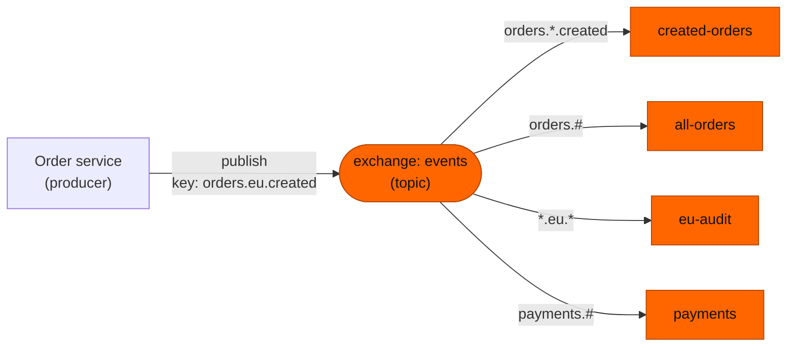

# 05 — Topic exchange: routing with patterns (* and #)

**Level:** Engineer  
**Episode:** Topic exchange: routing with patterns (* and #)  
**Language:** English  
**Code:** Java 21 · Maven · RabbitMQ Java client · Docker Compose  
**Requires:** [Episode 04 — Direct exchange](../04-rabbitmq-direct-exchange/)

## YouTube

[Watch this episode](https://www.youtube.com/watch?v=gS4I7ecF6DQ)

This folder is the companion project for the fifth episode of the course. The README is the **written version of the lesson**: together with the video it should leave the concept complete. Read it to review the ideas, follow the diagrams, and then run the experiments yourself.

> **The one sentence of this episode**
>
> **A topic exchange matches routing keys against word patterns: star is exactly one word, hash is zero or more.**

> **Learning-project disclaimer:** the queues are just queues: `eu-audit` does not audit anything and `payments` processes no payment. The `consume` command stands in for a consumer so that you can see what each queue holds. The two terminal demos in the video are **real recordings** of this project. The code is illustrative, not production-ready (see [What this project does not cover](#what-this-project-does-not-cover)).

## Learning objectives

After this episode you should be able to:

- Define a **topic exchange**, the **star wildcard** and the **hash wildcard**.
- Read a routing key as a list of **words** separated by dots.
- Write a binding pattern for dot-separated keys, and say which keys it matches.
- Predict which queues receive a message, from a table of patterns.
- Explain why wildcards work on whole words, and why `orders.*` matches neither `orders` nor `orders.eu.created`.

## From the video to the code

| Video scene | Concept | Where to see it |
|---|---|---|
| Cold open | Audit needs every payment event and only the EU orders | [1. The problem](#1-the-problem-one-binding-per-key) |
| Keys as paths | Words separated by dots | [2. Keys are lists of words](#2-keys-are-lists-of-words) |
| The topic exchange | Four patterns on `events` | [3. The rule](#3-the-rule-star-and-hash), [`Rules.java`](src/main/java/com/fromdevtodev/rabbitmq/topic/Rules.java), [Experiment 1](#experiment-1-which-queues-get-a-copy) |
| Star versus hash | Exactly one word, or zero or more | [4. Star versus hash](#4-star-versus-hash), [Experiment 2](#experiment-2-star-versus-hash-for-real) |
| In the code | `BuiltinExchangeType.TOPIC` and the pattern in `queueBind` | [`Topology.java`](src/main/java/com/fromdevtodev/rabbitmq/topic/Topology.java) |
| Misconception | Wildcards inside a word | [5. The misconception](#5-the-misconception-wildcards-work-inside-a-word) |

## 1. The problem: one binding per key

Audit asks for two things: **every payment event**, and **only the EU orders**. Our keys have the shape `domain.region.event`. With a direct exchange, a queue is bound once per exact key, so audit needs one binding for every combination:

| Today: regions `eu`, `us` | Next quarter: a new region `apac` |
|---|---|
| `payments.eu.created`, `payments.eu.failed` | (the same six bindings) |
| `payments.us.created`, `payments.us.failed` | `payments.apac.created` |
| `orders.eu.created`, `orders.eu.cancelled` | `payments.apac.failed` |
| **6 bindings** | **8 bindings**, and every team that cares about "all payments" must remember to add its own |

A forgotten binding is not an error: the message is simply not routed to that queue. What we want to say is the **shape** of the keys, not every combination of them.

## 2. Keys are lists of words

A routing key such as `orders.eu.created` reads like a path: a list of **words** separated by dots. Here: domain, region, event. A **word** is the text between two dots, and everything that follows depends on that: a topic exchange compares **words**, not characters.

## 3. The rule: star and hash

A **topic exchange** is an exchange type that matches the routing key of a message against the **pattern** of each binding. The pattern is written like a key, and two words are special:

- **`*` (the star wildcard)** matches **exactly one word**.
- **`#` (the hash wildcard)** matches **zero or more words**.

> A topic exchange matches routing keys against word patterns: star is exactly one word, hash is zero or more.

Our exchange is called `events`. Its bindings:

| Queue | Bound with pattern | Meaning |
|---|---|---|
| `created-orders` | `orders.*.created` | any region, only `created` |
| `all-orders` | `orders.#` | every order event |
| `eu-audit` | `*.eu.*` | any domain, region `eu`, any event |
| `payments` | `payments.#` | every payment event |



Which queues get a copy for each key?

| Routing key | `created-orders` | `all-orders` | `eu-audit` | `payments` |
|---|---|---|---|---|
| `orders.eu.created` | copy | copy | copy | – |
| `orders.us.cancelled` | – | copy | – | – |
| `payments.eu.failed` | – | – | copy | copy |

The producer's call does not change from episode 4: an exchange name and a plain routing key.

```java
channel.exchangeDeclare("events", BuiltinExchangeType.TOPIC, true);   // the type
channel.queueBind("eu-audit", "events", "*.eu.*");                    // the pattern goes where a binding key went
channel.basicPublish("events", "orders.eu.created", props, body);     // a plain key: wildcards live in bindings only
```

Two more facts from the RabbitMQ tutorial: a queue bound with a lone `#` receives every message (it behaves like a fanout exchange, the next episode), and a pattern with no wildcard at all behaves exactly like a direct binding.

## 4. Star versus hash

The difference is how many words each one can stand for. Same pattern prefix, three keys:

| Routing key | `orders.*` | `orders.#` |
|---|---|---|
| `orders` (1 word) | no match | **match** (zero words after `orders`) |
| `orders.eu` (2 words) | **match** | **match** |
| `orders.eu.created` (3 words) | no match | **match** |

The star needs **one** word in its place, and only one. The hash can stand for none, one or many. That is why `orders.#` is the right pattern for "every order event", and `orders.*` is not.

## 5. The misconception: "wildcards work inside a word"

| | Belief | Reality |
|---|---|---|
| Where | `*` and `#` work like glob or regex characters, anywhere in a word | They are wildcards only as a **whole word** between dots |
| Example | `ord*.eu.created` matches `orders.eu.created` | It does not: `ord*` is a plain word that happens to contain a star |
| Star | `orders.*` means "orders and whatever follows" | Exactly **one** more word: not zero, not two |

Think in words, never in characters. The RabbitMQ documentation defines the star and the hash as substituting for words; [Experiment 2](#experiment-2-star-versus-hash-for-real) measures the "inside a word" case on your broker.

## When *not* to use it

- **Exact keys are enough** (`error`, `warning`, `info`): a direct exchange is simpler to reason about, and there is no pattern to get wrong.
- **Keys are an API.** The hierarchy `domain.region.event` is something every binding depends on. Reordering or renaming its words breaks every pattern that relied on them, and a message that matches nothing is silently discarded.
- **You need a copy for everyone, whatever the key:** that is a fanout exchange.

## Hands-on experiments

### Prerequisites

- Java 21, Maven, Docker with Compose.
- Start RabbitMQ and build the project:

```bash
docker compose up -d rabbitmq
mvn -q -DskipTests compile
```

The management UI is at <http://localhost:15672> (`guest` / `guest`). Every command below is `mvn -q exec:java -Dexec.args="..."`; the examples abbreviate it to `App ...`. Other episodes' Compose files use the same ports: stop one before starting another (`docker compose down` in the folder where you started it).

| Command | What it does |
|---|---|
| `App setup [--set story\|wildcards]` | Declares the exchange `events`, the queues and the bindings of one set (default: `story`) |
| `App bind --queue Q --pattern P` | One more binding: declares the queue if needed and binds it with the pattern |
| `App publish --key K [--count 1] [--first 1]` | Publishes to the exchange `events` with routing key `K` |
| `App match --pattern P --key K` | Our model of the rule: does the pattern match the key? (no broker needed) |
| `App predict --key K [--set story\|wildcards]` | Which queues should get a copy, by our model (the broker has the last word) |
| `App consume --queue Q [--limit 0]` | Prints the messages of one queue (`--limit 0`: until Ctrl+C) |
| `App status [--queues a,b] [--samples 1]` | Prints the ready messages of each queue |
| `App reset [--also a,b]` | Deletes the exchange, every queue of the project, and the extra queues you name |

To look at the broker yourself:

```bash
docker compose exec rabbitmq rabbitmqctl list_bindings source_name routing_key destination_name
docker compose exec rabbitmq rabbitmqctl list_queues name messages_ready
```

(For a topic exchange the `routing_key` column of `list_bindings` shows the binding **pattern**. The command also lists the default exchange's automatic bindings, with an empty source name.)

### Experiment 1: which queues get a copy

```bash
App reset
App setup
App predict --key orders.eu.created     # our model: created-orders, all-orders, eu-audit
App publish --key orders.eu.created
App predict --key orders.us.cancelled   # our model: all-orders
App publish --key orders.us.cancelled
App predict --key payments.eu.failed    # our model: eu-audit, payments
App publish --key payments.eu.failed
App status                              # created-orders 1 | all-orders 2 | eu-audit 2 | payments 1
```

Expected: `created-orders` 1, `all-orders` 2, `eu-audit` 2, `payments` 1. Compare each `predict` line with what the broker did.

### Experiment 2: star versus hash, for real

```bash
App reset
App setup --set wildcards                # orders-star <- orders.*, orders-hash <- orders.#, orders-glob <- ord*.eu.created
App publish --key orders                 # 1 word
App publish --key orders.eu --first 2    # 2 words
App publish --key orders.eu.created --first 3   # 3 words
App status --queues orders-star,orders-hash,orders-glob
```

Expected: `orders-star` 1, `orders-hash` 3, `orders-glob` 0. The star matched only the two-word key; the hash matched all three, including `orders` with no word after it; and the star inside `ord*` was not a wildcard, so that queue received nothing even though the key looks like a match. If your broker prints something else for `orders-glob`, that is worth a bug report to us.

### Experiment 3: a new team, with the producer untouched

```bash
App reset
App setup
App bind --queue cancellations --pattern "orders.*.cancelled"   # a new team: its own queue, its own pattern
App publish --key orders.us.cancelled
App status --queues all-orders,cancellations                    # both 1
App reset --also cancellations
```

Expected: the new queue receives a copy of the next matching message, and nothing in `Publisher.java` changed. A queue only receives messages published **after** its binding exists.

### Try your own patterns

```bash
App match --pattern "orders.#.created" --key orders.eu.west.created   # matches
App match --pattern "*.*.created" --key orders.created                # does not match
```

`match` runs our own model, so you can practise without a broker; to check a pattern against the real thing, bind it with `bind` and publish.

## Project structure

```text
05-rabbitmq-topic-exchange/
├── docker-compose.yml
├── pom.xml
├── recordings/               # scripts that record the video demos (maintainers)
└── src/
    ├── main/java/com/fromdevtodev/rabbitmq/topic/
    │   ├── App.java          # command line
    │   ├── TopicPattern.java # our model of the rule: star, hash and plain words (no broker)
    │   ├── Rules.java        # names, the two sets of bindings, and which queues a key reaches
    │   ├── Topology.java     # exchangeDeclare (TOPIC), queueDeclare, queueBind, and the connection settings
    │   ├── Bindings.java     # setup, bind, reset
    │   ├── Publisher.java    # publish to the exchange events with a plain routing key
    │   ├── Consumer.java     # prints the messages of one queue
    │   ├── QueueStatus.java  # passive declare: ready messages per queue
    │   ├── Event.java        # the message
    │   └── ...               # Args, EventJson, Log, StatusLine
    └── test/java/...         # tests for the parts that need no broker
```

### Tests

```bash
mvn test
```

The tests cover the parts that need no running broker: the matching model in `TopicPattern` (the three running keys against the four patterns, star versus hash, a star inside a word, and the 6-versus-8 bindings of the audit story), the table of `Rules`, the message, the status line and argument parsing. The routing itself is the broker's job, and the experiments above show it.

## What this project does not cover

- **Fanout and headers exchanges:** episode 6 and the extras.
- **Unroutable messages in depth:** a message that matches no pattern is discarded by default; `mandatory`, return handlers and alternate exchanges come later.
- **Publisher confirms, acknowledgements, durability and retries:** later episodes. The consumer acknowledges each message right after printing it.
- **Limits and edge cases of routing keys** (maximum length, empty words, very long patterns): not needed to learn the rule, and not claimed here.
- **Binding exchanges to other exchanges.**

## Recap

- **A topic exchange matches routing keys against word patterns: star is exactly one word, hash is zero or more.**
- A routing key is a list of words separated by dots; wildcards work on whole words, never inside a word.
- Wildcards live in **bindings**; the message always carries a plain key.
- `orders.*` matches `orders.eu`; `orders.#` matches `orders`, `orders.eu` and `orders.eu.created`.
- Keys are an API: if exact keys are enough, a direct exchange is simpler.

## Sources

The claim-by-claim verification notes live in the video repository (`docs/sources/rabbitmq-topic-exchange-sources.md`). Official references:

- [RabbitMQ: Exchanges](https://www.rabbitmq.com/docs/exchanges)
- [RabbitMQ: AMQP 0-9-1 concepts](https://www.rabbitmq.com/tutorials/amqp-concepts)
- [RabbitMQ tutorial 5: Topics](https://www.rabbitmq.com/tutorials/tutorial-five-java)
- [RabbitMQ: Publishers](https://www.rabbitmq.com/docs/publishers)
- [rabbitmqctl reference](https://www.rabbitmq.com/docs/man/rabbitmqctl.8)
