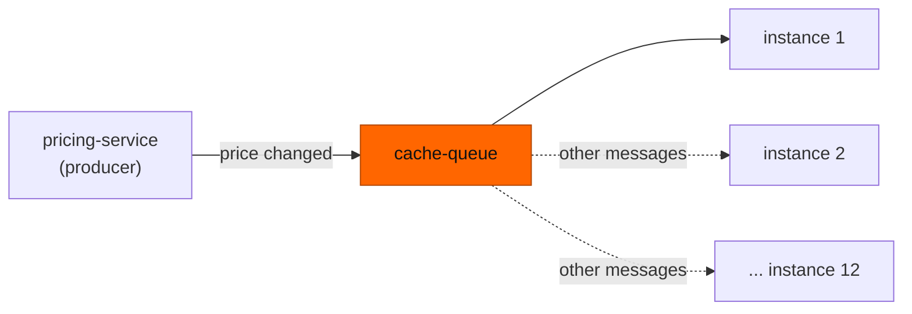
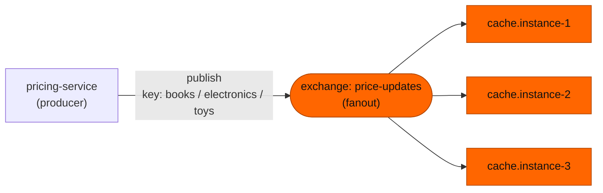

# 06 — Fanout exchange: broadcast to every queue

**Level:** Engineer  
**Episode:** Fanout exchange: broadcast to every queue  
**Language:** English  
**Code:** Java 21 · Maven · RabbitMQ Java client · Docker Compose  
**Requires:** [Episode 04 — Direct exchange](../04-rabbitmq-direct-exchange/) (what an exchange, a binding and a binding key are). Episode 5, the topic exchange, comes between them in the course order, but this episode does not need it.

## YouTube

[Watch this episode](https://www.youtube.com/watch?v=3yQDxEZO_ro)

This folder is the companion project for the sixth episode of the course. The README is the **written version of the lesson**: together with the video it should leave the concept complete. Read it to review the ideas, follow the diagrams, and then run the experiments yourself.

> **The one sentence of this episode**
>
> **A fanout exchange ignores the routing key and copies every message to every queue bound to it.**

> **Learning-project disclaimer:** the queues are just queues: `cache.instance-1` does not hold a real cache, and the `consume` and `subscribe` commands stand in for a service instance so that you can see what each queue receives. The two terminal demos in the video are **real recordings** of this project. The code is illustrative, not production-ready (see [What this project does not cover](#what-this-project-does-not-cover)).

## Learning objectives

After this episode you should be able to:

- Define a **fanout exchange**, a **broadcast** and an **exclusive queue**.
- Predict which queues receive a message published to a fanout exchange, whatever its routing key.
- Explain why several consumers on one queue are **not** a broadcast.
- Say what you need to broadcast to several service instances: one queue per instance, all bound to the exchange.
- Say what an exclusive queue gives you, and what you lose with it.

## From the video to the code

| Video scene | Concept | Where to see it |
|---|---|---|
| Cold open | A price change that must reach 12 instances | [1. The problem](#1-the-problem-one-price-change-twelve-instances) |
| The rule | Every bound queue, key ignored | [2. The rule](#2-the-rule-every-bound-queue-the-key-ignored), [`Rules.java`](src/main/java/com/fromdevtodev/rabbitmq/fanout/Rules.java) |
| Books, electronics and toys | The key changes nothing | [Experiment 1](#experiment-1-the-routing-key-changes-nothing) |
| Several consumers on one queue | The misconception | [3. The misconception](#3-the-misconception-several-consumers-are-a-broadcast), [Experiment 2](#experiment-2-two-consumers-one-queue) |
| One queue per instance | Exclusive queues | [4. One queue per instance](#4-one-queue-per-instance-and-the-exclusive-queue), [Experiment 3](#experiment-3-one-exclusive-queue-per-instance) |

## 1. The problem: one price change, twelve instances

The catalog service keeps a **cache** of prices in memory, and it runs as 12 instances. When the pricing service changes a price, **every** instance has to drop its cached copy.

The first idea is the one from episode 2: put the message in a queue and let the instances consume it.



It does not work. Consumers of one queue **share** its messages: each message goes to just one of them, so one instance drops its cache and eleven keep the old price.

## 2. The rule: every bound queue, the key ignored

A **fanout exchange** is an exchange type with one rule:

> A message goes to **every queue** bound to the exchange. The routing key is **ignored**.

That is a **broadcast**: one publish, and every receiver gets its own copy. Here the receivers are queues, one per service instance.

Our exchange is called `price-updates`. Three instance queues are bound to it, each with a different binding key:

| Queue | Bound with key |
|---|---|
| `cache.instance-1` | *(empty)* |
| `cache.instance-2` | `books` |
| `cache.instance-3` | `electronics` |



Every message ends in all three queues:

| Routing key | `cache.instance-1` | `cache.instance-2` | `cache.instance-3` |
|---|---|---|---|
| `books` | copy | copy | copy |
| `electronics` | copy | copy | copy |
| `toys` | copy | copy | copy |

The producer's call is the same as for any other exchange, and it still never mentions a queue:

```java
channel.basicPublish("price-updates", "books", properties, body);   // the key is accepted, and ignored
```

Two details:

- The routing key is **ignored**, not forbidden: you can still pass one, and queues can still be bound with a key. Neither changes which queues get a copy. Compare with episode 4, where `electronics` would have reached only the queue bound with `electronics`.
- A fanout exchange with **no queue bound** delivers nothing: the message is discarded by default, and the publish call does not fail (the same default as in episode 4; telling the producer is a later episode).

## 3. The misconception: "several consumers are a broadcast"

| | Belief | Reality |
|---|---|---|
| Consumers | Start 12 consumers on one queue and every one of them receives each message | Consumers of one queue **compete**: RabbitMQ delivers each message to just one of them |
| Where copies are made | The queue copies the message for its consumers | The **exchange** copies the message, once per bound **queue** |
| What a broadcast needs | More consumers | More **queues**, one per receiver, all bound to the exchange |

A queue is a buffer that its consumers share. A copy exists per queue, never per consumer. So broadcasting to 12 instances means 12 queues.

## 4. One queue per instance, and the exclusive queue

Each instance declares its **own** queue and binds it to `price-updates`. For cache invalidation the queue is usually an **exclusive queue**:

- It can be used by **only one connection**: the one that declared it.
- RabbitMQ **deletes it when that connection closes**.
- You can leave the name empty, and the broker chooses one (it looks like `amq.gen-...`). The instance uses the name the broker returns.

```java
String queue = channel.queueDeclare("", false, true, true, null).getQueue();  // exclusive, broker-named
channel.queueBind(queue, "price-updates", "");
```

That is the right fit when an instance only cares about messages published **while it is running**: the queue appears with the instance and disappears with it, so nothing piles up for instances that no longer exist.

It is also the limit. A copy is made only for queues that are bound **when the message is published**:

- A message published while an instance is down is not kept for it, and an instance that starts later does not see it.
- An exclusive queue is not shared, so it does not help when several instances should share the work of one stream.

If a service must not miss messages while it is down, give it a named, durable queue instead (bound to the same fanout exchange). Durability is a later episode.

## When *not* to use it

- You need to send only **some** messages to some queues: use a direct or a topic exchange.
- Every message must reach **one** worker, not every instance: use one queue with several consumers.
- A receiver must not miss messages while it is offline: it needs its own durable queue, not an exclusive one.

## Hands-on experiments

### Prerequisites

- Java 21, Maven, Docker with Compose.
- Start RabbitMQ and build the project:

```bash
docker compose up -d rabbitmq
mvn -q -DskipTests compile
```

The management UI is at <http://localhost:15672> (`guest` / `guest`). Every command below is `mvn -q exec:java -Dexec.args="..."`; the examples abbreviate it to `App ...`.

| Command | What it does |
|---|---|
| `App setup` | Declares the exchange `price-updates` (fanout), the queues `cache.instance-1`, `cache.instance-2`, `cache.instance-3` and their three bindings |
| `App setup-shared` | Declares the queue `cache.shared` and binds it to the exchange |
| `App publish --key K [--count 1] [--first 1]` | Publishes to the exchange `price-updates` with routing key `K` |
| `App predict --key K` | Our own model of the rule: which queues should get a copy (the broker has the last word) |
| `App consume --queue Q [--name N] [--limit 0]` | A consumer of one named queue; prints each message with the label `N` (`--limit 0`: until Ctrl+C) |
| `App subscribe [--name N] [--limit 0]` | One instance with its own exclusive, broker-named queue bound to the exchange |
| `App status [--queues a,b] [--samples 1]` | Prints the ready messages of each **named** queue |
| `App reset` | Deletes the exchange and the queues |

`status` reads named queues only: an exclusive queue belongs to its connection, so use the broker's own view for those:

```bash
docker compose exec rabbitmq rabbitmqctl list_bindings source_name routing_key destination_name
docker compose exec rabbitmq rabbitmqctl list_queues name messages_ready
```

### Experiment 1: the routing key changes nothing

```bash
App reset
App setup
App predict --key books          # our model: all three queues
App publish --key books
App publish --key electronics
App publish --key toys           # no binding has this key
App status                       # every queue: ready 3
```

Expected: each queue holds 3 messages, one per publish, although the three binding keys differ and no binding key is `toys`. Compare each `predict` line with what the broker did. For contrast, look at the bindings with `list_bindings`: the keys are stored, and ignored.

### Experiment 2: two consumers, one queue

```bash
App reset
App setup-shared
# terminal 1:
App consume --queue cache.shared --name cache-a
# terminal 2:
App consume --queue cache.shared --name cache-b
# terminal 3:
App publish --key books --count 4
```

Expected: four `received` lines in total, and **each message appears once**, from `cache-a` or from `cache-b`, never from both. How the four are split between the two consumers can vary; what does not vary is that no message reaches both. Stop the consumers with Ctrl+C.

### Experiment 3: one exclusive queue per instance

```bash
App reset
# terminal 1:
App subscribe --name instance-1
# terminal 2:
App subscribe --name instance-2
# terminal 3:
docker compose exec rabbitmq rabbitmqctl list_queues name messages_ready
App publish --key books --count 2
```

Expected: each `subscribe` prints the broker-chosen name of its queue; `list_queues` shows two such queues; and **both** instances print **both** messages. Now stop both instances with Ctrl+C and run `list_queues` again: the two queues are gone, because their connections closed.

To see the limit, run `App reset`, then `App publish --key books` with no instance running, and then `App subscribe --name late`: nothing arrives. The message was published when no queue was bound, so it was not delivered anywhere.

## Project structure

```text
06-rabbitmq-fanout-exchange/
├── docker-compose.yml
├── pom.xml
├── recordings/               # scripts that record the video demos (maintainers)
└── src/
    ├── main/java/com/fromdevtodev/rabbitmq/fanout/
    │   ├── App.java          # command line
    │   ├── Rules.java        # names, the three bindings, and our model of the fanout rule (no broker)
    │   ├── Topology.java     # exchangeDeclare (fanout), queueDeclare (named and exclusive), queueBind, connection settings
    │   ├── Bindings.java     # setup, setup-shared, reset
    │   ├── Publisher.java    # publish to the exchange price-updates
    │   ├── Consumer.java     # one consumer of a named queue
    │   ├── Subscriber.java   # one instance with its own exclusive queue
    │   ├── QueueStatus.java  # passive declare: ready messages per named queue
    │   ├── PriceChange.java  # the message
    │   └── ...               # Args, EventJson, Log, StatusLine
    └── test/java/...         # tests for the parts that need no broker
```

### Tests

```bash
mvn test
```

The tests cover the parts that need no running broker: the rule model in `Rules` (every bound queue gets a copy, whatever the key; no bindings, no copy), the message, the status line and argument parsing. The routing itself is the broker's job, and the experiments above show it.

## What this project does not cover

- **Direct, topic and headers exchanges:** other episodes.
- **Unroutable messages in depth:** `mandatory`, return handlers and alternate exchanges.
- **Durability, publisher confirms, acknowledgements and retries:** later episodes. The consumers acknowledge each message right after printing it.
- **Redelivery:** a message that a consumer does not acknowledge can be delivered again, possibly to another consumer of the same queue. That is a later episode.
- **Exchange-to-exchange bindings, and the pre-declared `amq.fanout` exchange.**
- **Real cache invalidation:** there is no cache here; the point is which queues receive a copy.

## Recap

- **A fanout exchange ignores the routing key and copies every message to every queue bound to it.**
- The copies are made per **queue**, never per consumer. Consumers of one queue share its messages.
- To broadcast to several instances, give each instance its own queue and bind them all to the exchange.
- An exclusive queue belongs to one connection and disappears with it: no leftovers, and no backlog for an instance that is not running.
- A message published while no queue is bound is delivered nowhere.

## Sources

The claim-by-claim verification notes live in the video repository (`docs/sources/rabbitmq-fanout-exchange-sources.md`). Official references:

- [RabbitMQ: Exchanges](https://www.rabbitmq.com/docs/exchanges)
- [RabbitMQ: Queues](https://www.rabbitmq.com/docs/queues)
- [RabbitMQ: Publishers](https://www.rabbitmq.com/docs/publishers)
- [RabbitMQ: AMQP 0-9-1 concepts](https://www.rabbitmq.com/tutorials/amqp-concepts)
- [rabbitmqctl reference](https://www.rabbitmq.com/docs/man/rabbitmqctl.8)
