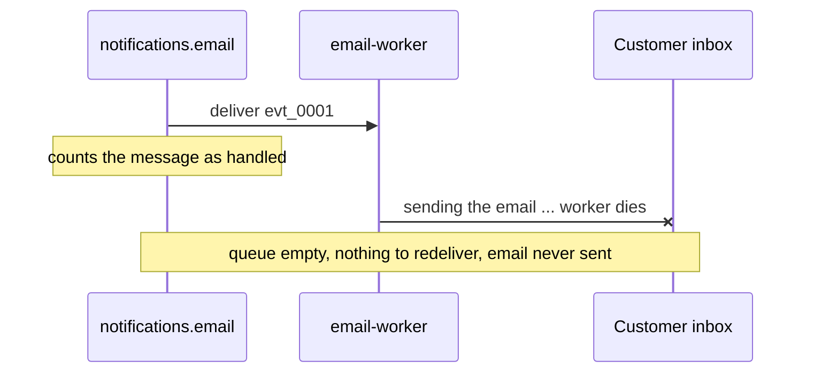
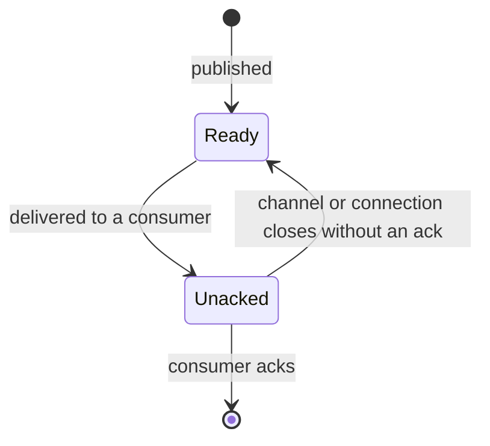
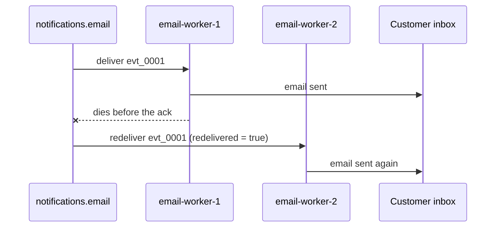

# 08 — Manual acknowledgements: what the ack really means

**Level:** Engineer  
**Episode:** Manual acknowledgements: what the ack really means  
**Language:** English  
**Code:** Java 21 · Maven · RabbitMQ Java client · Docker Compose  
**Requires:** [Episode 02 — Queues](../02-rabbitmq-queues/)

## YouTube

[Watch this episode](https://www.youtube.com/watch?v=i6UENke573A)

This folder is the companion project for the eighth episode of the course. The README is the **written version of the lesson**: together with the video it should leave the concept complete. Read it to review the ideas, follow the diagrams, and then run the experiments yourself.

> **The one sentence of this episode**
>
> **A delivery stays unacknowledged until the consumer answers, and RabbitMQ redelivers it if the consumer dies first.**

> **Learning-project disclaimer:** no email is sent. "Sending the confirmation email" is a sleep and a log line, so that the moments that matter are visible. The worker's "crash" is the program halting its own JVM abruptly (see [How the crash works](#how-the-crash-works)). The two terminal demos in the video are **real recordings** of this project. The code is illustrative, not production-ready (see [What this project does not cover](#what-this-project-does-not-cover)).

## Learning objectives

After this episode you should be able to:

- Define **acknowledgement**, **unacknowledged message** and **redelivery**.
- Explain what **automatic** and **manual** acknowledgement mode do, and what each does to a message when the consumer dies.
- Read the `ready` and `unacked` counters of a queue and say what state a message is in.
- Place `basicAck` correctly: after the work succeeded, never before it, never in a `finally` block.
- Explain why manual acknowledgement can produce a duplicate.

## From the video to the code

| Video scene | Concept | Where to see it |
|---|---|---|
| Cold open | A worker dies mid-send and the queue shows nothing | [1. The problem](#1-the-problem-a-message-that-vanished) |
| The kitchen | Ready, unacknowledged, acknowledgement, redelivery | [2. The vocabulary](#2-the-vocabulary) |
| Automatic mode, demo 1 | `autoAck = true`: delivered counts as done | [`EmailWorker.java`](src/main/java/com/fromdevtodev/rabbitmq/ack/EmailWorker.java), [Experiment 1](#experiment-1-automatic-acknowledgement-loses-the-message) |
| Delivered is not done | The misconception | [4. The misconception](#4-the-misconception-delivered-means-handled) |
| Manual mode, demo 2 | `unacked`, requeue, `redelivered=true` | [3. Manual acknowledgement](#3-manual-acknowledgement), [Experiment 2](#experiment-2-manual-acknowledgement-keeps-the-message) |
| Where the ack goes | After the work, never in `finally` | [5. Where the ack goes](#5-where-the-ack-goes) |
| The price | A duplicate | [6. The price: duplicates](#6-the-price-duplicates), [Experiment 3](#experiment-3-the-price-is-a-duplicate) |

## 1. The problem: a message that vanished

The confirmation email for order `ord_1001` travels as the message `evt_0001`. The `email-worker` receives it and starts sending the email. Halfway through, the worker dies. The queue shows zero messages, no error appears anywhere, and the customer never gets the email.



Nothing was lost on the network. RabbitMQ was told not to wait for an answer, and it did not.

## 2. The vocabulary

| Term | Meaning |
|---|---|
| **Ready message** | A message waiting in the queue for a consumer (episode 2). |
| **Unacknowledged message** (*unacked*) | A message that was **delivered** to a consumer, which has **not answered** yet. RabbitMQ is holding it. |
| **Acknowledgement** (*ack*) | The consumer telling RabbitMQ it is finished with a delivery, so RabbitMQ can forget the message. |
| **Redelivery** | RabbitMQ offering a message again to a consumer after it was delivered before and came back to the queue. |

The kitchen picture of the video: a **ticket on the rail** is a ready message; a cook takes it and it is **in progress** (unacked); the cook **rings the bell** when the dish is served (ack); if the cook collapses first, the **ticket goes back on the rail** (redelivery).

## 3. Manual acknowledgement

A consumer chooses its acknowledgement mode when it starts consuming. In the Java client it is one boolean argument of `basicConsume`:

```java
// automatic acknowledgement: RabbitMQ considers the message handled as soon as it is delivered
channel.basicConsume("notifications.email", true, onMessage, onCancel);

// manual acknowledgement: the consumer must answer every delivery
channel.basicConsume("notifications.email", false, onMessage, onCancel);
```

In manual mode a message goes through three states:



- **Ready → unacked.** The message leaves the ready count, but it does not disappear.
- **Unacked → gone.** Only when the consumer sends the ack does RabbitMQ drop the message.
- **Unacked → ready.** If the channel or the connection the delivery came on closes without an ack, RabbitMQ puts the message back on the queue automatically, and delivers it again with the `redelivered` flag set to `true`. Nobody has to write code for that.

The `ready` and `unacked` counters are the two columns you will watch in the experiments:

```bash
docker compose exec rabbitmq rabbitmqctl list_queues name messages_ready messages_unacknowledged consumers
```

## 4. The misconception: "delivered means handled"

| | Belief | Reality |
|---|---|---|
| Delivered | RabbitMQ delivered it, so it was handled | *Delivered* only means RabbitMQ sent it to a consumer's connection |
| Automatic mode | The broker keeps the message until the work is done | The broker forgets the message the moment it is delivered |
| Manual mode | The message is gone once it is delivered | The broker keeps it as *unacked* until the consumer answers |

The consumer's code is the only place that knows whether the work was done. An acknowledgement is how it tells the broker.

## 5. Where the ack goes

```java
channel.basicConsume("notifications.email", false, (consumerTag, delivery) -> {
    emailClient.send(delivery.getBody());              // the work first
    long number = delivery.getEnvelope().getDeliveryTag();
    channel.basicAck(number, false);                   // then the ack
}, consumerTag -> { });
```

| Placement | A crash during the send leaves... | Verdict |
|---|---|---|
| Ack **before** the work | the message acked and the email unsent: lost | This is automatic mode in disguise |
| Ack **after** the work succeeded | the message unacked: redelivered | Correct |
| Ack in a **`finally`** block | a failed send acked too: the failed job is discarded | Never do this |

What to do when the work *throws* instead of the worker dying (reject, requeue, dead-letter) is the next episode.

A note on the number passed to `basicAck`: it is the **delivery tag**, a counter RabbitMQ assigns to deliveries on one channel. It is scoped per channel, so it must be acknowledged on the channel it came from, and it is **not an identity for the message**. Use your own event ID (`evt_0001`) for that.

## 6. The price: duplicates

Manual acknowledgement gives **at-least-once delivery**: a message is not silently dropped, but it can arrive more than once.



RabbitMQ cannot know the email was sent: it only sees an unacknowledged message and a closed connection. **A missing ack does not mean the work was not done**, and an ack does not prove it was; it is the consumer's claim. The `redelivered` flag is a **hint** that the message was delivered before. Its absence proves nothing, so never use it to decide whether work is safe to do.

Making duplicates harmless is the subject of the ack gap and idempotent consumer episodes.

## When *not* to use manual acknowledgement

- **Live values** where the next message replaces a lost one (a ticker, a gauge).
- **Fire-and-forget data** where nothing breaks if some of it is never processed.

Use it when losing a message would cost money or trust, when the work can fail halfway, and when a duplicate is acceptable or can be made harmless.

## Hands-on experiments

### Prerequisites

- Java 21, Maven, Docker with Compose.
- Start RabbitMQ and build the project:

```bash
docker compose up -d rabbitmq
mvn -q -DskipTests compile
```

The management UI is at <http://localhost:15672> (`guest` / `guest`). Every command below is `mvn -q exec:java -Dexec.args="..."`; the examples abbreviate it to `App ...`.

| Command | What it does |
|---|---|
| `App setup` | Declares the queue `notifications.email` |
| `App publish [--count 1] [--first 1]` | Publishes order events (`evt_0001`, ...) to the queue through the default exchange |
| `App work --mode auto\|manual [--name N] [--crash none\|while-sending\|after-send] [--send-ms 4000] [--limit 0]` | An email worker (`--limit 0`: until Ctrl+C) |
| `App reset` | Deletes the queue |

To watch the queue, in another terminal:

```bash
watch -n 1 "docker compose exec -T rabbitmq rabbitmqctl -q list_queues name messages_ready messages_unacknowledged consumers"
```

### How the crash works

`--crash while-sending` makes the worker call `Runtime.halt` halfway through "sending the email". The JVM stops without running shutdown hooks and without closing its channel or connection; the operating system closes the sockets. To the broker this looks like a killed process. (`exec:java` runs the program inside Maven's JVM, so Maven stops too. That is expected.)

### Experiment 1: automatic acknowledgement loses the message

```bash
App reset
App setup
App publish
App work --mode auto --crash while-sending --send-ms 10000
```

While the worker is "sending", the watch shows `ready 0`, `unacked 0`, `consumers 1`: the queue already forgot the message. After the crash: `ready 0`, `unacked 0`, `consumers 0`.

Expected: the message is gone, the email was never "sent" (no `email sent` line), and nothing is redelivered.

### Experiment 2: manual acknowledgement keeps the message

```bash
App reset
App setup
App publish
App work --mode manual --name email-worker-1 --crash while-sending --send-ms 10000
```

Expected, in the watch: `ready 0 | unacked 1` while worker one is sending; after the crash `ready 1 | unacked 0 | consumers 0`. Now start a second worker:

```bash
App work --mode manual --name email-worker-2 --send-ms 3000 --limit 1
```

Expected log: `received evt_0001 (ord_1001), redelivered=true`, then `email sent`, then `acked evt_0001`; the queue ends at `ready 0 | unacked 0`.

### Experiment 3: the price is a duplicate

```bash
App reset
App setup
App publish
App work --mode manual --name email-worker-1 --crash after-send
App work --mode manual --name email-worker-2 --limit 1
```

Expected: worker one logs `email sent for ord_1001` and then crashes before the ack; worker two receives the message again (`redelivered=true`) and logs `email sent for ord_1001` a second time. The "customer" got two emails.

### Experiment 4: a worker that never acks

Temporarily comment out the `basicAck` line in `EmailWorker.java` and run a manual worker without `--limit`. The message stays `unacked 1` for as long as the worker is connected: RabbitMQ holds it and nothing ever finishes it. Stop the worker (Ctrl+C) so its connection closes, and the message should return to `ready 1`.

## Project structure

```text
08-rabbitmq-manual-ack/
├── docker-compose.yml
├── pom.xml
├── recordings/               # scripts that record the video demos (maintainers)
└── src/
    ├── main/java/com/fromdevtodev/rabbitmq/ack/
    │   ├── App.java          # command line
    │   ├── Topology.java     # the queue, the connection settings, reset
    │   ├── Setup.java        # declares the queue
    │   ├── Publisher.java    # publishes order events through the default exchange
    │   ├── EmailWorker.java  # the consumer: acknowledgement mode, where the ack goes, where it crashes
    │   ├── AckMode.java      # automatic or manual
    │   ├── CrashPoint.java   # none, while-sending, after-send
    │   ├── OrderEvent.java   # the message
    │   └── ...               # Args, EventJson, Log
    └── test/java/...         # tests for the parts that need no broker
```

### Tests

```bash
mvn test
```

The tests cover the parts that need no running broker: the mode and crash-point parsing, the message and its JSON, and argument parsing. What RabbitMQ does with an unacknowledged message is the broker's job, and the experiments above show it.

## What this project does not cover

- **Negative acknowledgements and requeueing** (`basicNack`, `basicReject`): the next episode.
- **Prefetch** (how many unacknowledged deliveries a consumer may hold): a later episode. The manual worker sets `basicQos(1)` only to keep one message in flight in the demos.
- **Publisher confirms**: a different mechanism, on the publishing side, with its own episode. They are independent of the acknowledgements here.
- **Durability, dead-letter exchanges, retries, idempotent consumers**: later episodes.
- **Acknowledging several deliveries at once** (`multiple = true`).

## Recap

- **A delivery stays unacknowledged until the consumer answers, and RabbitMQ redelivers it if the consumer dies first.**
- In automatic mode, *delivered* counts as *done* at once, so a crash loses the message.
- In manual mode a message is ready, then unacked, then gone only when the consumer acks.
- The ack goes after the work succeeded, never before it and never in a `finally` block.
- The price is at-least-once delivery: a message can arrive twice, and an ack is the consumer's claim, not proof.

## Sources

The claim-by-claim verification notes live in the video repository (`docs/sources/rabbitmq-manual-ack-sources.md`). Official references:

- [RabbitMQ: Consumer Acknowledgements and Publisher Confirms](https://www.rabbitmq.com/docs/confirms)
- [RabbitMQ: Consumers](https://www.rabbitmq.com/docs/consumers)
- [rabbitmqctl reference](https://www.rabbitmq.com/docs/man/rabbitmqctl.8)
