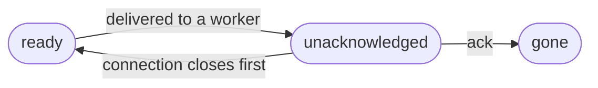

# 08 — Manual acknowledgements: what the ack really means

**Level:** Engineer  
**Episode:** Manual acknowledgements: what the ack really means  
**Language:** English  
**Code:** Java 21 · Maven · RabbitMQ Java client · Docker Compose  
**Requires:** [02 — RabbitMQ queues](../02-rabbitmq-queues/README.md)  
**Reading time:** about 15 minutes, plus the experiments

## YouTube

https://www.youtube.com/watch?v=JMp_GDqWSGg

This README is the **written version of the lesson**. It tells the same story as the video, with more room for the reasoning and for the code. You can read it before the video, after it, or instead of it. Everything it describes can be run on your machine with `./run.sh`.

> **The one sentence of this episode**
>
> **A delivery stays unacknowledged until the consumer answers, and RabbitMQ redelivers it if the consumer dies first.**

> **Learning-project disclaimer:** no email is sent. The worker "sends" an email with a pause (`--send-ms`) and a log line, and its crash is produced by the program halting its own JVM, which has the same effect on the broker as a killed process. The terminal demos in the video run this project against a real RabbitMQ. The code is illustrative, not production-ready (see [What this project does not cover](#what-this-project-does-not-cover)).

## Learning objectives

After this episode you should be able to:

- Define **acknowledgement**, **unacknowledged message** and **redelivery**.
- Explain why, in automatic mode, a worker that dies halfway through its job loses the message, and why the queue shows nothing wrong.
- Read `messages_ready`, `messages_unacknowledged` and `consumers` together, and predict how they change when a worker takes a message, acknowledges it or dies.
- Say where the acknowledgement goes in the worker, and why a correct worker can still send the same email twice.
- Read the code of the demo and say which line chooses the mode and which line acknowledges.

## Contents

1. [The problem: the email that never left](#the-problem-the-email-that-never-left)
2. [The vocabulary](#the-vocabulary)
3. [Experiment 1: automatic mode loses the message](#experiment-1-automatic-mode-loses-the-message)
4. [The three states of a message](#the-three-states-of-a-message)
5. [Experiment 2: manual mode brings it back](#experiment-2-manual-mode-brings-it-back)
6. [Experiment 3: the price, a duplicate](#experiment-3-the-price-a-duplicate)
7. [Where the ack goes](#where-the-ack-goes), [the rule](#the-rule)
8. [Read the code](#read-the-code)
9. [Try it yourself](#try-it-yourself), [where it fits](#where-it-fits), [summary](#summary) and [what this project does not cover](#what-this-project-does-not-cover)

| Video scene | Where it is in this README |
|---|---|
| Cold open, "The email that never left" | [The problem](#the-problem-the-email-that-never-left) |
| Demo 1 and its board | [Experiment 1](#experiment-1-automatic-mode-loses-the-message) |
| "Delivered is not done", the three terms, the three states | [The vocabulary](#the-vocabulary), [The three states of a message](#the-three-states-of-a-message) |
| Challenge: the worker dies before the ack, demo 2 and its board | [Experiment 2](#experiment-2-manual-mode-brings-it-back) |
| "Manual acknowledgement in the Java client" | [Read the code](#read-the-code) |
| Demo 3 and its board | [Experiment 3](#experiment-3-the-price-a-duplicate) |
| Challenge: where should the worker acknowledge? | [Where the ack goes](#where-the-ack-goes) |
| "Manual acknowledgement: when to use it" | [Where it fits](#where-it-fits) |
| Recap | [Summary](#summary) |

## The problem: the email that never left

An order is placed. The order service publishes one message, `evt_0001`, and the email worker takes it to send the confirmation. Halfway through the send, the worker dies.

You open the management page and look at the queue `notifications.email`:

```text
ready:     0
unacked:   0
consumers: 0
```

Nothing is wrong, according to the numbers. No message is waiting, none is stuck, and nobody is consuming. Yet the customer never got an email, and nothing anywhere says so.

Whether that can happen depends on one setting of the consumer. The experiment below makes it happen on your machine.

## The vocabulary

| Term | Meaning | In this project |
|---|---|---|
| **Acknowledgement (ack)** | The consumer's answer to the broker: "I am done with this delivery". It lets the broker discard the message. | `channel.basicAck(...)` in `EmailWorker` |
| **Unacknowledged message** | A message that was delivered to a consumer but not answered yet. The broker keeps it and counts it apart from the ready ones. | The `unacked` counter (`messages_unacknowledged`) |
| **Redelivery** | Delivering a message again, because the first delivery was never acknowledged and its connection closed. The message carries `redelivered = true`. | The `redelivered=` part of the worker's log line |

## Experiment 1: automatic mode loses the message

You need **Java 21**, **Maven** and **Docker** (with Docker Compose v2). Then:

```bash
./run.sh up
```

This starts RabbitMQ in a container and compiles the project. The management page is at <http://localhost:15672> (user `guest`, password `guest`; local use only). Open a second terminal and leave the counters running:

```bash
./run.sh watch
```

That prints three numbers twice a second: **ready** (waiting in the queue), **unacked** (delivered, not answered) and **consumers** (programs connected to take messages). In the video, this is the right-hand terminal.

> **About the output blocks below.** They show the *shape* of what the program prints. The timestamps (`12:00:00.043`) are illustrative: yours will differ. The counters and the order of the events are what matter.

**Predict first.** One message is in the queue. A worker in **automatic** mode takes it and starts sending the email, then dies halfway through. What do `ready` and `unacked` read while the worker is still sending? And after it died?

```bash
./run.sh experiment1
```

<details>
<summary>The commands behind it</summary>

```bash
mvn -q exec:java -Dexec.args="publish --count 1"                                                                # one ready message
mvn -q exec:java -Dexec.args="work --mode auto --name email-worker-1 --crash while-sending --send-ms 8000"    # takes it, then halts halfway through the send
```

</details>

**Step 1: publish.** The order service publishes `evt_0001` and exits. The counters read `ready 1`, `unacked 0`, `consumers 0`:

```text
12:00:05.101 [order-service] published evt_0001 (ord_1001)
```

**Step 2: the worker takes it.** In automatic mode the worker tells RabbitMQ not to wait for an answer. It receives the message and starts sending the email, which takes eight seconds in this experiment:

```text
12:00:07.015 [email-worker-1] received evt_0001 (ord_1001), redelivered=false
12:00:07.016 [email-worker-1] sending the email for ord_1001 (takes 8000 ms)
```

Look at the counters while it sends: `ready 0`, `unacked 0`, `consumers 1`. The message left the queue, and the email has not gone out yet.

**Step 3: the worker dies.** Halfway through the send the program halts its JVM: no acknowledgement, no clean shutdown.

```text
12:00:11.018 [email-worker-1] crashing halfway through the email: the JVM halts now, with no clean shutdown
```

The counters read `ready 0`, `unacked 0`, `consumers 0`. The queue is empty and nothing will be redelivered. The email was never sent.

**Why.** In automatic mode RabbitMQ considers a message delivered, and therefore done, the moment it sends it. The documentation says that if the connection closes before the message is processed, it is lost, and it advises treating automatic mode as unsafe for messages you cannot lose. **Delivered is not the same as handled**, and that belief is exactly what failed here.

## The three states of a message

In manual mode a message has one more state than you saw above:



A published message is **ready**: waiting in the queue. When RabbitMQ delivers it to a worker it becomes **unacknowledged**: delivered, but not answered. RabbitMQ keeps it. When the work is done the worker sends the **acknowledgement**, and only then does RabbitMQ remove the message. If the connection closes before the answer, RabbitMQ puts the message back as ready and delivers it again: a **redelivery**.

Automatic mode skips the middle state. The message goes from ready straight to gone, at the moment of delivery.

## Experiment 2: manual mode brings it back

**Predict first.** The same crash, one change: the workers now run in **manual** mode. Worker one takes the message and dies halfway through the send, with no ack. A moment later, what does the queue show? Choose before you read on:

- **A.** `ready 0`, `unacked 0`: the message is gone for good.
- **B.** `unacked 1`: still held until someone restarts the worker.
- **C.** `ready 1`: waiting to be delivered again.

```bash
./run.sh experiment2
```

<details>
<summary>The commands behind it</summary>

```bash
mvn -q exec:java -Dexec.args="publish --count 1"                                                              # one ready message
mvn -q exec:java -Dexec.args="work --mode manual --name email-worker-1 --crash while-sending --send-ms 8000" # holds it, halts halfway through the send
mvn -q exec:java -Dexec.args="work --mode manual --name email-worker-2 --send-ms 3000 --limit 1"             # takes it again, sends, acknowledges
```

</details>

**Step 1.** After the publish, `ready 1`, `unacked 0`.

**Step 2: worker one holds the message.** It receives it and starts sending. The counters read `ready 0`, `unacked 1`, `consumers 1`: the message is not waiting any more, and it is not gone. RabbitMQ keeps it until the answer comes.

**Step 3: worker one dies.** The connection closes with the message unacknowledged. The counters read `ready 1`, `unacked 0`, `consumers 0`. The answer is **C**: A is what automatic mode does, and B is wrong because RabbitMQ requeues an unacknowledged delivery as soon as the connection it was delivered on closes.

**Step 4: worker two takes it again.** Look at the flag in its log:

```text
12:00:30.040 [email-worker-2] received evt_0001 (ord_1001), redelivered=true
12:00:30.041 [email-worker-2] sending the email for ord_1001 (takes 3000 ms)
12:00:33.043 [email-worker-2] email sent for ord_1001
12:00:33.045 [email-worker-2] acknowledged evt_0001
```

`redelivered=true` is set by RabbitMQ: this message was delivered before. It can go to a different consumer than the first time, as it did here.

**Step 5: the queue is empty.** After the acknowledgement, `ready 0`, `unacked 0`. This time the message left the queue only after the work was done.

**Why.** The message stayed unacknowledged until the worker answered, and the worker died first, so RabbitMQ redelivered it. Nothing was lost, and nobody had to notice anything.

## Experiment 3: the price, a duplicate

In experiment 2 the worker died in the middle of the send, so the customer got one email, from worker two. Now the crash moves: the email goes out completely, and the worker dies a moment later, *before* the acknowledgement.

**Predict first.** Same broker, same rule, a different moment. How many emails will the customer get? Count them in the logs.

```bash
./run.sh experiment3
```

<details>
<summary>The commands behind it</summary>

```bash
mvn -q exec:java -Dexec.args="publish --count 1"
mvn -q exec:java -Dexec.args="work --mode manual --name email-worker-1 --crash after-send --send-ms 3000"          # sends the email, halts before the ack
mvn -q exec:java -Dexec.args="work --mode manual --name email-worker-2 --send-ms 3000 --limit 1"                   # takes it again, sends again
```

</details>

Worker one logs `email sent for ord_1001` and halts. The broker only knows that no acknowledgement came and the connection closed, so the message is back as ready. Worker two receives it with `redelivered=true` and does the whole job again. The experiment ends by counting the lines:

```text
Emails sent for ord_1001: 2
```

**Why.** An acknowledgement is the worker's *claim* that the job is done. A missing acknowledgement does not prove that the work was not done, and the broker cannot tell the difference between "died before sending" and "died after sending". It plays safe and delivers again. That is what *at least once* means: the message is not lost with the consumer, but it can arrive more than once. The rule does not promise that the work happens only once.

## Where the ack goes

The worker calls the email client, which may throw an exception. Where should the `basicAck` go?

| Placement | What a crash or a failure does |
|---|---|
| Before the send | A crash during the send loses the email: the broker already discarded the message. That is automatic mode in disguise. |
| **Right after the send returns without an exception** | A crash before the ack means a redelivery and possibly a duplicate. Nothing is lost. |
| In a `finally` block | A failed send is acknowledged too, so the job is thrown away. |

The ack goes **after the work succeeded**, never before it and never in a `finally` block. What the worker should do when the send throws is the subject of the next episode.

## The rule

> **A delivery stays unacknowledged until the consumer answers, and RabbitMQ redelivers it if the consumer dies first.**

What it promises, and what it does not:

- It promises that a message is **not lost with the consumer**.
- It does **not** promise that the work happens only once: a crash after the work and before the ack gives a duplicate.
- It says nothing about *your* code being safe to run twice. That is yours to make true.

## Read the code

The project is small: about 450 lines in 12 files, and the whole lesson lives in four places. This is the path one experiment follows.

| File | Role |
|---|---|
| `App` | Entry point: reads the command (`setup`, `publish`, `work`, `reset`) and its options |
| `Publisher` | **The order service.** Publishes `--count` messages, `evt_0001`…, and exits. Unchanged from episode 2 |
| `EmailWorker` | **The email worker.** Takes one message at a time, "sends" the email, and acknowledges or not, depending on the mode |
| `AckMode`, `CrashPoint` | The two switches of the demos: automatic or manual, and where the worker dies |
| `Topology`, `Setup` | The one queue `notifications.email`, and the connection settings |
| `OrderEvent`, `EventJson` | The message: an `order.created` event, and its JSON form |
| `Args`, `Log` | Small supporting pieces; you can skip them |

### 1. The commands

<!-- snippet: src/main/java/com/fromdevtodev/rabbitmq/manualack/App.java#commands -->
```java
switch (args[0]) {
    case "setup" -> Setup.run();
    case "publish" -> Publisher.publish(options.number("count", 1), options.number("first", 1));
    case "work" -> EmailWorker.run(
            options.text("name", "email-worker"),
            AckMode.parse(options.text("mode", "manual")),
            CrashPoint.parse(options.text("crash", "none")),
            options.number("send-ms", 3_000),
            options.number("limit", 0));
    case "reset" -> Topology.reset();
```
<!-- /snippet -->

`work` is the new command. `--mode` chooses automatic or manual acknowledgement, and `--crash` chooses where the worker dies: `none`, `while-sending` or `after-send`. The two options are everything the three experiments change.

### 2. The switch: one argument

<!-- snippet: src/main/java/com/fromdevtodev/rabbitmq/manualack/EmailWorker.java#consume -->
```java
channel.basicQos(1);
channel.basicConsume(Topology.QUEUE, mode.autoAck(), onMessage, consumerTag -> stopped.countDown());
```
<!-- /snippet -->

The second argument of `basicConsume` is `autoAck`. In automatic mode it is `true`, and RabbitMQ forgets the message when it sends it. In manual mode it is `false`, and RabbitMQ waits for an answer on every delivery. That boolean is the whole difference between experiment 1 and experiment 2.

> **Ignore this for now.** `channel.basicQos(1)` makes the worker take one message at a time (*prefetch*, episode 10). It is only here so the counters are easy to read.

### 3. The work, then the ack

<!-- snippet: src/main/java/com/fromdevtodev/rabbitmq/manualack/EmailWorker.java#handle -->
```java
DeliverCallback onMessage = (consumerTag, delivery) -> {
    OrderEvent event = EventJson.fromBytes(delivery.getBody());
    Log.info(name, "received " + event.eventId() + " (" + event.orderId() + "), redelivered="
            + delivery.getEnvelope().isRedeliver());
    sendEmail(name, event, crash, sendMillis);
    if (crash == CrashPoint.AFTER_SEND) {
        halt(name, "after the email was sent, before the ack");
    }
    if (mode == AckMode.MANUAL) {
        channel.basicAck(delivery.getEnvelope().getDeliveryTag(), false);
        Log.info(name, "acknowledged " + event.eventId());
    }
    if (limit > 0 && handled.incrementAndGet() >= limit) {
        stopped.countDown();
    }
};
```
<!-- /snippet -->

When a message is delivered the callback logs it, with the `redelivered` flag RabbitMQ set, and sends the email. Only then, in manual mode, does it call `basicAck` with the delivery number RabbitMQ gave **this delivery on this channel**. That number is not the identity of the message: the message's identity is its event ID, `evt_0001`. Acknowledging a delivery number on another channel is a channel error.

The order of the lines is the lesson: the work comes first and the ack second. In demo 3, `halt` sits between them.

> **Not explained here.** Publisher confirms (did the broker take my message?) are a different mechanism, with their own episode. They do not replace acknowledgements, and acknowledgements do not replace them.

### 4. The crash

<!-- snippet: src/main/java/com/fromdevtodev/rabbitmq/manualack/EmailWorker.java#halt -->
```java
/** What a killed process looks like to the broker: no ack, no channel.close(), no connection.close(). */
private static void halt(String name, String where) {
    Log.info(name, "crashing " + where + ": the JVM halts now, with no clean shutdown");
    System.out.flush();
    Runtime.getRuntime().halt(1);
}
```
<!-- /snippet -->

`Runtime.halt` ends the JVM at once: no `channel.close()`, no `connection.close()`, no shutdown hooks. The operating system closes the sockets of a halted process, so the broker sees the connection drop, which is what it sees when a worker is killed. This is how the demos produce a crash on demand.

### 5. The test: how you know the switch is wired right

<!-- snippet: src/test/java/com/fromdevtodev/rabbitmq/manualack/ManualAckTest.java#test -->
```java
@Test
void automaticModeAsksTheBrokerToForgetAtDelivery() {
    assertTrue(AckMode.parse("auto").autoAck());
    assertFalse(AckMode.parse("manual").autoAck());
    assertSame(AckMode.AUTO, AckMode.parse("automatic"));
}
```
<!-- /snippet -->

The tests need no RabbitMQ: they cover the pieces that do not talk to the broker. This one fixes the link between the option and the flag: `auto` becomes `autoAck = true`, and `manual` becomes `false`. Run all of them with:

```bash
./run.sh test
```

## Try it yourself

Each exercise has a prediction first. Write your answer down, then run it, then open the answer. All of them start from an empty queue (`./run.sh reset`, then `./run.sh app setup`).

**1. A worker that never answers.** Manual mode, a worker that is connected but takes ten minutes to "send", and no crash:

```bash
./run.sh app publish --count 1
./run.sh app work --mode manual --send-ms 600000
```

What do the counters read a few seconds later? Then press Ctrl+C in the worker's terminal. What do they read now?

<details>
<summary>Answer</summary>

First `ready 0`, `unacked 1`, `consumers 1`: the message is delivered, nobody answered, and a connected worker never gives it back. Nothing finishes it. After Ctrl+C the connection closes, and the message is requeued: `ready 1`, `unacked 0`, `consumers 0`. This is derived from the rule, not measured on a long run.

</details>

**2. Where does the ack go?** A worker acknowledges *before* sending the email. It dies during the send. What does the queue show afterwards, and was the email sent?

<details>
<summary>Answer</summary>

`ready 0`, `unacked 0`, and no email. The acknowledgement already told the broker the job was done, so the message was discarded. Manual mode with the ack first behaves like automatic mode.

</details>

**3. Count the emails.** In experiment 2 the customer got one email. In experiment 3 they got two. What would they get if worker one died *after* the ack, with the email already sent?

<details>
<summary>Answer</summary>

One. The acknowledgement was delivered, the broker discarded the message, and nobody redelivers it. The duplicate in experiment 3 exists only because the crash fell between the work and the ack.

</details>

**4. The exception.** The email client throws an exception for one order. The worker catches it, logs it and does nothing else. What happens to that message while the worker stays connected?

<details>
<summary>Answer</summary>

It stays unacknowledged: delivered, not answered, and held by the broker. It is not requeued, because the connection did not close, and it is not acknowledged, because the worker never called `basicAck`. Telling the broker "this one failed" is the next episode.

</details>

## Where it fits

**Use manual acknowledgement when:**

- losing a message would cost money or trust, like the confirmation email;
- the work can fail halfway, and a duplicate is acceptable or can be made harmless, because you will sometimes get one.

**Do not use it when:**

- the data is a live value where the next message replaces a lost one, like a ticker or a gauge;
- it is fire-and-forget data where nothing breaks if some of it is never processed: automatic mode is simpler and faster.

## Things that surprise people

- **Delivered is not done.** "RabbitMQ delivered it" only means the broker sent it to a consumer's connection.
- **`redelivered` is a hint.** `redelivered=true` is reliable evidence of a second delivery. `redelivered=false` proves nothing: a message that an application republished looks like a first delivery.
- **The delivery number is not an identity.** It counts deliveries on one channel. Use the event ID to recognise a message.
- **An ack proves nothing about the work.** It is the consumer's claim, and a missing ack does not prove the work was not done.
- **Troubleshooting.**
  - *Connection refused when you run the program:* RabbitMQ is not up yet. Run `./run.sh up` and wait for it to finish.
  - *Port 5672 or 15672 already in use:* another RabbitMQ owns it, for example the one of another episode. Run `./run.sh down` in that episode's folder, or change the ports in `docker-compose.yml` and set `RABBITMQ_PORT` for the program.
  - *A worker ends without a message and Maven reports a failure:* that is the crash. The program halted its own JVM on purpose, and `./run.sh` expects it.
  - *`unknown flag: --wait`:* your Docker Compose is older than v2.1. Use `docker compose up -d`, wait ten seconds, then `./run.sh app setup`.

## Summary

1. In automatic mode, delivered counts as done at once, so a crash loses the message.
2. In manual mode the message stays unacknowledged until the consumer answers, and if the connection closes first, RabbitMQ redelivers it.
3. The ack goes after the work succeeded, never before it and never in a `finally` block. The price is that a message can arrive twice.

**Next:** 09 — Nack and requeue: what a worker does when the work fails, and why a bad message loops forever.

## What this project does not cover

- Telling the broker that a job failed (`basicNack`, `basicReject`) and requeueing from the consumer: episode 9.
- Prefetch and how many unacknowledged deliveries a consumer may hold: episode 10. The worker's `basicQos(1)` only keeps one message in flight.
- Publisher confirms: a different mechanism, with its own episode.
- Durability, queue types, quorum-queue redelivery limits and dead-lettering.
- Making the work safe to repeat (idempotent consumers), acknowledging several deliveries at once, and the consumer acknowledgement timeout.
