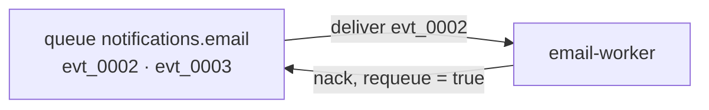

# 09 — Nack and requeue: how one bad message loops forever

**Level:** Engineer  
**Episode:** Nack and requeue: how one bad message loops forever  
**Language:** English  
**Code:** Java 21 · Maven · RabbitMQ Java client · Docker Compose  
**Requires:** [08 — Manual acknowledgements](../08-rabbitmq-manual-ack/README.md)  
**Reading time:** about 14 minutes, plus the experiments

## YouTube

The video link will be added here when the episode is published.

This README is the **written version of the lesson**. It tells the same story as the video, with more room for the reasoning and for the code. You can read it before the video, after it, or instead of it. Everything it describes can be run on your machine with `./run.sh`.

> **The one sentence of this episode**
>
> **Requeue puts a rejected message straight back, so a message that always fails is delivered again and again.**

> **Learning-project disclaimer:** no email is ever sent. The "email worker" pauses and writes a log line, so that you can watch what RabbitMQ does with the answers it gets. The terminal demos in the video run this project against a real RabbitMQ. The code is illustrative, not production-ready (see [What this project does not cover](#what-this-project-does-not-cover)).

## Learning objectives

After this episode you should be able to:

- Define **nack**, **requeue** and **poison message**.
- Explain why a message nacked with `requeue = true` can come back forever, and why the messages behind it wait.
- Choose between `requeue = true` and `requeue = false` for a failing message, by asking whether the failure will pass by itself.
- Recognise a poison-message loop in a worker's log.
- Say what `requeue = false` costs when nothing is configured to keep the message.
- Read the code of the demos and say which call sends the nack, which argument is `requeue`, and where the worker decides.

## Contents

1. [The problem: the order with no email address](#the-problem-the-order-with-no-email-address)
2. [The vocabulary](#the-vocabulary)
3. [Experiment 1: the loop](#experiment-1-the-loop)
4. [Experiment 2: the same orders, requeue false](#experiment-2-the-same-orders-requeue-false)
5. [Choosing](#choosing)
6. [The rule](#the-rule)
7. [Read the code](#read-the-code)
8. [Try it yourself](#try-it-yourself), [where it fits](#where-it-fits), [things that surprise people](#things-that-surprise-people), [summary](#summary) and [what this project does not cover](#what-this-project-does-not-cover)

| Video scene | Where it is in this README |
|---|---|
| Cold open, "The same order, again and again" | [The problem](#the-problem-the-order-with-no-email-address) |
| "Requeue puts it straight back", recap, "When the work cannot be done" | [The vocabulary](#the-vocabulary) |
| "The worker answers every delivery", challenge "What happens to the good order?" | [Read the code](#read-the-code), [Experiment 1](#experiment-1-the-loop) |
| Board and demo "A message that always fails" | [Experiment 1](#experiment-1-the-loop) |
| "Why it never ends", "Three signs of a poison loop" | [The vocabulary](#the-vocabulary), [Experiment 1](#experiment-1-the-loop) |
| "The same nack, two answers", board and demo "The same orders, with requeue false" | [Experiment 2](#experiment-2-the-same-orders-requeue-false) |
| "Will the failure pass by itself?", "One answer for each kind of failure" | [Choosing](#choosing) |
| "Requeue is not a retry later" | [Things that surprise people](#things-that-surprise-people) |
| Challenge "A payload that can never be parsed", "Requeue: when it fits" | [Try it yourself](#try-it-yourself), [Where it fits](#where-it-fits) |
| Recap | [Summary](#summary) |

## The problem: the order with no email address

The queue `notifications.email` holds three orders. The email worker takes one message at a time:

- `evt_0001` (`ord_1041`) is a good order.
- `evt_0002` (`ord_1042`) has **no email address**. No attempt will ever send its email.
- `evt_0003` (`ord_1043`) is a good order, behind it.

The worker sends the first email and acknowledges it. It cannot send the second, so it answers RabbitMQ with a *nack* and asks for the message to be put back. RabbitMQ does exactly that, and delivers it again. The worker fails again, asks again, and the log fills with the same line while the CPU stays busy. `evt_0003`, a perfectly good order, never gets its email.



Nothing here is a RabbitMQ bug. It is what one argument does.

## The vocabulary

Three new terms, each tied to the project:

- **Nack** (negative acknowledgement): the consumer's answer that a delivery was **not** processed. In the Java client it is `basicNack`. The previous episode's `basicAck` is the opposite answer. (`basicNack` is a RabbitMQ extension of AMQP 0-9-1, which has `basic.reject` for one message; the nack can also cover many deliveries with its `multiple` flag, which this project never uses.) Code: `EmailWorker`.
- **Requeue**: the last argument of a nack. `true` asks RabbitMQ to put the message back in the queue, in its **original position** if it can. `false` asks it to discard the message, or to dead-letter it if the queue is set up for that. Code: `Rules.requeue` and the nack call in `EmailWorker`.
- **Poison message**: a message that fails every time it is delivered, so that trying it again can never fix it. The order with no email address is one. Code: `OrderEvent.hasEmailAddress` and `Rules.check`.

The redelivered flag is a related detail. When a message is delivered again, RabbitMQ sets a flag on the delivery. It is a **hint** that the message may have been delivered before: it is a yes or a no, **not a count**. The attempt number in this project's log comes from the worker (`Attempts`), not from the broker.

## Experiment 1: the loop

**Predict first.** The worker nacks `evt_0002` with `requeue = true`, every time. After the first nack, where is `evt_0002`? And where is `evt_0003`? Write down what you expect the worker's log to show before you run anything. (If you want to check your reasoning without a broker, `./run.sh app explain` prints what the rules answer. It is the decision written as code, not a measurement.)

```bash
./run.sh up           # RabbitMQ in Docker
./run.sh experiment1  # the whole experiment, step by step
```

<details>
<summary>The raw commands behind <code>./run.sh experiment1</code></summary>

```bash
./run.sh app setup                                          # the exchange orders, the queue notifications.email, the binding
./run.sh counters                                           # empty, no consumer
./run.sh app publish --first 1 --count 3 --bad 2            # evt_0001, evt_0002 (no email address), evt_0003
./run.sh app work --on-invalid requeue --work-ms 700 --max-deliveries 8
./run.sh counters
```

</details>

What to look for in the worker's log. The lines below are written from the log format of `EmailWorker`, with illustrative timestamps: run the experiment to see your own.

```text
[email-worker] received evt_0001 (ord_1041), attempt 1, redelivered=false
[email-worker] sent the email for ord_1041 and acknowledged evt_0001
[email-worker] received evt_0002 (ord_1042), attempt 1, redelivered=false
[email-worker] the order has no email address: nack evt_0002, requeue=true
[email-worker] received evt_0002 (ord_1042), attempt 2, redelivered=true
[email-worker] the order has no email address: nack evt_0002, requeue=true
...
```

The worker stops itself after eight deliveries, so the experiment ends: one for `evt_0001` and seven for `evt_0002`. The count of eight is arithmetic from `--max-deliveries 8`, not a measurement of how long a loop lasts: left alone, this one never ends.

**Why.**

- With one worker taking one message at a time, `evt_0002` is the message in hand. A nack with `requeue = true` returns it to its original position, which is **in front of** `evt_0003`. The next delivery is `evt_0002` again.
- `evt_0003` is never delivered while the loop runs. There is no line for it in the log.
- Nothing waits between attempts. The pace is the worker's own (`--work-ms`), and the attempt number is the worker's own counter.
- When the worker stops, its unacknowledged message goes back to the queue: `./run.sh counters` shows two ready messages, `evt_0002` at the front.

**Verdict.** The loop is not a malfunction. It is requeue doing what it says, on a message that can never succeed. Three signs to recognise it: the same event ID repeating in the log, `redelivered=true` on every attempt after the first, and the messages behind it never getting delivered.

## Experiment 2: the same orders, requeue false

**Predict first.** The only change is one argument: the worker nacks the invalid order with `requeue = false`. Is `evt_0003` delivered this time? Is `evt_0002` still in the queue afterwards?

```bash
./run.sh experiment2
```

<details>
<summary>The raw commands behind <code>./run.sh experiment2</code></summary>

```bash
./run.sh app setup
./run.sh app publish --first 1 --count 3 --bad 2
./run.sh app work --on-invalid discard --work-ms 300 --max-deliveries 3
./run.sh counters
```

</details>

What the experiment checks, step by step (the counters of `notifications.email`):

| After | ready | unacked |
|---|---|---|
| start | 0 | 0 |
| the three orders are published | 3 | 0 |
| the worker handled three deliveries and stopped | 0 | 0 |

The log shows `evt_0001` acknowledged, `evt_0002` received **once** and nacked with `requeue=false`, and `evt_0003` acknowledged.

**Why.**

- With `requeue = false`, RabbitMQ does not put the message back, so the worker moves on to `evt_0003`.
- No dead-letter exchange and no policy are configured in this project (`Topology`), so nothing keeps `evt_0002`: it is **discarded**. The queue moves, and the evidence is gone.

**Verdict.** The loop is gone, and so is the message. Keeping a rejected message somewhere is the job of a dead-letter exchange, which has its own episode.

## Choosing

Ask one question about the failure: **will it pass by itself?**

| The failure | Example | The nack |
|---|---|---|
| It may pass | the mail server is down for a moment | `requeue = true`, knowing that requeue does **not** wait |
| It will not pass | the order has no email address | `requeue = false` |
| It will not pass, and you need the message | a payload cut off, to inspect later | `requeue = false`, with something that keeps it (dead-letter exchanges, a later episode) |

## The rule

> **Requeue puts a rejected message straight back, so a message that always fails is delivered again and again.**

What the sentence does **not** promise: that the message waits, that it goes to the back of the line, that RabbitMQ counts the attempts, or that anything ends the loop. On a classic queue nothing does.

## Read the code

Small supporting pieces (argument parsing, logging, JSON) you can skip: `Args`, `Log`, `EventJson`.

| File | Role |
|---|---|
| `App` | the entry point: `setup`, `publish`, `work`, `explain`, `reset` |
| `Topology` | declares the exchange `orders`, the classic queue `notifications.email` and the binding |
| `Setup` | the starting point of both experiments |
| `Publisher` | the producer, `order-service`: publishes the orders |
| `OrderEvent` | the message: an event ID, an order ID and an email address that may be missing |
| `EmailWorker` | the consumer: takes one message at a time and answers with an ack or a nack |
| `Rules` | what the worker answers for each kind of failure, with no broker in it |
| `Attempts` | the worker's own count of how many times it received each message |
| `NackAndRequeueTest` | unit tests of the rules and the small pieces (no broker needed) |

The walkthrough follows the order in which an experiment runs.

**1. The entry point.** `App` reads the command and calls one class.

<!-- snippet: src/main/java/com/fromdevtodev/rabbitmq/nack/App.java#commands -->
```java
switch (args[0]) {
    case "setup" -> Setup.run();
    case "publish" -> Publisher.publish(
            options.number("first", 1),
            options.number("count", 3),
            numbers(options.text("bad", "2")));
    case "work" -> EmailWorker.run(
            options.text("name", "email-worker"),
            Rules.OnInvalid.valueOf(options.text("on-invalid", "requeue").toUpperCase()),
            options.number("work-ms", 700),
            options.number("max-deliveries", 0));
    case "explain" -> explain(options.text("failure", "invalid-order"), options.text("on-invalid", "requeue"));
    case "reset" -> Topology.reset();
```
<!-- /snippet -->

**2. The topology.** The queue is declared as a **classic** queue explicitly, so the demo does not depend on the default queue type of the broker you run it on. There is no dead-letter exchange.

<!-- snippet: src/main/java/com/fromdevtodev/rabbitmq/nack/Topology.java#topology -->
```java
static void declare(Channel channel) throws IOException {
    channel.exchangeDeclare(EXCHANGE, BuiltinExchangeType.DIRECT, true);
    channel.queueDeclare(QUEUE, true, false, false, Map.of("x-queue-type", "classic"));
    channel.queueBind(QUEUE, EXCHANGE, ROUTING_KEY);
}
```
<!-- /snippet -->

**3. The producer.** It publishes the orders and goes away. The events in `--bad` are published without an email address.

<!-- snippet: src/main/java/com/fromdevtodev/rabbitmq/nack/Publisher.java#publish -->
```java
static void publish(long first, long count, Set<Long> withoutEmail) throws IOException, TimeoutException {
    try (Connection connection = Topology.connect("order-service");
         Channel channel = connection.createChannel()) {
        Topology.declare(channel);
        for (long seq = first; seq < first + count; seq++) {
            OrderEvent event = OrderEvent.of(seq, withoutEmail.contains(seq));
            channel.basicPublish(Topology.EXCHANGE, Topology.ROUTING_KEY, properties(event), EventJson.toBytes(event));
            Log.info("order-service", "published " + event.eventId() + " (" + event.orderId() + ")"
                    + (event.hasEmailAddress() ? "" : ", without an email address"));
        }
    }
}
```
<!-- /snippet -->

**4. The consumer.** This is where the lesson lives: the answer to RabbitMQ. The line `basicNack(deliveryTag, false, requeue)` is the nack; its last argument is `requeue`.

> **Ignore these for now.** `channel.basicQos(1)` (one message at a time) is prefetch, episode 10. The acknowledgement mode (`basicConsume` with `false`) is episode 8.

<!-- snippet: src/main/java/com/fromdevtodev/rabbitmq/nack/EmailWorker.java#worker -->
```java
DeliverCallback onMessage = (consumerTag, delivery) -> {
    OrderEvent order = EventJson.fromBytes(delivery.getBody());
    long deliveryTag = delivery.getEnvelope().getDeliveryTag();
    int attempt = attempts.next(order.eventId());
    Log.info(name, "received " + order.eventId() + " (" + order.orderId() + "), attempt " + attempt
            + ", redelivered=" + delivery.getEnvelope().isRedeliver());
    sleep(workMillis);                                       // "sending the email"

    Rules.Failure failure = Rules.check(order);
    Rules.Outcome outcome = Rules.decide(failure, onInvalid);
    if (outcome == Rules.Outcome.ACK) {
        channel.basicAck(deliveryTag, false);
        Log.info(name, "sent the email for " + order.orderId() + " and acknowledged " + order.eventId());
    } else {
        boolean requeue = Rules.requeue(outcome);
        Log.info(name, failure.reason() + ": nack " + order.eventId() + ", requeue=" + requeue);
        channel.basicNack(deliveryTag, false, requeue);
    }
    if (maxDeliveries > 0 && deliveries.incrementAndGet() >= maxDeliveries) {
        stopped.countDown();
    }
};
channel.basicConsume(Topology.QUEUE, false, onMessage, consumerTag -> stopped.countDown());
```
<!-- /snippet -->

**5. The decision.** One answer per kind of failure, written so that you can read it and test it without a broker.

<!-- snippet: src/main/java/com/fromdevtodev/rabbitmq/nack/Rules.java#decide -->
```java
/** One answer per kind of failure. */
static Outcome decide(Failure failure, OnInvalid onInvalid) {
    return switch (failure) {
        case NONE -> Outcome.ACK;                                    // the work is done: acknowledge
        case INVALID_ORDER -> onInvalid == OnInvalid.REQUEUE
                ? Outcome.NACK_REQUEUE                               // the episode's loop: it fails the same way forever
                : Outcome.NACK_DISCARD;                              // permanent: do not put it back
        case MAIL_SERVER_DOWN -> Outcome.NACK_REQUEUE;               // transient: it may pass, but requeue does not wait
    };
}
```
<!-- /snippet -->

**6. The tests.** They pin the decision: the loop is a nack with requeue, the fix is a nack without it, and a transient failure is requeued whatever the setting.

<!-- snippet: src/test/java/com/fromdevtodev/rabbitmq/nack/NackAndRequeueTest.java#test -->
```java
@Test
void aValidOrderIsAcknowledged() {
    OrderEvent order = OrderEvent.of(1, false);
    assertEquals(Rules.Failure.NONE, Rules.check(order));
    assertEquals(Rules.Outcome.ACK, Rules.decide(Rules.check(order), Rules.OnInvalid.REQUEUE));
    assertEquals(Rules.Outcome.ACK, Rules.decide(Rules.check(order), Rules.OnInvalid.DISCARD));
}

@Test
void anOrderWithoutAnEmailAddressIsAPermanentFailure() {
    OrderEvent order = OrderEvent.of(2, true);
    assertFalse(order.hasEmailAddress());
    assertEquals(Rules.Failure.INVALID_ORDER, Rules.check(order));
}

@Test
void theLoopIsNackWithRequeueAndTheFixIsNackWithoutIt() {
    assertEquals(Rules.Outcome.NACK_REQUEUE, Rules.decide(Rules.Failure.INVALID_ORDER, Rules.OnInvalid.REQUEUE));
    assertEquals(Rules.Outcome.NACK_DISCARD, Rules.decide(Rules.Failure.INVALID_ORDER, Rules.OnInvalid.DISCARD));
    assertTrue(Rules.requeue(Rules.Outcome.NACK_REQUEUE));
    assertFalse(Rules.requeue(Rules.Outcome.NACK_DISCARD));
    assertFalse(Rules.requeue(Rules.Outcome.ACK));
}

@Test
void aTransientFailureIsRequeuedWhateverTheSetting() {
    assertEquals(Rules.Outcome.NACK_REQUEUE, Rules.decide(Rules.Failure.MAIL_SERVER_DOWN, Rules.OnInvalid.REQUEUE));
    assertEquals(Rules.Outcome.NACK_REQUEUE, Rules.decide(Rules.Failure.MAIL_SERVER_DOWN, Rules.OnInvalid.DISCARD));
}
```
<!-- /snippet -->

## Try it yourself

1. **Predict.** Run `./run.sh app work --on-invalid requeue --work-ms 200 --max-deliveries 8` on a fresh queue with three orders. How many lines say `received evt_0002`? <details><summary>Answer</summary>Seven: it is arithmetic. The first delivery is `evt_0001`, and every one of the other seven goes to `evt_0002`, which is always back in front.</details>
2. **Apply the rule.** A message body is cut off and can never be parsed. The queue must keep moving, and you want to look at the message later. What does the worker answer? <details><summary>Answer</summary>A nack with `requeue = false`, and a dead-letter exchange configured on the queue so that the message is kept. The nack alone only discards it. (Dead-letter exchanges are a later episode.)</details>
3. **Change the code.** In `Rules.decide`, make `INVALID_ORDER` return `NACK_REQUEUE` for the `DISCARD` setting too, and run `./run.sh test`. Which tests fail, and why? <details><summary>Answer</summary>`theLoopIsNackWithRequeueAndTheFixIsNackWithoutIt` fails: it asserts that the discard setting gives `NACK_DISCARD`.</details>
4. **Next failure mode.** The worker has to cope with a mail server that is down for ten minutes. With `requeue = true`, what does the log look like, and what is missing? <details><summary>Answer</summary>The same message again and again for ten minutes: requeue does not wait. What is missing is a delay between attempts and a limit on them, which are built with retries in a later episode. This is reasoning from the rule, not a measurement.</details>

## Where it fits

Use `requeue = true` when the failure will pass by itself and nothing behind the message is urgent. Use `requeue = false` for bad data, ideally with something that keeps the message. Requeue is the wrong tool when you expect a delay or a limit: it has neither.

## Things that surprise people

- **Requeue is not "try again later".** The message goes back in its original position, if RabbitMQ can, so a message that was first is first again. (With several consumers the position may end up closer to the head. This project has one.)
- **The redelivered flag is not a counter.** It says that the message may have been delivered before, not how many times. Count attempts yourself if you need to.
- **A nack with `requeue = false` loses the message** unless the queue is set up to dead-letter it. Nothing warns you.
- **Quorum queues are different.** RabbitMQ's documentation lists poison-message handling as a feature specific to quorum queues. This project uses a classic queue, and quorum queues are a later episode.
- **Port already in use?** Another episode's RabbitMQ is still running: run `./run.sh down` in that episode's folder first.

## Summary

- A nack with `requeue = true` puts the message straight back, in its original position, with no delay and no count.
- A message that always fails is a poison message: it comes back again and again, and the messages behind it wait.
- `requeue = false` stops the loop, and discards the message unless something is set up to keep it.

**Next episode:** [10 — Prefetch](../10-rabbitmq-prefetch/README.md), how many messages a consumer can hold at once.

## What this project does not cover

- Dead-letter exchanges (how to keep a rejected message), delays and bounded retries: later episodes.
- Prefetch beyond the single phrase "one message at a time", and how requeue behaves with several consumers.
- The `multiple` flag of acknowledgements, and `basic.reject`.
- Quorum queues and their delivery limit.
- Publisher confirms, persistence guarantees and idempotent consumers.
- Anything about production use: the "email" is a pause and a log line.
