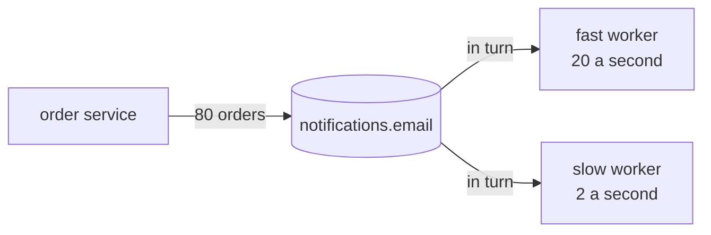

# 10 — RabbitMQ prefetch: stop a slow consumer from hoarding messages

**Level:** Engineer  
**Episode:** Prefetch: stop a slow consumer from hoarding messages  
**Language:** English  
**Code:** Java 21 · Maven · RabbitMQ Java client · Docker Compose  
**Requires:** [08 — Manual acknowledgements](../08-rabbitmq-manual-ack/README.md)  
**Reading time:** about 14 minutes, plus the experiments

This README is the **written version of the lesson**. It tells the same story as the video, with more room for the reasoning and for the code. Everything it describes can be run on your machine with `./run.sh`.

> **The one sentence of this episode**
>
> **Prefetch caps how many unacknowledged messages RabbitMQ gives a consumer at once.**

> **Learning-project disclaimer:** no email is sent. A worker "handles" a message with a pause (`--delay-ms`) and a log line, so the speeds below are set by the code, not by a real provider. The code is illustrative, not production-ready (see [What this project does not cover](#what-this-project-does-not-cover)).

## Learning objectives

After this episode you should be able to:

- Define **prefetch**, **in-flight message** and **fair dispatch**.
- Read `ready` and `unacknowledged` for a queue and say where the work really is.
- Predict how many messages a consumer can hold, and how orders split between a fast and a slow consumer.
- Choose a prefetch for a workload, and say what a number that is too small or too big costs.
- Read the code of the demo and say which line sets the prefetch.

## Contents

1. [The problem: ready 0, customers still waiting](#the-problem-ready-0-customers-still-waiting)
2. [The vocabulary](#the-vocabulary)
3. [Experiment 1: no limit](#experiment-1-no-limit)
4. [Experiment 2: prefetch 1](#experiment-2-prefetch-1)
5. [Experiment 3: the price of a big prefetch](#experiment-3-the-price-of-a-big-prefetch)
6. [The rule](#the-rule)
7. [Read the code](#read-the-code)
8. [Try it yourself](#try-it-yourself)
9. [Where it fits, and when not to use it](#where-it-fits-and-when-not-to-use-it)
10. [What this project does not cover](#what-this-project-does-not-cover)

| Video scene | README section |
|---|---|
| The question, briefing and run 1 | The problem, Experiment 1 |
| The rule, challenge | The vocabulary, The rule |
| Run 2 and the numbers | Experiment 2 |
| The code | Read the code |
| Run 3 and the limits | Experiment 3 |
| Challenge, trade-offs, recap | The rule, Where it fits |

## The problem: ready 0, customers still waiting

Eighty orders arrive at once. Two workers send the confirmation emails, one fast (20 messages a second) and one slow (2 a second). A few seconds later the queue says `ready 0`. Yet customers are still waiting.

The belief behind the surprise: *RabbitMQ sends each message to whichever consumer is free.* It does not. With no limit it deals messages out **in turn**, busy or not. A **prefetch** turns the count of unacknowledged messages into a rule: a consumer at its limit is skipped until it acknowledges one.



## The vocabulary

- **Prefetch** — the number of unacknowledged messages RabbitMQ may give one consumer at once. `0` means no limit. In the project it is the argument of `channel.basicQos(...)` in `Worker`.
- **In-flight message** — a message RabbitMQ has delivered and the consumer has not yet acknowledged. It is the *unacknowledged message* of episode 8 seen from the consumer's side; `unacked` in the counters.
- **Fair dispatch** — the name the RabbitMQ work queues tutorial gives to the effect of a small prefetch: a worker gets a new message only after it acknowledged the last one.

Prefetch only matters with manual acknowledgements (episode 8). With automatic acknowledgements nothing stays unacknowledged, so there is nothing to cap.

## Experiment 1: no limit

First, the way to read the queue. In a second terminal run:

```bash
./run.sh watch
```

It prints the queue's counters twice a second: **ready** (waiting in the queue), **unacked** (delivered, not answered: in flight) and **consumers** (programs connected to take messages). In the video, this is the right-hand terminal.

> **About the output blocks below.** They show the *shape* of what the program prints. The timestamps (`12:00:07.015`) and the figures are illustrative: yours will differ. What matters is the order of the events and which counter is high or zero.

**Predict first:** when `ready` reaches zero, who is holding the orders, and who is idle?

```bash
./run.sh up
./run.sh hoarding
```

<details>
<summary>The commands behind it (one terminal each)</summary>

```bash
./run.sh app work --name fast --delay-ms 50  --prefetch 0     # terminal 1: the fast worker
./run.sh app work --name slow --delay-ms 500 --prefetch 0     # terminal 2: the slow worker
./run.sh app publish --count 80                               # terminal 3: the order service
./run.sh watch                                                # terminal 4: the counters
```

</details>

**Step 1: the two workers join.** Each one connects with prefetch 0, which means no limit. The counters read `ready 0`, `unacked 0`, `consumers 2`:

```text
12:00:03.691 [fast] waiting for messages on 'notifications.email' (prefetch 0 = no limit, Ctrl+C to stop)
12:00:03.702 [slow] waiting for messages on 'notifications.email' (prefetch 0 = no limit, Ctrl+C to stop)
```

**Step 2: the order service publishes 80 orders at once** and exits:

```text
12:00:07.101 [order-service] published evt_0001 (ord_1001)
12:00:07.102 [order-service] published evt_0002 (ord_1002)
...
12:00:07.140 [order-service] published evt_0080 (ord_1080)
```

**Step 3: look at the counters.** Almost at once `ready` is 0, but `unacked` is high: RabbitMQ has already dealt the orders out, in turn, to both workers. The fast worker handles its share in moments and goes idle. The slow worker works through its pile, one message at a time:

```text
queue                  ready  unacked  consumers
notifications.email        0       38          2
```

In the worker logs each message has two lines, one when it is taken and one when it is done:

```text
12:00:07.115 [fast] received evt_0001 (ord_1001), message 1 for this worker
12:00:07.166 [fast] handled evt_0001
12:00:07.119 [slow] received evt_0002 (ord_1002), message 1 for this worker
12:00:07.620 [slow] handled evt_0002
```

**Step 4: the end.** Only when the slow worker acknowledges its last order do both counters reach zero. `./run.sh hoarding` ends by printing how many orders each worker handled; the two numbers add up to 80:

```text
== 3/3  How the 80 orders were split (the queue took about 21 s to drain)
fast handled 40
slow handled 40
```

**Why:** with prefetch 0 there is no cap on in-flight messages, so RabbitMQ dealt the orders out in turn, without asking who was busy. The orders the slow worker holds are not in the queue any more, so no other worker can take them. `ready 0` did not mean the work was done.

**Verdict:** the work is in the `unacked` count, not in `ready`.

## Experiment 2: prefetch 1

**Predict first:** how high can `unacked` go with two workers and a prefetch of 1, and who takes most of the orders?

```bash
./run.sh fair-dispatch
```

<details>
<summary>The commands behind it (one terminal each)</summary>

```bash
./run.sh app work --name fast --delay-ms 50  --prefetch 1     # terminal 1
./run.sh app work --name slow --delay-ms 500 --prefetch 1     # terminal 2
./run.sh app publish --count 80                               # terminal 3
./run.sh watch                                                # terminal 4
```

</details>

**Step 1: the workers join with prefetch 1.** Same counters as before: `ready 0`, `unacked 0`, `consumers 2`:

```text
12:10:03.691 [fast] waiting for messages on 'notifications.email' (prefetch 1, Ctrl+C to stop)
12:10:03.702 [slow] waiting for messages on 'notifications.email' (prefetch 1, Ctrl+C to stop)
```

**Step 2: the same 80 orders are published.** The output is the same as in experiment 1.

**Step 3: look at the counters** (illustrative figures again). `ready` falls steadily and `unacked` never goes above 2: one message for each worker at most. No pile forms anywhere:

```text
queue                  ready  unacked  consumers
notifications.email       31        2          2
```

**Step 4: the split** (illustrative figures: only the shape matters). The fast worker comes back for the next order sooner, so it takes most of them. The slow worker only ever holds one at a time. The queue empties in a few seconds:

```text
== 3/3  How the 80 orders were split (the queue took about 4 s to drain)
fast handled 71
slow handled 9
```

**Why:** the prefetch applies to each consumer separately, so in flight can never exceed *prefetch × consumers*, here 1 × 2 = 2 (that is arithmetic, not a measurement). A worker holding its one message is skipped, so the next order goes to a worker with room.

**Verdict:** the same workers and orders, one number changed, and nobody hoards.

## Experiment 3: the price of a big prefetch

**Predict first:** a slow worker with prefetch 10 holds ten of twenty orders and works on one. It crashes. What do the counters say?

One command runs the whole experiment:

```bash
./run.sh pile-returns
```

<details>
<summary>The commands behind it (three terminals)</summary>

```bash
./run.sh app work --name slow --delay-ms 20000 --prefetch 10    # terminal 1: 20 s per order
./run.sh app publish --count 20                                 # terminal 2
./run.sh watch                                                  # terminal 3
```

</details>

**Step 1: the worker joins** with prefetch 10 and one consumer:

```text
12:20:14.700 [slow] waiting for messages on 'notifications.email' (prefetch 10, Ctrl+C to stop)
```

**Step 2: twenty orders are published.** The worker takes the first one and starts the 20-second pause. RabbitMQ gives it ten in total, so the counters read `ready 10`, `unacked 10`, `consumers 1`:

```text
12:20:20.003 [slow] received evt_0001 (ord_1001), message 1 for this worker
```

The worker is busy with one order and nine more wait behind it. No other worker could take those nine.

**Step 3: the worker crashes** (the counters below are exact by construction: ten delivered plus ten ready, all back in the queue). Kill the Java process of terminal 1 (`kill -9`, or close the terminal): no acknowledgement, no clean shutdown. RabbitMQ sees the connection close and puts all ten back:

```text
queue                  ready  unacked  consumers
notifications.email       20        0          0
```

**Why:** RabbitMQ requeues unacknowledged deliveries when the connection closes (episode 8). Nothing is lost, but the order that was half done will be delivered again, and all ten were stuck behind one slow order while the worker was alive.

**Verdict:** a bigger prefetch means a bigger pile held by one consumer, and a bigger pile returned by a crash.

## The rule

> **Prefetch caps how many unacknowledged messages RabbitMQ gives a consumer at once.**

Three questions choose the number: how long does one message take, do the workers differ in speed, and what does a crash with work in flight cost? It does *not* promise throughput: the documentation says a prefetch of 1 is the most conservative value and significantly reduces throughput, and that values in the 100–300 range usually give good throughput for quick messages. This project measured neither; it ran on one laptop with one broker.

## Read the code

| Class | Role |
|---|---|
| `App` | Entry point: picks the command (`setup`, `publish`, `work`, `reset`) |
| `Publisher` | The order service: publishes order events and goes away |
| `Worker` | An email worker: **sets the prefetch**, consumes, handles, acknowledges |
| `Topology` | The queue `notifications.email` and the connection settings |
| `Setup`, `Args`, `Log`, `OrderEvent`, `EventJson` | Small supporting pieces; you can skip them |

**1. The entry point.** `work` takes the prefetch from `--prefetch` (default 0, no limit).

<!-- snippet: src/main/java/com/fromdevtodev/rabbitmq/prefetch/App.java#commands -->
```java
switch (args[0]) {
    case "setup" -> Setup.run();
    case "publish" -> Publisher.publish(options.number("count", 1), options.number("first", 1));
    case "work" -> Worker.run(
            options.text("name", "worker"),
            options.number("delay-ms", 500),
            (int) options.number("prefetch", 0),
            options.number("limit", 0));
    case "reset" -> Topology.reset();
```
<!-- /snippet -->

**2. The queue.** Every side declares it; declaring an existing queue with the same settings does nothing.

> **Ignore these flags for now.** The `true` is *durable*, which is the subject of episode 11.

<!-- snippet: src/main/java/com/fromdevtodev/rabbitmq/prefetch/Topology.java#declare -->
```java
static void declareQueue(Channel channel) throws IOException {
    channel.queueDeclare(QUEUE, true, false, false, null);
}
```
<!-- /snippet -->

**3. The producer.** It publishes all orders at once and does not know whether any worker exists.

<!-- snippet: src/main/java/com/fromdevtodev/rabbitmq/prefetch/Publisher.java#publish -->
```java
/** Publishes messages {@code first .. first + count - 1}, in that order. */
static void publish(long count, long first) throws IOException, TimeoutException {
    try (Connection connection = Topology.connect("order-service");
         Channel channel = connection.createChannel()) {
        Topology.declareQueue(channel);
        for (long seq = first; seq < first + count; seq++) {
            OrderEvent event = OrderEvent.of(seq);
            AMQP.BasicProperties properties = new AMQP.BasicProperties.Builder()
                    .contentType("application/json")
                    .messageId(event.eventId())
                    .deliveryMode(2)
                    .build();
            channel.basicPublish("", Topology.QUEUE, properties, EventJson.toBytes(event));
            Log.info("order-service", "published " + event.eventId() + " (" + event.orderId() + ")");
        }
    }
}
```
<!-- /snippet -->

**4. The worker, where the lesson lives.** `basicQos` comes before `basicConsume`. The `false` in `basicConsume` is manual acknowledgement, and the ack comes after the work.

<!-- snippet: src/main/java/com/fromdevtodev/rabbitmq/prefetch/Worker.java#worker -->
```java
channel.basicQos(prefetch);   // at most this many unacknowledged messages for this consumer; 0 = no limit
DeliverCallback onMessage = (consumerTag, delivery) -> {
    OrderEvent event = EventJson.fromBytes(delivery.getBody());
    long position = received.incrementAndGet();
    Log.info(name, "received " + event.eventId() + " (" + event.orderId() + "), message " + position + " for this worker");
    sleep(delayMillis);
    Log.info(name, "handled " + event.eventId());
    channel.basicAck(delivery.getEnvelope().getDeliveryTag(), false);
    if (limit > 0 && position >= limit) {
        stopped.countDown();
    }
};
channel.basicConsume(Topology.QUEUE, false, onMessage, consumerTag -> stopped.countDown());
```
<!-- /snippet -->

**5. The tests.** No broker needed.

<!-- snippet: src/test/java/com/fromdevtodev/rabbitmq/prefetch/PrefetchTest.java#test -->
```java
@Test
void messagesAreNumberedInPublishingOrder() {
    assertEquals("evt_0001", OrderEvent.of(1).eventId());
    assertEquals("ord_1001", OrderEvent.of(1).orderId());
    assertEquals("evt_0005", OrderEvent.of(5).eventId());
    assertEquals(OrderEvent.TYPE, OrderEvent.of(3).type());
}
```
<!-- /snippet -->

## Try it yourself

1. **Prefetch 5, two workers, 12 ready.** Prediction: ready 2, unacked 10 (arithmetic: 5 × 2 = 10 in flight). Check with `./run.sh app work --name a --delay-ms 20000 --prefetch 5` in two terminals and `./run.sh app publish --count 12`.
2. **Apply the rule.** Your workers send emails that take two to twenty seconds and differ in speed. Which prefetch? *A small one: unfinished orders stay in the queue where any worker can take them.*
3. **A number that is too small.** Think about a consumer of quick messages over a slow network with prefetch 1. What does it spend most of its time doing? *Waiting for the next delivery; this is why the documentation points to larger values for throughput.*
4. **What if a worker dies with prefetch 10?** Predict `ready` and `unacked` before running experiment 3. This points at the next failure mode: what survives a restart of the broker itself (episode 11).

## Where it fits, and when not to use it

Use a **small** prefetch for work that takes seconds or varies a lot, for workers of different speeds, and when in-flight work is costly to repeat. Be careful with a small one for quick messages over a slow network and for cheap work where throughput matters most, and do not leave a number in place by habit.

**Things that surprise people.** `ready 0` does not mean done. Messages held by a consumer cannot be taken by another. If two ports are busy, "address already in use" means another episode's RabbitMQ is still running: `./run.sh down` in that folder.

**Summary.** Prefetch caps in-flight messages per consumer. Small keeps unfinished work in the queue; big gives throughput at the price of piles. Choose it for the workload, then check it.

**Next episode:** durability, what survives when RabbitMQ restarts.

## What this project does not cover

Global (per-channel) prefetch, per-queue-type limits, consumer priorities, delivery acknowledgement timeouts, streams, and any "best" prefetch value or throughput figure.
