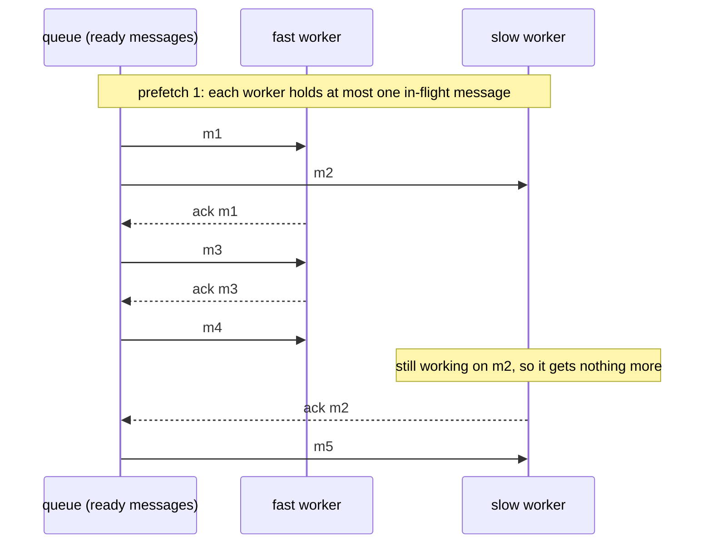

# 10 — Prefetch: stop a slow consumer from hoarding messages

**Level:** Engineer  
**Episode:** Prefetch: stop a slow consumer from hoarding messages  
**Language:** English  
**Code:** Java 21 · Maven · RabbitMQ Java client · Docker Compose  
**Requires:** Episode 08 — Manual acknowledgements (what the ack really means)

## YouTube

[Watch this episode]({{youtubeUrl}})

This folder is the companion project for the tenth episode of the course. The README is the **written version of the lesson**: together with the video it should leave the concept complete. Read it to review the ideas, follow the diagrams, and then run the experiments yourself.

> **The one sentence of this episode**
>
> **Prefetch caps how many unacknowledged messages RabbitMQ gives a consumer at once.**

> **Learning-project disclaimer:** the "workers" in this project send no emails. A worker takes a message, waits for its turn in a rate limiter to simulate the work, and then acknowledges it, so that you can see how many messages each worker holds. The terminal demos in the video are **real recordings** of this project. The code is illustrative, not production-ready (see [What this project does not cover](#what-this-project-does-not-cover)).

## Learning objectives

After this episode you should be able to:

- Define **prefetch**, an **in-flight message** and **fair dispatch**.
- Explain why a queue can show `ready 0` while customers are still waiting.
- Predict how many messages are ready and how many are in flight, from the prefetch and the number of consumers.
- Choose a prefetch for a workload, and name the cost of a value that is too small and of one that is too big.
- Say why "RabbitMQ sends each message to whichever consumer is free" is wrong, and what makes it nearly true.

## From the video to the code

| Video scene | Concept | Where to see it |
|---|---|---|
| Cold open | An empty queue, and customers still waiting | [1. The problem](#1-the-problem-an-empty-queue-and-customers-still-waiting) |
| Real demo 1 | No limit: the slow worker hoards | [`recordings/hoarding.sh`](recordings/hoarding.sh) · [Experiment 1](#experiment-1-no-limit-the-slow-worker-hoards) |
| Dealing cards | In-flight message, prefetch | [2. Three terms](#2-three-terms) |
| Fair dispatch | Prefetch 1 | [`Consumer.java`](src/main/java/com/fromdevtodev/rabbitmq/prefetch/Consumer.java) · [Experiment 2](#experiment-2-prefetch-1-fair-dispatch) |
| Reading the numbers | `ready` vs `unacked` | [4. Reading the numbers](#4-reading-the-numbers) |
| Too small, too big | The cost of each extreme | [5. Too small, too big](#5-too-small-too-big) · [Experiment 4](#experiment-4-what-a-crash-costs) |
| Misconception | "Whichever consumer is free" | [6. The misconception](#6-the-misconception-rabbitmq-sends-each-message-to-whichever-consumer-is-free) |
| Real demo 2 | Prefetch 1 on the same load | [`recordings/fair-dispatch.sh`](recordings/fair-dispatch.sh) |

## 1. The problem: an empty queue, and customers still waiting

Two workers send the `notifications.email` messages. One is fast; the other is slow (a small machine, a heavy template). A burst of orders arrives, and a minute later the queue looks fine: `ready 0`. Yet customers are still waiting for their email.

The messages are not in the queue. RabbitMQ already handed them to the workers. The fast one finished its share and is idle. The slow one is holding a pile of messages it has not even started on, while a free worker sits next to it.

## 2. Three terms

| Term | Meaning |
|---|---|
| **In-flight message** | A message that RabbitMQ has delivered to a consumer and that the consumer has not acknowledged yet. These are the *unacknowledged* messages of the previous episode, seen from the consumer's side. |
| **Prefetch** | The most in-flight messages RabbitMQ will give a consumer at once. When the consumer has that many, RabbitMQ stops delivering to it until it acknowledges one. `0` means no limit. |
| **Fair dispatch** | Giving work to consumers by what they can handle, not in turn: a consumer that is still busy gets no new message. With a prefetch of 1, a consumer gets its next message only after it acknowledged the previous one. |

Think of a dealer and players: the ready messages are the deck, each message in a player's hand is in flight, and the hand limit is the prefetch. With no limit, the dealer deals the whole deck in turn, even to a player who plays one card a minute. With a hand limit, the dealer deals a new card only when a card has been played.



## 3. In the code

Prefetch is one call on the channel, **before** the consumer starts:

```java
channel.basicQos(1);                                   // prefetch: at most 1 unacknowledged message at once
channel.basicConsume("notifications.email", false, onDelivery, onCancel);   // false: manual acknowledgements
// ... later, when the work is done:
channel.basicAck(deliveryTag, false);
```

Three details that matter:

- The limit is **per consumer**: RabbitMQ applies it separately to each consumer, so two workers with `basicQos(5)` can hold up to 5 each.
- `basicQos(0)` means **no limit**.
- It only makes sense with **manual acknowledgements** (`autoAck = false`). With automatic acknowledgements a delivery counts as done as soon as it is sent, so there is nothing to limit.

## 4. Reading the numbers

```bash
docker compose exec rabbitmq rabbitmqctl list_queues name messages_ready messages_unacknowledged consumers
```

| Number | Meaning |
|---|---|
| `messages_ready` | Messages waiting in the queue for a consumer. |
| `messages_unacknowledged` | Messages delivered and not acknowledged: all the in-flight messages of all consumers. |
| `consumers` | How many consumers the queue has. |

The queue's depth is `ready + unacknowledged`. A small `ready` does **not** mean there is no work left: look at `unacknowledged`. With a prefetch `P` and `C` consumers, in-flight messages can never exceed `P × C`.

## 5. Too small, too big

| | Too small (for example 1) | Too big (or no limit) |
|---|---|---|
| Throughput | A consumer waits for the next delivery after every ack. The RabbitMQ documentation says a prefetch of 1 is the most conservative value, reduces throughput significantly, and does so in particular when the latency to the consumer is high | Higher delivery rate, up to diminishing returns |
| Fairness | Good: slow consumers hold little | Bad: a slow consumer holds a pile of work while others idle |
| Memory | Little in flight | More delivered-but-unprocessed messages, so more consumer RAM, and more on the broker side with no limit |
| When a consumer dies | Little to put back | Everything it held goes back to the queue and is delivered again (a dead client can take a while to be detected) |

The documentation reports that values in the **100 to 300 range** usually offer optimal throughput without significant risk of overwhelming consumers, and that finding a suitable value is trial and error that varies with the workload ([Consumer Acknowledgements and Publisher Confirms](https://www.rabbitmq.com/docs/confirms)). That advice is about throughput. If each message takes seconds, delivery latency is small next to the work, and a small prefetch costs almost nothing.

## 6. The misconception: "RabbitMQ sends each message to whichever consumer is free"

| | Belief | Reality |
|---|---|---|
| How messages are assigned | to a consumer that is free | **in turn**, to the next consumer; with no limit, whether it is busy does not matter |
| What "free" means | the broker knows | the broker only knows how many deliveries are unacknowledged, and only enforces it if you set a prefetch |
| What fixes it | a smarter consumer | a prefetch: a consumer that holds `prefetch` messages is skipped until it acknowledges one |

The official work queues tutorial describes the same thing: with the default round-robin, every consumer gets on average the same number of messages, and RabbitMQ will "still dispatch messages evenly" even if some are much heavier ([tutorial 2](https://www.rabbitmq.com/tutorials/tutorial-two-java)). Its fix is `basicQos(1)`.

## 7. Choosing a value

There is no universal number. Ask:

1. **How long does one message take?** Seconds of work: a small prefetch. Milliseconds of work and a network between broker and consumer: a larger one, so the consumer never waits for a delivery.
2. **How different are your consumers?** The more uneven they are, the less you can afford for the slow one to hold.
3. **What does a crash cost?** Everything in flight goes back to the queue. Handling the redelivery is the previous episode; the more in flight, the more of it there is.
4. **Measure.** Change the value, watch `ready`, `unacknowledged` and the time to drain, and keep the smallest value that does not starve your fastest consumer.

## Hands-on experiments

### Prerequisites

- Java 21, Maven, Docker with Compose.
- Start RabbitMQ and build the project:

```bash
docker compose up -d rabbitmq
mvn -q -DskipTests compile
```

The management UI is at <http://localhost:15672> (`guest` / `guest`). Every command below is `mvn -q exec:java -Dexec.args="..."`; the examples abbreviate it to `App ...`.

> Every episode project uses the same ports. If another episode's RabbitMQ is running, stop it first (`docker compose down` in its folder).

| Command | What it does |
|---|---|
| `App publish --count N [--rate R] [--first 1]` | Puts N numbered messages at the tail; `--rate 0` (default) means as fast as possible |
| `App consume [--name worker] [--rate 1] [--prefetch 1] [--report-ms 1000]` | A worker: `rate` messages per second, `prefetch 0` = no limit; prints `in flight` and `handled` every `report-ms` |
| `App status [--samples 1] [--interval-ms 1000]` | Prints `ready` and `consumers` for the queue |
| `App reset` | Deletes the queue and its messages |

`App status` shows only the ready messages and the consumers. For `unacknowledged`, use the `rabbitmqctl` command in [section 4](#4-reading-the-numbers); the in-flight messages of each worker are in the worker's own report line.

Keep a fourth terminal for the queue:

```bash
while true; do docker compose exec -T rabbitmq rabbitmqctl -q --no-table-headers list_queues name messages_ready messages_unacknowledged consumers; sleep 1; done
```

### Experiment 1: no limit, the slow worker hoards

```bash
App reset
App consume --name fast --rate 20 --prefetch 0     # terminal 1
App consume --name slow --rate 2  --prefetch 0     # terminal 2
App publish --count 40                             # terminal 3 (the queue watcher runs in terminal 4)
```

Expected, roughly: the 40 messages are dealt out in turn, so each worker receives about half of them at once. `ready` drops to 0 almost immediately while `unacknowledged` stays high. The fast worker reports `in flight 0` after about a second; the slow worker's `in flight` counts down by about 2 per second, for about ten seconds. The queue looks empty, and the work is sitting in the slow worker.

### Experiment 2: prefetch 1, fair dispatch

```bash
App reset
App consume --name fast --rate 20 --prefetch 1
App consume --name slow --rate 2  --prefetch 1
App publish --count 40
```

Expected, roughly: `unacknowledged` never goes above 2 (one per worker), `ready` counts down quickly, and the fast worker ends with most of the `handled` messages. The whole batch drains in a few seconds instead of about ten. The exact split depends on your machine; the shape does not.

### Experiment 3: the value in between

Repeat experiment 2 with `--prefetch 5` for both workers.

Expected: each worker's `in flight` never exceeds 5, so `unacknowledged` never exceeds 10. The slow worker still holds more than with a prefetch of 1, and the batch takes longer.

### Experiment 4: what a crash costs

```bash
App reset
App consume --name fast --rate 20 --prefetch 0
App consume --name slow --rate 2  --prefetch 0     # terminal 2
App publish --count 40
# while the slow worker still reports a large "in flight": press Ctrl+C in terminal 2
```

Expected: the slow worker's in-flight messages are requeued: `ready` jumps up by about that many, and the fast worker picks them up. Repeat with `--prefetch 1` on the slow worker and `ready` rises by at most one. Not every message was delivered once: the requeued ones are delivered **again**, which is why consumers must tolerate redeliveries (later episodes).

## Project structure

```text
10-rabbitmq-prefetch/
├── docker-compose.yml
├── pom.xml
├── recordings/               # scripts that record the video demos (maintainers)
└── src/
    ├── main/java/com/fromdevtodev/rabbitmq/prefetch/
    │   ├── App.java          # command line: publish, consume, status, reset
    │   ├── Consumer.java     # basicQos(prefetch), manual ack, a local buffer of held messages
    │   ├── Tally.java        # received, acknowledged, in flight
    │   ├── ReportLine.java   # the line each worker prints
    │   ├── Publisher.java    # numbered messages, optional rate
    │   ├── QueueStatus.java  # passive declare: ready messages and consumers
    │   ├── RatePacer.java    # a steady rate, to simulate "work takes this long"
    │   ├── Topology.java     # the queue and connection settings
    │   └── ...               # Args, EventJson, Log, OrderCreated, StatusLine
    └── test/java/...         # tests for the parts that need no broker
```

### Tests

```bash
mvn test
```

The tests cover the parts that need no running broker: the rate limiter (with a fake clock), the in-flight arithmetic, the report and status lines, message numbering and argument parsing. How RabbitMQ deals messages out is the broker's job, so it is shown by the experiments, not by unit tests.

## What this project does not cover

- **Acknowledgement semantics, nack and requeue:** episodes 8 and 9.
- **Global (per-channel) prefetch:** deprecated and disabled by default from RabbitMQ 4.3 according to the documentation; this project only uses the per-consumer form (`basicQos(n)`).
- **Queue types:** other queue types can cap prefetch themselves (for example, the documentation says quorum queues cap it at 2,000); the project uses the default queue type.
- **Acknowledgement timeouts, batching acknowledgements with `multiple`, durability, publisher confirms, retries and dead-lettering:** other episodes.
- **Reading queue metrics in depth** (the four numbers together with the ack rate): episode 21.

## Recap

- **Prefetch caps how many unacknowledged messages RabbitMQ gives a consumer at once.**
- A message delivered and not acknowledged is in flight; `ready 0` does not mean no work is left.
- With no limit, messages are dealt out in turn, so a slow consumer can hold a pile while a fast one idles.
- A small prefetch gives fair dispatch; the price is a wait for each next delivery, which matters when messages are quick.
- Everything a consumer holds goes back to the queue if it dies.

## Sources

The claim-by-claim verification notes live in the video repository (`docs/sources/rabbitmq-prefetch-sources.md`). Official references:

- [Consumer Prefetch](https://www.rabbitmq.com/docs/consumer-prefetch)
- [Consumer Acknowledgements and Publisher Confirms](https://www.rabbitmq.com/docs/confirms)
- [RabbitMQ tutorial 2: Work Queues](https://www.rabbitmq.com/tutorials/tutorial-two-java)
