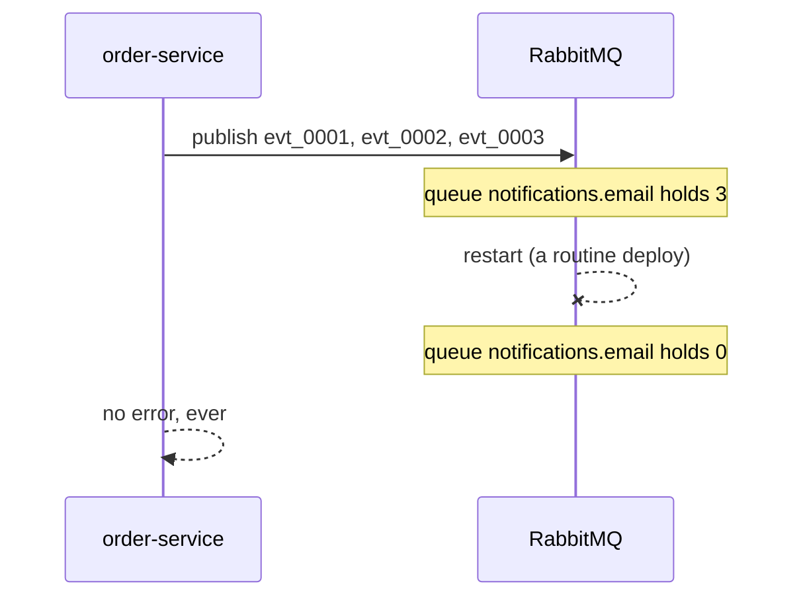
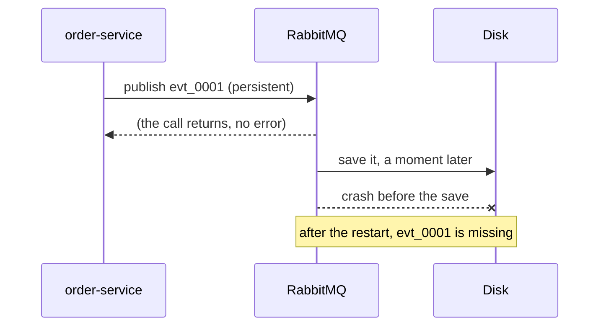

# 11 — Durability: what survives a RabbitMQ restart

**Level:** Engineer  
**Episode:** Durability: what survives a RabbitMQ restart  
**Language:** English  
**Code:** Java 21 · Maven · RabbitMQ Java client · Docker Compose  
**Requires:** [02 — Queues](../02-rabbitmq-queues/README.md)  
**Reading time:** about 14 minutes, plus the experiments

## YouTube

https://www.youtube.com/watch?v=ahnagiIMdLs

This README is the **written version of the lesson**. It tells the same story as the video, with more room for the reasoning and for the code. You can read it before the video, after it, or instead of it. Everything it describes can be run on your machine with `./run.sh`.

> **The one sentence of this episode**
>
> **Only a durable queue holding persistent messages can survive a broker restart, and even then not every message is guaranteed.**

> **Learning-project disclaimer:** nothing here sends a real email or awards real points. The messages only wait in the queues, so that you can count them before and after a restart. The terminal demos in the video run this project against a real RabbitMQ. The code is illustrative, not production-ready (see [What this project does not cover](#what-this-project-does-not-cover)).

## Learning objectives

After this episode you should be able to:

- Define **durable**, **persistent message** and **transient message**.
- Say which of the two settings belongs to the queue and which belongs to each message.
- Predict what a broker restart leaves for each of the four combinations of the two settings.
- Explain why a durable queue can come back empty, and why the publisher never sees an error.
- Explain why "persistent" is still not a guarantee, and name the mechanism that closes the gap (the next episode).
- Read the code of the demos and point at the one argument that makes a queue durable and the one that makes a message persistent.

## Contents

1. [The problem: three emails, one deploy](#the-problem-three-emails-one-deploy)
2. [The vocabulary](#the-vocabulary)
3. [One belief, and the rule](#one-belief-and-the-rule)
4. [Experiment 1: a durable queue, an empty restart](#experiment-1-a-durable-queue-an-empty-restart)
5. [Experiment 2: persistent against transient](#experiment-2-persistent-against-transient)
6. [Not guaranteed: accepted is not the same as saved](#not-guaranteed-accepted-is-not-the-same-as-saved)
7. [The rule](#the-rule)
8. [Read the code](#read-the-code)
9. [Try it yourself](#try-it-yourself), [where it fits](#where-it-fits), [things that surprise people](#things-that-surprise-people), [summary](#summary) and [what this project does not cover](#what-this-project-does-not-cover)

| Video scene | Where it is in this README |
|---|---|
| Cold open, "Three emails, one deploy" | [The problem](#the-problem-three-emails-one-deploy) |
| Board "What you are about to see: demo 1", demo "A durable queue, an empty restart" | [Experiment 1](#experiment-1-a-durable-queue-an-empty-restart) |
| "The queue came back. The messages did not", "Two settings, in two different places" | [The vocabulary](#the-vocabulary) |
| "Is the queue durable, so my messages are safe?", "What a restart leaves" | [One belief, and the rule](#one-belief-and-the-rule) |
| Challenge: a durable queue, no persistence flag; board and demo "Persistent against transient" | [Experiment 2](#experiment-2-persistent-against-transient) |
| "Two settings in the Java client" | [Read the code](#read-the-code) |
| "Accepted is not the same as saved", "Before you rely on it" | [Not guaranteed](#not-guaranteed-accepted-is-not-the-same-as-saved) |
| Challenge: the queue is durable, the messages vanish | [Try it yourself](#try-it-yourself) |
| "Persistent messages: when to use them" | [Where it fits](#where-it-fits) |
| Recap | [Summary](#summary) |

## The problem: three emails, one deploy

Three customers place an order. For each one, the order service publishes a confirmation to the queue `notifications.email`: `evt_0001`, `evt_0002`, `evt_0003`. The email worker has not taken them yet, so they wait in the queue.

Then a routine deploy restarts the broker. When RabbitMQ is back the queue is still there, and it is **empty**. The order service shows no error, because from its point of view it published three messages and the broker accepted them. Three customers wait for an email that will never be sent.



The queue was declared **durable**, and many people stop reading the documentation there. The rest of this episode is the other half.

## The vocabulary

Three terms, each tied to a place in the project.

- **Durable.** A durable queue is a queue that RabbitMQ declares again by itself after a restart. Durable is a setting **of the queue**, made once, when the queue is declared. In this project it is the second argument of `queueDeclare`, in `Topology.declareQueue`.
- **Persistent message.** A persistent message is a message that RabbitMQ saves to disk, so that it can be restored after a restart. Persistent is a setting **of each message**, made every time you publish one. In this project it is the properties argument of `basicPublish`, in `Publisher.send`.
- **Transient message.** Any other message. RabbitMQ makes no promise to keep it across a restart. A message published with no properties at all is transient.

The two settings live in two different objects, and neither implies the other. That is the whole episode.

## One belief, and the rule

The belief is natural: *"I declared the queue durable, so my messages are safe."* It is false, and it is easy to see why it is tempting. The call that loses the messages in experiment 1 compiles, runs and is accepted by the broker. Nothing in it looks wrong.

- **Durable** decides whether the *queue* exists after a restart. It says nothing about the messages inside it.
- **Persistent** decides whether *that message* is saved. A message needs both: a durable queue to come back to, and a persistent message to be restored in it.

That gives four combinations. After a **graceful** restart:

| Queue | Message | What is left |
|---|---|---|
| durable | persistent | The queue is back, **with its messages** |
| durable | transient | The queue is back, **empty** (experiment 1) |
| not durable | persistent | The queue is gone, and so is what it held |
| not durable | transient | Nothing is left |

Only the first row keeps a message. The project has no experiment for the last two rows: since RabbitMQ 4.3, declaring a shared (non-exclusive) queue that is not durable is rejected by default, and an exclusive queue is deleted when its connection closes, so neither could show a queue surviving or not surviving a restart.

## Experiment 1: a durable queue, an empty restart

**Predict first.** The queue `notifications.email` is durable and empty. The order service publishes three messages with no properties at all, and then the broker restarts. How many messages does the queue hold afterwards, and is it still durable? Write your answer down before you run anything. (To check your reasoning without a broker, `./run.sh app explain --durable true --persistent false` prints what the rule predicts. It is the rule written as code, not a measurement.)

```bash
./run.sh up           # RabbitMQ in Docker
./run.sh experiment1  # the whole experiment, step by step
```

<details>
<summary>The raw commands behind <code>./run.sh experiment1</code></summary>

```bash
./run.sh reset                                              # delete both queues
./run.sh app setup                                          # declare notifications.email and loyalty.points, both durable
./run.sh counters                                           # name, durable, messages
./run.sh app publish --queue notifications.email --count 3 --first 1   # evt_0001 to evt_0003, no properties
./run.sh counters
./run.sh restart                                            # docker compose restart -t 60 rabbitmq, then wait for the broker
```

</details>

What the experiment checks, step by step (`notifications.email`):

| After | durable | messages |
|---|---|---|
| start | true | 0 |
| three messages published, no properties | true | 3 |
| the broker restarts | true | **0** |

The output of the counters has this shape (illustrative: it is written from the format that `run.sh` prints, so spacing differs on your machine):

```text
queue                  durable  messages
notifications.email    true     0
```

**Why.**

- The queue was declared durable, so RabbitMQ declared it again after the restart. That is why the line is still there, and still says `true`.
- The messages carried no properties, so they were **transient**. A transient message is not restored. The queue came back with nothing to put in it.
- The publisher's log shows three lines ending in `transient` and no error. The broker accepted three messages and nobody will ever be told that they were not kept.

**Verdict.** The queue survived the restart and its messages did not. Durable, on its own, was not enough.

## Experiment 2: persistent against transient

**Predict first.** Now two durable queues. Three **persistent** confirmations go to `notifications.email` and three **transient** loyalty updates go to `loyalty.points`. The broker restarts. How many messages does each queue hold afterwards?

```bash
./run.sh experiment2  # persistent against transient, in the same restart
```

<details>
<summary>The raw commands behind <code>./run.sh experiment2</code></summary>

```bash
./run.sh reset
./run.sh app setup
./run.sh counters
./run.sh app publish --queue notifications.email --count 3 --first 1 --persistent true   # evt_0001 to evt_0003
./run.sh app publish --queue loyalty.points --count 3 --first 4                          # evt_0004 to evt_0006
./run.sh counters
./run.sh restart
```

</details>

| After | email | points |
|---|---|---|
| start | 0 | 0 |
| three persistent confirmations to `notifications.email` | 3 | 0 |
| three transient updates to `loyalty.points` | 3 | 3 |
| the broker restarts | **3** | **0** |

**Why.**

- Both queues are durable, so both are back after the restart. The queue setting is the same.
- The only difference is how each message was published. The persistent messages were saved, so they were restored. The transient ones were not, so `loyalty.points` came back empty.
- Because both runs go through **one** restart, nothing else differs between the two queues: the same broker, the same restart, the same moment.

**Verdict.** Same queue setting, different message setting, different result. Durable brought the queues back. Persistent brought the messages back.

## Not guaranteed: accepted is not the same as saved

There is a last piece, and it is explained here, not demonstrated, because it cannot be shown honestly with a clean restart.



RabbitMQ does not write each message to disk the instant it receives it: it writes in batches, a moment after it accepted them. If the broker **crashes** inside that moment, a persistent message was accepted and never saved. The order service is not told: its publish call had already returned without an error.

Both experiments used a **graceful** restart (`docker compose restart -t 60 rabbitmq` gives the broker up to a minute to shut down cleanly). They show what a deploy does. They do not show a crash, and they do not claim to.

How a publisher learns that RabbitMQ has really taken responsibility for a message is the job of **publisher confirms**, the next episode. Until then, the checklist is:

1. Declare the queue **durable**: it comes back.
2. Publish **persistent** messages: each one is saved.
3. Do not trust the settings, trust a test: restart the broker and count, as the experiments do.
4. Remember the window: a crash can still lose a message the broker accepted.

## The rule

> **Only a durable queue holding persistent messages can survive a broker restart, and even then not every message is guaranteed.**

What the rule does **not** promise: that a message survives a crash in the moment before it is saved (a persistent message is not a guarantee), that the publisher will be told when a message is lost, or that the message was **processed**. Surviving a restart means the message is still in the queue, nothing more.

## Read the code

| File | Role |
|---|---|
| `App.java` | Entry point: one command per step of the experiments |
| `Topology.java` | The queue names, the connection, and the call that declares a queue as **durable** |
| `Publisher.java` | The producer: publishes order events, persistent or transient depending on one flag |
| `RestartRule.java` | The rule of the episode written as code, so that you can read and test it (RabbitMQ does the real work) |
| `Setup.java` | Declares the two durable queues, the starting point of each experiment |
| `OrderEvent.java`, `EventJson.java`, `Args.java`, `Log.java` | Small supporting pieces; you can skip them |

The restart itself is not Java: `./run.sh restart` calls `docker compose restart -t 60 rabbitmq` and waits until the broker answers again. The project only publishes before it and counts after it.

Follow the execution:

**1. The entry point** maps each command of the experiments to one class. The flag `--persistent` is the only thing that separates experiment 1 from the persistent half of experiment 2.

<!-- snippet: src/main/java/com/fromdevtodev/rabbitmq/durability/App.java#commands -->
```java
switch (args[0]) {
    case "setup" -> Setup.run();
    case "publish" -> Publisher.publish(
            options.text("queue", Topology.EMAIL),
            options.number("count", 1),
            options.number("first", 1),
            options.flag("persistent", false));
    case "explain" -> explain(options.flag("durable", true), options.flag("persistent", false));
    case "reset" -> Topology.reset();
```
<!-- /snippet -->

**2. The queue: setting number one.** Every side declares the queue first, with the same arguments, so whoever starts first creates it and the others do nothing. The second argument is `durable`.

<!-- snippet: src/main/java/com/fromdevtodev/rabbitmq/durability/Topology.java#declare -->
```java
static void declareQueue(Channel channel, String queue) throws IOException {
    // queue, durable, exclusive, autoDelete, arguments
    channel.queueDeclare(queue, true, false, false, null);
}
```
<!-- /snippet -->

`true` for `durable` is made **once**, when the queue is created. It asks RabbitMQ to declare the queue again after a restart. It says nothing about the messages.

> **Ignore these for now.** `exclusive` and `autoDelete` are `false` here, and `arguments` is `null`: they decide how long a queue lives and are not needed for this episode. A named exchange also has its own durable setting; this project publishes to the default exchange, so there is none to set.

**3. The publisher: setting number two.** This is the line that decides whether a message is saved. One flag, two calls.

<!-- snippet: src/main/java/com/fromdevtodev/rabbitmq/durability/Publisher.java#publish -->
```java
/** One message to the default exchange; the queue's name is the routing key. */
static void send(Channel channel, String queue, OrderEvent event, boolean persistent) throws IOException {
    AMQP.BasicProperties properties = persistent
            ? MessageProperties.PERSISTENT_TEXT_PLAIN   // delivery mode 2: save this message
            : null;                                     // no properties: delivery mode 1, a transient message
    channel.basicPublish("", queue, properties, EventJson.toBytes(event));
}
```
<!-- /snippet -->

`MessageProperties.PERSISTENT_TEXT_PLAIN` carries **delivery mode 2**: save this message. Passing `null` publishes with no properties, which is delivery mode 1: a transient message. Both calls compile, both run, and the broker accepts both. That is the whole trap of experiment 1.

> **Ignore these for now.** The content type of `PERSISTENT_TEXT_PLAIN` does not matter here. There is no publisher confirm and no consumer in this project: confirms are the next episode, and acknowledgements were the subject of [episode 08](../08-rabbitmq-manual-ack/README.md).

**4. The rule, and its tests.** `RestartRule` is the table of the four combinations in four lines. RabbitMQ implements this itself; the class exists so that you can predict the result and then check your prediction against the real broker.

<!-- snippet: src/main/java/com/fromdevtodev/rabbitmq/durability/RestartRule.java#rule -->
```java
/** A message needs both settings: a durable queue to come back to, and a persistent message to be saved. */
static Outcome afterRestart(boolean durableQueue, boolean persistentMessage) {
    if (!durableQueue) {
        return Outcome.NOTHING;
    }
    return persistentMessage ? Outcome.QUEUE_AND_MESSAGES : Outcome.QUEUE_ONLY;
}
```
<!-- /snippet -->

The tests need no broker.

<!-- snippet: src/test/java/com/fromdevtodev/rabbitmq/durability/DurabilityTest.java#test -->
```java
@Test
void aDurableQueueWithPersistentMessagesKeepsBoth() {
    assertEquals(RestartRule.Outcome.QUEUE_AND_MESSAGES, RestartRule.afterRestart(true, true));
}

@Test
void aDurableQueueWithTransientMessagesComesBackEmpty() {
    assertEquals(RestartRule.Outcome.QUEUE_ONLY, RestartRule.afterRestart(true, false));
}

@Test
void aQueueThatIsNotDurableIsGoneWhateverItHeld() {
    assertEquals(RestartRule.Outcome.NOTHING, RestartRule.afterRestart(false, true));
    assertEquals(RestartRule.Outcome.NOTHING, RestartRule.afterRestart(false, false));
}
```
<!-- /snippet -->

`RestartRule` models a **graceful restart** only. A crash in the window of the previous section is a different case, and the class does not cover it.

## Try it yourself

1. **Predict the combination.** What does a restart leave for a durable queue with persistent messages? And for a durable queue with transient messages? *Answer:* the first keeps the queue and its messages, the second keeps only the queue. Check both with `./run.sh app explain --durable true --persistent true` and `--persistent false`: it prints the rule's prediction, not a measurement.
2. **Fix experiment 1.** Experiment 1 publishes with no properties. Which one change keeps the three messages? *Answer:* publish them as persistent. Run `./run.sh app reset`, `./run.sh app setup`, `./run.sh app publish --queue notifications.email --count 3 --persistent true`, then `./run.sh restart`: the queue should hold 3, as in experiment 2. Compare the log lines: they now end in `persistent`.
3. **Apply the rule.** A queue is durable and the messages still vanish after a restart; the publish call passes `null` as its properties. Which change fixes it? *Answer:* replace `null` with persistent properties. Making the queue exclusive would not help: an exclusive queue is deleted when its connection closes.
4. **Point at the next failure mode.** `./run.sh restart` never loses a persistent message. Does that prove persistent messages are safe? *Answer:* no. The restart is graceful, so the broker has time to finish its work. The window of the section above only opens on a crash, which this project does not reproduce. How a publisher finds out is the next episode.

## Where it fits

Use **persistent messages** when losing one would cost money or trust (the confirmation emails), when the message cannot be rebuilt from another source, or when a restart must not lose the order.

Avoid them for live values that the next message replaces, for data you can rebuild from another source, and when throughput matters more than any single message: saving messages to disk costs throughput, so a transient message is the cheaper choice. Choose per kind of message, not once for the whole system: in the experiments, `notifications.email` is persistent and `loyalty.points` is transient on purpose.

## Things that surprise people

- **Durable does not mean "keeps messages".** It means the queue is recreated. The messages are a separate setting.
- **Nothing fails.** A transient message in a durable queue is accepted without an error, and its loss after a restart is silent.
- **`null` properties are not "default persistent".** No properties means transient.
- **`./run.sh down` deletes the data.** It runs `docker compose down -v`, which removes the volume that holds RabbitMQ's data. `./run.sh restart` keeps it. That is the difference between a restart and a fresh broker.
- **Graceful is not a crash.** The experiments restart the broker cleanly. A crash in the window between accepting and saving a message is the case they do not show.
- **Port conflicts.** Another episode's RabbitMQ uses the same ports. Run `./run.sh down` in that episode's folder first.

## Summary

- **Durable** is a setting of the queue: it brings the queue back after a restart. **Persistent** is a setting of each message: it brings the message back. A message needs both.
- Any other message is **transient**: no promise to keep it. A durable queue with transient messages comes back empty, and the publisher sees no error.
- Even persistent messages can be lost to a crash in the moment before they are saved. A restart test with a count tells you more than the settings do.

**Next episode:** *Publisher confirms*: how a publisher learns that RabbitMQ really took its message.

## What this project does not cover

- Publisher confirms and what they guarantee (the next episode), and the exact timing of disk writes.
- Quorum queues and streams, which keep their messages by design, and any behaviour that depends on a cluster or a lost disk: a restart is not a lost node.
- Consuming and acknowledgements: what happens to messages that were delivered but not acknowledged when the broker restarted.
- Durable named exchanges: the project publishes to the default exchange.
- Production concerns: security, configuration and error handling are minimal on purpose.
