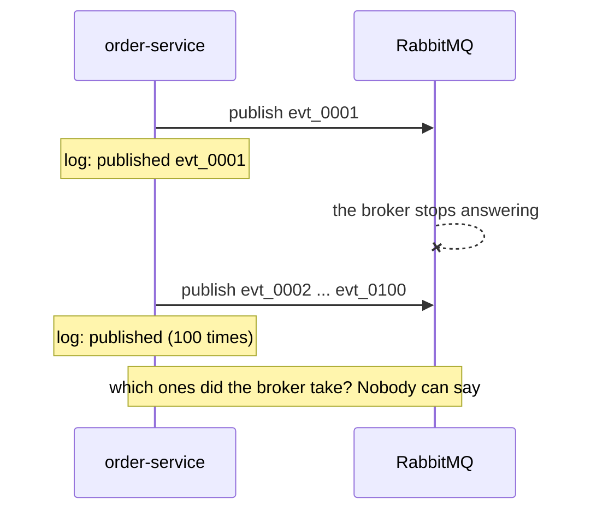

# 12 — Publisher confirms: did RabbitMQ really take it?

**Level:** Engineer  
**Episode:** Publisher confirms: did RabbitMQ really take it?  
**Language:** English  
**Code:** Java 21 · Maven · RabbitMQ Java client · Docker Compose  
**Requires:** [11 — Durability](../11-rabbitmq-durability/README.md)  
**Reading time:** about 15 minutes, plus the experiments

## YouTube

https://www.youtube.com/watch?v=cfWSB_fKie8

This README is the **written version of the lesson**. It tells the same story as the video, with more room for the reasoning and for the code. You can read it before the video, after it, or instead of it. Everything it describes can be run on your machine with `./run.sh`.

> **The one sentence of this episode**
>
> **A publisher confirm tells the producer the broker has taken responsibility for a message, not that anyone processed it.**

> **Learning-project disclaimer:** nothing here sends a real email or awards real points. The messages only wait in the queue, so that you can count them. The terminal demos in the video run this project against a real RabbitMQ. The code is illustrative, not production-ready (see [What this project does not cover](#what-this-project-does-not-cover)).

## Learning objectives

After this episode you should be able to:

- Define **publisher confirm**, **publish sequence number** and **broker nack**.
- Say what a confirm promises, and three things it does not say.
- Explain why a publish call that returns says nothing about the broker.
- Tell a confirm from a consumer acknowledgement, and say why neither covers the other.
- Say what a producer knows when no answer arrives, and what it should do.
- Explain why republishing can create a duplicate.
- Read the code of the demos and point at the map that matches answers to messages.

## Contents

1. [The problem: a log that says published](#the-problem-a-log-that-says-published)
2. [The vocabulary](#the-vocabulary)
3. [Three beliefs](#three-beliefs)
4. [Experiment 1: two confirms and a nack](#experiment-1-two-confirms-and-a-nack)
5. [What a confirm does not say](#what-a-confirm-does-not-say)
6. [Experiment 2: a broker that says nothing](#experiment-2-a-broker-that-says-nothing)
7. [One at a time, or in flight](#one-at-a-time-or-in-flight)
8. [The rule](#the-rule)
9. [Read the code](#read-the-code)
10. [Try it yourself](#try-it-yourself), [where it fits](#where-it-fits), [things that surprise people](#things-that-surprise-people), [summary](#summary) and [what this project does not cover](#what-this-project-does-not-cover)

| Video scene | Where it is in this README |
|---|---|
| Cold open, "One word in a log proves nothing" | [The problem](#the-problem-a-log-that-says-published) |
| "A confirm is the broker's answer" | [The vocabulary](#the-vocabulary) |
| "Three things people believe about publishing" | [Three beliefs](#three-beliefs) |
| Board "What you are about to see: demo 1", demo "Two confirms and a nack" | [Experiment 1](#experiment-1-two-confirms-and-a-nack) |
| "Confirms in the Java client" | [Read the code](#read-the-code) |
| "Is a confirm a receipt for the work?" | [What a confirm does not say](#what-a-confirm-does-not-say) |
| Challenge "No answer for message 3", board and demo "Silence is not a no" | [Experiment 2](#experiment-2-a-broker-that-says-nothing) |
| "One at a time, or in flight?" | [One at a time, or in flight](#one-at-a-time-or-in-flight) |
| "What to do with each answer", challenge "Payment events must not be lost" | [The rule](#the-rule), [Try it yourself](#try-it-yourself) |
| "Publisher confirms: when, and what they cost" | [Where it fits](#where-it-fits) |
| Recap | [Summary](#summary) |

## The problem: a log that says published

The order service logs one word for every order it sends to the broker: `published`. During an incident the broker stops answering for a while. The log still says `published`, a hundred times. Afterwards a hundred orders never produced an email, and no line of the log says which ones.



The word in the log means only that the client handed the message to the network. It says nothing about what the broker did with it. RabbitMQ has a mechanism that does: **publisher confirms**.

## The vocabulary

- **Publisher confirm.** The broker's answer to one published message. A confirm says that the broker has **taken responsibility** for the message. Confirms are a mode of the *channel*: you switch them on once, and from then on every message you publish gets exactly one answer.
- **Publish sequence number.** The number a channel gives to each message it publishes, counting from one. The producer uses it to match an answer with a message. It belongs to the channel, and it is **not an identity**: the same event published twice gets two numbers. The event ID is what identifies the event.
- **Broker nack.** The opposite answer: the broker did **not** take the message. (Not to be confused with the nack of a *consumer*, which is a different message in the other direction.)

## Three beliefs

Each of these is natural, and each is false.

1. *"The publish call returned without an error, so the broker has the message."*
2. *"The broker confirmed it, so the message was processed."*
3. *"No answer means the message was lost, so publishing it again is free."*

The two experiments test them. Experiment 1 tests the first two in one run. Experiment 2 tests the third.

## Experiment 1: two confirms and a nack

The queue `orders.in` is durable, and it holds at most **two** messages. When it is full it **rejects** the next publish (`x-overflow: reject-publish`), and the broker answers that publish with a nack. Nobody consumes from the queue.

**Predict first.** The order service publishes three persistent messages, one at a time, waiting for each answer before the next. What does each message hear back, and how many messages does the queue hold at the end? Write it down before you run anything. (To check what each answer lets you conclude, without a broker: `./run.sh app explain --heard nack`. It prints the rule as code, not a measurement.)

```bash
./run.sh up           # RabbitMQ in Docker
./run.sh experiment1  # the whole experiment, step by step
```

<details>
<summary>The raw commands behind <code>./run.sh experiment1</code></summary>

```bash
./run.sh app reset                                         # delete the queue
./run.sh app setup --limit 2                               # durable, classic, at most 2 messages, reject-publish
./run.sh counters                                          # ready and consumers
./run.sh app publish --count 3 --pace one-by-one           # evt_0001 to evt_0003, one at a time
./run.sh counters
```

</details>

What the experiment checks, step by step:

| After | answer | ready | consumers |
|---|---|---|---|
| start | | 0 | 0 |
| `evt_0001` as #1 | confirmed | 1 | 0 |
| `evt_0002` as #2 | confirmed | 2 | 0 |
| `evt_0003` as #3 | **nacked** | 2 | 0 |

The log of the order service has this shape (illustrative: the timestamps and spacing differ on your machine):

```text
order-service  published evt_0001 as #1 to orders.in, persistent
order-service  #1 confirmed (evt_0001)
order-service  published evt_0002 as #2 to orders.in, persistent
order-service  #2 confirmed (evt_0002)
order-service  published evt_0003 as #3 to orders.in, persistent
order-service  #3 NACKED by the broker (evt_0003)
```

**Why.**

- The publish of `evt_0003` looks exactly like the other two: the call returns, nothing is thrown. Only the **answer** tells them apart. That refutes belief 1.
- `evt_0001` and `evt_0002` were confirmed, and `consumers` is `0` the whole time. Nobody has read them. A confirm is not a consumer. That refutes belief 2.
- The queue was full, so the broker refused the third message, and `ready` stays at 2: the refused message never entered the queue.

**Verdict.** Two messages taken, one refused, no consumer involved. A call that returns says nothing about the broker, and a confirm is not about processing.

## What a confirm does not say

| | Publisher confirm | Consumer ack |
|---|---|---|
| Sent by | the broker | a consumer |
| Sent to | the producer | the broker |
| Says | the broker took the message | the consumer finished with a delivery |
| Never says | that a consumer did anything | that the producer was told |

The two mechanisms are independent: neither covers the other. A third thing a confirm does not say is that the message **reached a queue**: a message that matches no binding is confirmed too, once the broker has routed it nowhere. The mandatory flag of [episode 07](../07-rabbitmq-unroutable-messages/README.md) is how a publisher hears about those.

## Experiment 2: a broker that says nothing

The queue is the same, with **no length limit**. The order service publishes `evt_0001` and waits for its confirm. Then the broker is **frozen** with `docker compose pause`, which stops the RabbitMQ process and leaves the connection open. The order service publishes `evt_0002` as #2, and no answer comes.

**Predict first.** After three seconds without an answer, what does the producer know about #2? And what does it do? Then: after the broker is unfrozen, how many messages does the queue hold?

```bash
./run.sh experiment2  # freezes and unfreezes the broker for you
```

<details>
<summary>The raw commands behind <code>./run.sh experiment2</code></summary>

```bash
./run.sh app reset
./run.sh app setup --limit none                            # no length limit
./run.sh app republish --gate target/go-ahead --timeout-ms 3000 &    # evt_0001 as #1, then waits at the gate
docker compose pause rabbitmq                              # freeze the broker
touch target/go-ahead                                      # release the second message: evt_0002 as #2
# three seconds with no answer: the producer publishes evt_0002 again, as #3
docker compose unpause rabbitmq                            # unfreeze: the answers arrive
./run.sh counters
```

</details>

| Moment | What happens | ready |
|---|---|---|
| `evt_0001` as #1 | confirmed | 1 |
| the broker is frozen, `evt_0002` as #2 | the call returns; **no answer** | (frozen) |
| three seconds later | outcome unknown; `evt_0002` published again as #3 | (frozen) |
| the broker is unfrozen | #2 and #3 are both confirmed | **3** |

**Why.**

- With the broker frozen, the producer got **neither a confirm nor a nack**. It cannot tell whether the broker has `evt_0002` or never saw it. The outcome is **unknown**: silence is not a nack, and it is not a loss. That refutes belief 3.
- The only way to make sure the broker ends up with the message is to publish it again, with the **same event ID**. It went out as #3: same event, new sequence number.
- When the broker woke up it took both. The queue holds **three messages for two orders**: `evt_0002` is there twice.

**Verdict.** Publishing again protected the message and created a duplicate. Whoever reads this queue must be ready to see the same event twice (how a consumer copes is a later episode of the course).

The freeze is a model of a broker that stops answering (a stuck disk, a paused virtual machine). It is not a crash and not a network failure: it shows what **silence** means, and nothing else.

## One at a time, or in flight

Experiment 1 waits for each answer before publishing the next message. That is the simplest way to use confirms, and it costs the producer a round trip for every message. The other way is to publish without waiting and keep a **map** from sequence number to event:

- Answers arrive later, and not necessarily in the order of the publishes.
- One answer can cover **several** messages: with `multiple` set, it means "this sequence number and every lower one".
- Whatever is still in the map has had **no answer yet**.

`./run.sh app publish --count 20 --pace burst` publishes everything first and collects the answers afterwards: compare the order of the log lines with the order of the publishes. The RabbitMQ documentation suggests handling confirms asynchronously, or in batches, when volume matters.

## The rule

> **A publisher confirm tells the producer the broker has taken responsibility for a message, not that anyone processed it.**

What a producer may conclude from each thing it hears:

| It hears | It knows | Next move |
|---|---|---|
| a confirm | the broker took responsibility for the message; nobody has processed it | stop waiting; do not assume anyone has read it |
| a nack | the broker did not take the message | decide: publish it again later, or report the failure |
| nothing | the broker may or may not have the message | publish it again with the same event ID, and expect a duplicate |

What the rule does **not** promise: that a consumer processed the message, that the message reached a queue (an unroutable message is confirmed too), or that a confirmed message survives a restart. That last one depends on the two settings of [episode 11](../11-rabbitmq-durability/README.md): a durable queue, and persistent messages. Confirms are what tells the producer when RabbitMQ has really taken a persistent message.

## Read the code

| File | Role |
|---|---|
| `App.java` | Entry point: one command per step of the experiments |
| `Topology.java` | The queue `orders.in`, the connection, and the arguments that limit its length |
| `Publisher.java` | The producer: switches confirm mode on, numbers and publishes each message, waits for the answers |
| `ConfirmTracker.java` | The map from sequence number to event: where answers are matched with messages |
| `Republish.java` | Experiment 2: the message that gets no answer, and the republish |
| `ConfirmRule.java` | The rule of the episode written as code, so that you can read and test it (RabbitMQ does the real work) |
| `Setup.java`, `Gate.java`, `OrderEvent.java`, `EventJson.java`, `Args.java`, `Log.java` | Small supporting pieces; you can skip them |

Follow the execution:

**1. The entry point** maps each command of the experiments to one class.

<!-- snippet: src/main/java/com/fromdevtodev/rabbitmq/confirms/App.java#commands -->
```java
switch (args[0]) {
    case "setup" -> Setup.run(limit(options.text("limit", "2")));
    case "publish" -> Publisher.publish(
            options.number("count", 1),
            options.number("first", 1),
            pace(options.text("pace", "one-by-one")),
            options.number("timeout-ms", 5_000),
            gate(options));
    case "republish" -> Republish.run(
            gate(options),
            options.number("timeout-ms", 3_000),
            options.number("settle-ms", 60_000));
    case "explain" -> explain(heard(options.text("heard", "confirm")));
    case "reset" -> Topology.reset();
```
<!-- /snippet -->

**2. The queue** is declared in one place. With a limit, a full queue rejects the next publish, and that is what produces the nack of experiment 1.

<!-- snippet: src/main/java/com/fromdevtodev/rabbitmq/confirms/Topology.java#declare -->
```java
/** {@code maxLength == null}: no limit. Otherwise a full queue rejects the next publish, and the broker answers it with a nack. */
static void declareQueue(Channel channel, Integer maxLength) throws IOException {
    Map<String, Object> arguments = new HashMap<>();
    arguments.put("x-queue-type", "classic");
    if (maxLength != null) {
        arguments.put("x-max-length", maxLength);
        arguments.put("x-overflow", "reject-publish");
    }
    // queue, durable, exclusive, autoDelete, arguments
    channel.queueDeclare(ORDERS_IN, true, false, false, arguments);
}
```
<!-- /snippet -->

> **Ignore these for now.** `exclusive` and `autoDelete` are `false`: they decide how long a queue lives and are not needed here. The publisher does not declare the queue, it only checks that it exists: declaring it again with other arguments would be refused by the broker.

**3. Confirm mode and the listener.** Switch the mode on once per channel, then register one callback for each kind of answer.

<!-- snippet: src/main/java/com/fromdevtodev/rabbitmq/confirms/Publisher.java#listener -->
```java
/** Confirm mode is a setting of the channel: switch it on once, then listen for the two kinds of answer. */
static void listen(Channel channel, ConfirmTracker tracker) throws IOException {
    channel.confirmSelect();
    channel.addConfirmListener(
            (seq, multiple) -> report(tracker.confirmed(seq, multiple)),   // basic.ack
            (seq, multiple) -> report(tracker.nacked(seq, multiple)));     // basic.nack
}
```
<!-- /snippet -->

**4. Publishing.** Ask the channel for the number the next publish will get, remember the message under it **before** publishing, then publish. The call returns at once.

<!-- snippet: src/main/java/com/fromdevtodev/rabbitmq/confirms/Publisher.java#publish -->
```java
/** Publishes one event and returns at once; the answer arrives later, through the listener. */
static Sent send(Channel channel, ConfirmTracker tracker, OrderEvent event) throws IOException {
    long seq = channel.getNextPublishSeqNo();                           // the number this message will get
    var answer = tracker.register(seq, event);                          // remember it BEFORE it goes out
    channel.basicPublish("", Topology.ORDERS_IN, MessageProperties.PERSISTENT_TEXT_PLAIN, EventJson.toBytes(event));
    Log.info(WHO, "published " + event.eventId() + " as #" + seq + " to " + Topology.ORDERS_IN + ", persistent");
    return new Sent(seq, event, answer);
}
```
<!-- /snippet -->

> **Ignore these for now.** The messages are persistent, as in episode 11. The content type does not matter here. There is no consumer in this project.

**5. The tracker.** The map is the whole idea: one entry per message, removed when an answer covers it. `multiple` covers every lower number. What stays in the map has no answer.

<!-- snippet: src/main/java/com/fromdevtodev/rabbitmq/confirms/ConfirmTracker.java#tracker -->
```java
/** Call it BEFORE publishing, so that an answer can never arrive for a message nobody remembers. */
CompletableFuture<Answer> register(long sequence, OrderEvent event) {
    CompletableFuture<Answer> answer = new CompletableFuture<>();
    pending.put(sequence, new Entry(event, answer));
    return answer;
}

/** A basic.ack from the broker: the messages it covers are confirmed. */
List<Resolved> confirmed(long sequence, boolean multiple) {
    return resolve(sequence, multiple, Answer.CONFIRMED);
}

/** A basic.nack from the broker: the messages it covers were NOT taken. */
List<Resolved> nacked(long sequence, boolean multiple) {
    return resolve(sequence, multiple, Answer.NACKED);
}

private List<Resolved> resolve(long sequence, boolean multiple, Answer answer) {
    // multiple = true: this sequence number and every lower one; false: this one only.
    NavigableMap<Long, Entry> covered = multiple
            ? pending.headMap(sequence, true)
            : pending.subMap(sequence, true, sequence, true);
    List<Resolved> resolved = new ArrayList<>();
    for (Long number : new ArrayList<>(covered.keySet())) {
        Entry entry = pending.remove(number);
        if (entry != null) {   // an answer that covers a number twice must not resolve it twice
            entry.answer().complete(answer);
            resolved.add(new Resolved(number, entry.event(), answer));
        }
    }
    return resolved;
}
```
<!-- /snippet -->

**6. Waiting, and silence.** An answer that does not arrive in time is not an error: it is an unknown outcome.

<!-- snippet: src/main/java/com/fromdevtodev/rabbitmq/confirms/Publisher.java#await -->
```java
/** The answer, or {@code null} when none arrives in time: that is not a failure, it is an unknown outcome. */
static ConfirmTracker.Answer awaitAnswer(Sent sent, long timeoutMs) {
    try {
        return sent.answer().get(timeoutMs, TimeUnit.MILLISECONDS);
    } catch (TimeoutException e) {
        Log.info(WHO, "no answer for #" + sent.sequence() + " (" + sent.event().eventId() + ") after " + timeoutMs
                + " ms: the outcome is unknown");
        return null;
    } catch (InterruptedException e) {
        Thread.currentThread().interrupt();
        throw new IllegalStateException(e);
    } catch (ExecutionException e) {
        throw new IllegalStateException(e.getCause());
    }
}
```
<!-- /snippet -->

**7. The republish** of experiment 2.

<!-- snippet: src/main/java/com/fromdevtodev/rabbitmq/confirms/Republish.java#republish -->
```java
Publisher.Sent second = Publisher.send(channel, tracker, OrderEvent.of(2));       // evt_0002 as #2
Publisher.Sent third = null;
if (Publisher.awaitAnswer(second, timeoutMs) == null) {
    // Silence. It is not a nack and it is not a loss: nobody knows. Publish the SAME event again.
    Log.info(Publisher.WHO, "publishing " + second.event().eventId() + " again (same event ID)");
    third = Publisher.send(channel, tracker, OrderEvent.of(2));                   // evt_0002 again, as #3
}
```
<!-- /snippet -->

**8. The rule, and its tests.** `ConfirmRule` is the table of the previous section in a few lines. RabbitMQ does not use it: it exists so that you can predict, and then check against the real broker.

<!-- snippet: src/main/java/com/fromdevtodev/rabbitmq/confirms/ConfirmRule.java#rule -->
```java
/** A confirm is the broker taking responsibility, a nack is the broker refusing, and silence is not an answer. */
static Verdict whatYouKnow(Heard heard) {
    return switch (heard) {
        case CONFIRM -> Verdict.TAKEN;
        case NACK -> Verdict.REFUSED;
        case SILENCE -> Verdict.UNKNOWN;
    };
}
```
<!-- /snippet -->

The tests need no broker. They cover the tracker, including answers that arrive in any order.

<!-- snippet: src/test/java/com/fromdevtodev/rabbitmq/confirms/ConfirmsTest.java#test -->
```java
@Test
void aConfirmAnswersOnlyTheMessageItNames() {
    ConfirmTracker tracker = new ConfirmTracker();
    tracker.register(1, OrderEvent.of(1));
    tracker.register(2, OrderEvent.of(2));

    List<ConfirmTracker.Resolved> resolved = tracker.confirmed(1, false);

    assertEquals(1, resolved.size());
    assertEquals(List.of(2L), tracker.unanswered());
}

@Test
void anAnswerWithMultipleCoversEveryLowerNumber() {
    ConfirmTracker tracker = new ConfirmTracker();
    for (long n = 1; n <= 3; n++) {
        tracker.register(n, OrderEvent.of(n));
    }

    List<ConfirmTracker.Resolved> resolved = tracker.confirmed(3, true);

    assertEquals(3, resolved.size());
    assertTrue(tracker.unanswered().isEmpty());
}

@Test
void aNackResolvesTheMessageAsNotTaken() {
    ConfirmTracker tracker = new ConfirmTracker();
    CompletableFuture<ConfirmTracker.Answer> answer = tracker.register(3, OrderEvent.of(3));

    tracker.nacked(3, false);

    assertEquals(ConfirmTracker.Answer.NACKED, answer.getNow(null));
}

@Test
void silenceIsNotAnAnswer() {
    ConfirmTracker tracker = new ConfirmTracker();
    CompletableFuture<ConfirmTracker.Answer> answer = tracker.register(2, OrderEvent.of(2));

    assertFalse(answer.isDone());
    assertEquals(List.of(2L), tracker.unanswered());
}
```
<!-- /snippet -->

## Try it yourself

1. **Predict the answer.** Messages #1 and #2 are confirmed with `multiple = false`. Then an answer arrives for #3 with `multiple = true`. Which messages does it cover? *Answer:* only #3. The earlier ones were already answered, and `multiple` means "this number and every lower one that is still pending". See `anAnswerWithMultipleCoversEveryLowerNumber`.
2. **Change the limit.** Run `./run.sh app reset`, `./run.sh app setup --limit 5`, then `./run.sh app publish --count 8`. How many confirms and how many nacks, and how many messages in the queue? *Answer:* five confirms, three nacks, five messages. Check with `./run.sh counters`.
3. **See an answer arrive out of order.** Run `./run.sh app setup --limit none`, then `./run.sh app publish --count 50 --pace burst`. Are the confirm lines in the order of the publishes? *Answer:* not necessarily, and one line may cover several messages. Do not write code that depends on the order.
4. **Apply the rule.** A producer waits thirty seconds for message #7 and hears nothing. Is it safe to give up on it? To publish it again? *Answer:* neither is free. Giving up may lose the message. Publishing it again may create a duplicate, so keep the same event ID and let the consumer cope.
5. **Check the end of the chain.** The two confirmed messages of experiment 1 sit in the queue and nobody reads them. Does the confirm mean the email was sent? *Answer:* no. The confirm said that the broker took the message. Nothing in this project consumes it.

## Where it fits

Use **publisher confirms** when losing a message would cost money or trust (payment events), when the producer can publish the message again, and when a lost event must be noticed instead of discovered a day later. They pair with the settings of episode 11: a durable queue and persistent messages decide what survives a restart, and the confirm tells the producer when the broker has really taken the message.

Avoid them for data you can regenerate (metrics samples), and avoid waiting for every answer at high volume: publish in flight and track the answers instead.

## Things that surprise people

- **A publish call that returns proves nothing.** It returns when the client has handed the message to the network.
- **A nack is an answer, and silence is not a nack.** A nack tells you the broker refused. Silence tells you nothing.
- **A confirm is not a consumer's ack.** They travel in opposite directions and mean different things.
- **A republish is not free.** It can leave two copies in the queue.
- **Sequence numbers restart with each channel.** They are not an identity: use the event ID for that.
- **`./run.sh down` deletes the data.** It runs `docker compose down -v`.
- **Port conflicts.** Another episode's RabbitMQ uses the same ports. Run `./run.sh down` in that episode's folder first.

## Summary

- A **publisher confirm** is the broker's answer to one published message. It says the broker has taken responsibility for it, and nothing about any consumer.
- Three things can happen to a message: a **confirm** (taken), a **nack** (refused) or **silence** (unknown). Silence is not a loss: publish it again with the same event ID, and expect a duplicate.
- A publish call that returns says nothing. Keep a map from sequence number to event, and use what is left in it to know what has no answer.

**Next episode:** *Dead-letter exchanges*: where failed messages go.

## What this project does not cover

- Transactions (`txSelect`), the older and slower alternative to confirms, and the exact timing of when the broker confirms a persistent message.
- Quorum queues and streams, and anything that depends on a cluster: the confirm semantics are the same idea, but the project runs one broker.
- A broker crash and a network partition: experiment 2 freezes the process, it does not kill it or cut the connection.
- Consuming, acknowledgements and idempotent consumers: the project has no consumer.
- The `mandatory` flag and returned messages (episode 07), beyond naming the gap.
- Production concerns: retries with a policy, back-pressure, security, configuration and error handling are minimal on purpose.
