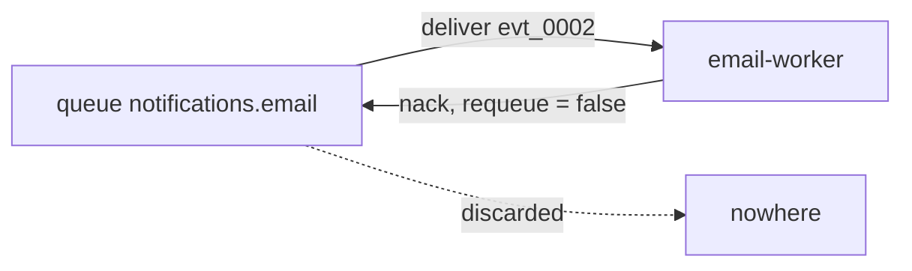

# 13 — Dead-letter exchanges: where failed messages go

**Level:** Engineer  
**Episode:** Dead-letter exchanges: where failed messages go  
**Language:** English  
**Code:** Java 21 · Maven · RabbitMQ Java client · Docker Compose  
**Requires:** [09 — Nack and requeue](../09-rabbitmq-nack-and-requeue/README.md)  
**Reading time:** about 14 minutes, plus the experiments

## YouTube

https://www.youtube.com/watch?v=YgxM5b8bvXA

This README is the **written version of the lesson**. It tells the same story as the video, with more room for the reasoning and for the code. You can read it before the video, after it, or instead of it. Everything it describes can be run on your machine with `./run.sh`.

> **The one sentence of this episode**
>
> **A dead-letter exchange receives messages that a queue rejected, expired or dropped, so failures stay visible.**

> **Learning-project disclaimer:** no email is ever sent. The "email worker" pauses and writes a log line, so that you can watch what RabbitMQ does with the answers it gets. The terminal demos in the video run this project against a real RabbitMQ. The code is illustrative, not production-ready (see [What this project does not cover](#what-this-project-does-not-cover)).

## Learning objectives

After this episode you should be able to:

- Define **dead letter**, **dead-letter exchange** and **dead-letter queue**.
- Configure a dead-letter exchange and its queue, and name the one queue argument that connects them.
- List the situations that dead-letter a message, and the one that does not.
- Read why a message died from its `x-death` header.
- Explain when a dead-letter exchange still keeps nothing, and how to find out.
- Read the code of the demos and say which declaration is the dead-letter side, which one names it, and which call reads the header.

## Contents

1. [The problem: the order that vanished](#the-problem-the-order-that-vanished)
2. [The vocabulary](#the-vocabulary)
3. [Experiment 1: build it, reject an order, find it](#experiment-1-build-it-reject-an-order-find-it)
4. [Why a message dies](#why-a-message-dies)
5. [Experiment 2: when it keeps nothing](#experiment-2-when-it-keeps-nothing)
6. [The rule](#the-rule)
7. [Read the code](#read-the-code)
8. [Try it yourself](#try-it-yourself), [where it fits](#where-it-fits), [things that surprise people](#things-that-surprise-people), [summary](#summary) and [what this project does not cover](#what-this-project-does-not-cover)

| Video scene | Where it is in this README |
|---|---|
| Cold open "Which orders never got their email?", recap | [The problem](#the-problem-the-order-that-vanished) |
| "A failure that stays visible", the three vocabulary scenes | [The vocabulary](#the-vocabulary) |
| "Setting it up", challenge "Where does the message end up?", board and demo "Build it, reject an order, find it" | [Experiment 1](#experiment-1-build-it-reject-an-order-find-it) |
| "The x-death header", "Four reasons a message dies" | [Why a message dies](#why-a-message-dies) |
| "A dead-letter queue bound with another key", board and demo "The same rejection, and nothing is kept" | [Experiment 2](#experiment-2-when-it-keeps-nothing) |
| "Set it and forget it?" | [Things that surprise people](#things-that-surprise-people) |
| "Dead-lettering: when it fits", challenge "An exchange nobody declared" | [Where it fits](#where-it-fits), [Try it yourself](#try-it-yourself) |
| Recap | [Summary](#summary) |

## The problem: the order that vanished

The queue `notifications.email` holds three orders, and the email worker takes one message at a time:

- `evt_0001` (`ord_1041`) is a good order.
- `evt_0002` (`ord_1042`) has **no email address**. No attempt will ever send its email.
- `evt_0003` (`ord_1043`) is a good order.

The previous episode ended with the right answer for `evt_0002`: a nack with `requeue = false`, so the queue keeps moving. But with nothing else configured, RabbitMQ simply discards the message. Support asks which orders never got their email, and nobody can say: the message left the queue, nothing kept it, and there is no record of why.



## The vocabulary

Three new terms, each tied to the project:

- **Dead letter**: a message that a queue has taken out of circulation, because it was rejected without requeue, because it expired, or because the queue dropped it. Code: the nack in `EmailWorker`.
- **Dead-letter exchange**: an ordinary exchange, of any type, declared as usual, to which RabbitMQ republishes the dead letters of a queue. The queue names it with the argument `x-dead-letter-exchange`. Code: `Topology.declareSourceSide` (the argument) and `Topology.declareDeadLetterSide` (the exchange `orders.dlx`).
- **Dead-letter queue**: an ordinary queue bound to the dead-letter exchange, so that the dead letters have somewhere to land. The name is a convention: RabbitMQ has no special object for it. Code: `notifications.email.dlq` in `Topology.declareDeadLetterSide`.

One more detail you need, not a new term: a dead letter is routed like any message, with the routing key it was published with (`order.created`), unless the queue also sets `x-dead-letter-routing-key`. This project sets none, so the dead-letter queue is bound with `order.created`.

## Experiment 1: build it, reject an order, find it

**Predict first.** The work queue names `orders.dlx` as its dead-letter exchange, a queue is bound to it, and the worker nacks `evt_0002` with `requeue = false`. Where does the message end up? How many messages does each queue hold at the end?

```bash
./run.sh up           # RabbitMQ in Docker
./run.sh experiment1  # the whole experiment, step by step
```

<details>
<summary>The raw commands behind <code>./run.sh experiment1</code></summary>

```bash
./run.sh reset
./run.sh app setup --stage dead-letter        # build step 1: orders.dlx, notifications.email.dlq and their binding
./run.sh app setup --stage source             # build step 2: the work queue, which names orders.dlx
./run.sh app publish --first 1 --count 3 --bad 2
./run.sh app work --work-ms 300 --max-deliveries 3
./run.sh counters
./run.sh app inspect                          # read the x-death header of the dead letter
```

</details>

The build has two steps, and the order is natural: first the place where failures go, then the queue that points to it.

<!-- snippet: src/main/java/com/fromdevtodev/rabbitmq/dlx/Topology.java#dead-letter-side -->
```java
static void declareDeadLetterSide(Channel channel, String bindingKey) throws IOException {
    channel.exchangeDeclare(DEAD_LETTER_EXCHANGE, BuiltinExchangeType.DIRECT, true);
    channel.queueDeclare(DEAD_LETTER_QUEUE, true, false, false, Map.of("x-queue-type", "classic"));
    channel.queueBind(DEAD_LETTER_QUEUE, DEAD_LETTER_EXCHANGE, bindingKey);
}
```
<!-- /snippet -->

<!-- snippet: src/main/java/com/fromdevtodev/rabbitmq/dlx/Topology.java#source-side -->
```java
static void declareSourceSide(Channel channel, Options options) throws IOException {
    channel.exchangeDeclare(EXCHANGE, BuiltinExchangeType.DIRECT, true);
    Map<String, Object> arguments = new HashMap<>();
    arguments.put("x-queue-type", "classic");
    if (options.deadLetter()) {
        arguments.put("x-dead-letter-exchange", DEAD_LETTER_EXCHANGE);   // no x-dead-letter-routing-key: the key is kept
    }
    if (options.maxLength() > 0) {
        arguments.put("x-max-length", options.maxLength());             // README experiment: reason "maxlen"
    }
    if (options.messageTtlMillis() > 0) {
        arguments.put("x-message-ttl", options.messageTtlMillis());     // README experiment: reason "expired"
    }
    channel.queueDeclare(QUEUE, true, false, false, arguments);
    channel.queueBind(QUEUE, EXCHANGE, ROUTING_KEY);
}
```
<!-- /snippet -->

**Ignore these for now.** `x-queue-type = classic` only pins the queue type so the demo does not depend on a default. The `x-max-length` and `x-message-ttl` lines are for the experiments in [Try it yourself](#try-it-yourself). The documentation recommends setting the dead-letter exchange with a **policy** rather than a hard-coded argument, because a policy can change without redeploying; this project uses the argument so that every line is visible.

What to look for. The lines below are written from the log format of the project, with illustrative timestamps: run the experiment to see your own.

```text
[setup] dead-letter exchange 'orders.dlx' and queue 'notifications.email.dlq' declared, bound with key order.created
[setup] queue 'notifications.email' declared and bound to 'orders' with key order.created, dead-letter exchange: orders.dlx
[order-service] published evt_0002 (ord_1042), without an email address
[email-worker] the order has no email address: nack evt_0002, requeue=false
[inspector] evt_0002 (ord_1042) in 'notifications.email.dlq'
[inspector] x-death: reason=rejected, queue=notifications.email, exchange=orders, count=1, routing-keys=[order.created]
```

**Why.**

- The nack with `requeue = false` takes `evt_0002` out of `notifications.email`. That makes it a dead letter.
- The queue names `orders.dlx`, so RabbitMQ republishes it there, with the key `order.created`.
- `orders.dlx` is a direct exchange, and `notifications.email.dlq` is bound with `order.created`, so the message lands there. `evt_0003` was processed as usual.
- At the end `./run.sh counters` shows an empty work queue and one ready message in the dead-letter queue. The inspection is a peek: it nacks the message back with requeue true, so the dead-letter queue still holds it.

**Verdict.** The rejected order did not disappear: it moved, and it carries the reason.

## Why a message dies

RabbitMQ records each death in the `x-death` header (AMQP 0-9-1): a list with the most recent entry first. Each entry has the `queue` where the message died, the `reason`, the `count` of deaths for that queue and reason, the `exchange` it was published to and its `routing-keys`.

<!-- snippet: src/main/java/com/fromdevtodev/rabbitmq/dlx/XDeath.java#xdeath -->
```java
static List<Death> parse(Object header) {
    List<Death> deaths = new ArrayList<>();
    if (!(header instanceof List<?> entries)) {
        return deaths;                                  // not dead-lettered: no header
    }
    for (Object entry : entries) {
        if (entry instanceof Map<?, ?> map) {
            List<String> keys = new ArrayList<>();
            if (map.get("routing-keys") instanceof List<?> list) {
                list.forEach(key -> keys.add(String.valueOf(key)));
            }
            deaths.add(new Death(
                    String.valueOf(map.get("queue")),
                    String.valueOf(map.get("reason")),
                    map.get("count") instanceof Number number ? number.longValue() : 0,
                    String.valueOf(map.get("exchange")),
                    keys));
        }
    }
    return deaths;
}
```
<!-- /snippet -->

The `reason` is one of four words:

| Reason | Situation |
|---|---|
| `rejected` | A nack or reject with `requeue = false` (this episode's demo). |
| `expired` | The message had a time to live, per message or per queue, and it ran out. |
| `maxlen` | The queue has a length limit and is full. By default the oldest messages are dropped from the front. |
| `delivery_limit` | A quorum queue returned the message more times than its delivery limit. |

One case is **not** a dead letter: when a whole queue expires, the queue is deleted and its messages are not dead-lettered.

## Experiment 2: when it keeps nothing

**Predict first.** The same setup, with one difference: `notifications.email.dlq` is bound with the key `order.failed`. A dead letter keeps the key `order.created`. After the same rejection, how many messages does each queue hold? Is there an error anywhere?

```bash
./run.sh experiment2
```

<details>
<summary>The raw commands behind <code>./run.sh experiment2</code></summary>

```bash
./run.sh reset
./run.sh app setup --stage dead-letter --dlq-key order.failed
./run.sh app setup --stage source
./run.sh app publish --first 1 --count 3 --bad 2
./run.sh app work --work-ms 300 --max-deliveries 3
./run.sh counters
./run.sh app inspect                          # finds the dead-letter queue empty
```

</details>

**Why.**

- The dead letter reaches `orders.dlx` with the key `order.created`. No queue is bound to `orders.dlx` with that key, so RabbitMQ drops it, as it would any message nobody is bound to.
- Both queues are empty at the end, the worker saw no error, and the output of the program contains none. The setting was there; the message is not.

**Verdict.** The `x-dead-letter-exchange` argument only says where to republish. Whether the message arrives depends on the exchange existing and on a binding matching its key.

## The rule

> **A dead-letter exchange receives messages that a queue rejected, expired or dropped, so failures stay visible.**

What it does **not** promise: that the message arrives (a missing exchange or a non-matching binding drops it silently; in a cluster it can also be lost if its target queue is unavailable, because by default dead-lettering is at-most-once), that it is retried (there is no delay and no limit), or that anyone looks at it (the dead-letter queue needs watching).

## Read the code

| Class | Role |
|---|---|
| `App` | Entry point and command line (`setup`, `publish`, `work`, `inspect`, `reset`). |
| `Topology` | **The lesson.** The two declaration steps, the names and the connection. |
| `Setup` | Runs the build steps in order, one at a time or both. |
| `Publisher` | The order service: publishes the three orders. |
| `EmailWorker` | The consumer: acks a good order, nacks an invalid one with `requeue = false`. |
| `Rules` | The worker's decision as plain code, with no broker in it. |
| `XDeath`, `Inspector` | Read the `x-death` header of the first dead letter. |
| `Args`, `Log`, `EventJson`, `OrderEvent` | Small supporting pieces; you can skip them. |

Follow the execution:

**1. The entry point.** `App` maps each command to one class.

<!-- snippet: src/main/java/com/fromdevtodev/rabbitmq/dlx/App.java#commands -->
```java
switch (args[0]) {
    case "setup" -> Setup.run(
            options.text("stage", "all"),
            options.text("dlq-key", Topology.ROUTING_KEY),
            new Topology.Options(
                    options.text("dead-letter", "on").equals("on"),
                    options.number("max-length", 0),
                    options.number("message-ttl-ms", 0)));
    case "publish" -> Publisher.publish(
            options.number("first", 1),
            options.number("count", 3),
            numbers(options.text("bad", "2")));
    case "work" -> EmailWorker.run(
            options.text("name", "email-worker"),
            options.number("work-ms", 700),
            options.number("max-deliveries", 0),
            options.text("release-file", ""));
    case "inspect" -> Inspector.inspect();
    case "reset" -> Topology.reset();
```
<!-- /snippet -->

**2. The two build steps.** Both snippets are in [Experiment 1](#experiment-1-build-it-reject-an-order-find-it). Note that the work queue does not need the dead-letter exchange to exist when it is declared: it needs it when a message is dead-lettered.

**3. The consumer.** The worker takes one message at a time and answers every delivery by hand (it is registered with `basicConsume(queue, false, ...)`: `false` means manual acknowledgements). The small `--release-file` wrapper around the callback is a recording aid (the scripts use it to make each event happen while the narrator talks about it) and is empty in every other use. Manual acks are episode 8, nack and requeue episode 9 and `basicQos(1)` episode 10: not explained here.

<!-- snippet: src/main/java/com/fromdevtodev/rabbitmq/dlx/EmailWorker.java#worker -->
```java
DeliverCallback onMessage = (consumerTag, delivery) -> {
    OrderEvent order = EventJson.fromBytes(delivery.getBody());
    long deliveryTag = delivery.getEnvelope().getDeliveryTag();
    Log.info(name, "received " + order.eventId() + " (" + order.orderId() + ")");
    sleep(workMillis);                                       // "sending the email"

    Rules.Failure failure = Rules.check(order);
    Rules.Outcome outcome = Rules.decide(failure);
    if (outcome == Rules.Outcome.ACK) {
        channel.basicAck(deliveryTag, false);
        Log.info(name, "sent the email for " + order.orderId() + " and acknowledged " + order.eventId());
    } else {
        Log.info(name, failure.reason() + ": nack " + order.eventId() + ", requeue=false");
        channel.basicNack(deliveryTag, false, false);
    }
    if (maxDeliveries > 0 && deliveries.incrementAndGet() >= maxDeliveries) {
        stopped.countDown();
    }
};
```
<!-- /snippet -->

**4. The decision.** The worker never mentions the dead-letter exchange: the queue's settings decide where a rejected message goes.

<!-- snippet: src/main/java/com/fromdevtodev/rabbitmq/dlx/Rules.java#decide -->
```java
static Outcome decide(Failure failure) {
    return switch (failure) {
        case NONE -> Outcome.ACK;                  // the work is done: acknowledge
        case INVALID_ORDER -> Outcome.NACK_DISCARD; // it never succeeds: nack with requeue false, let the queue's settings decide
    };
}
```
<!-- /snippet -->

**5. Reading the reason.** The inspector reads the first message of the dead-letter queue without taking it away.

<!-- snippet: src/main/java/com/fromdevtodev/rabbitmq/dlx/Inspector.java#inspect -->
```java
static void inspect() throws IOException, TimeoutException {
    try (Connection connection = Topology.connect("inspector");
         Channel channel = connection.createChannel()) {
        GetResponse response = channel.basicGet(Topology.DEAD_LETTER_QUEUE, false);
        if (response == null) {
            Log.info("inspector", "'" + Topology.DEAD_LETTER_QUEUE + "' is empty");
            return;
        }
        OrderEvent order = EventJson.fromBytes(response.getBody());
        List<XDeath.Death> deaths = XDeath.parse(response.getProps().getHeaders() == null
                ? null : response.getProps().getHeaders().get("x-death"));
        Log.info("inspector", order.eventId() + " (" + order.orderId() + ") in '" + Topology.DEAD_LETTER_QUEUE + "'");
        deaths.forEach(death -> Log.info("inspector", "x-death: " + death.describe()));
        channel.basicNack(response.getEnvelope().getDeliveryTag(), false, true);   // peek only: put it back
    }
}
```
<!-- /snippet -->

**6. The test.** No broker needed.

<!-- snippet: src/test/java/com/fromdevtodev/rabbitmq/dlx/DeadLetterTest.java#test -->
```java
@Test
void aValidOrderIsAcknowledged() {
    assertEquals(Rules.Outcome.ACK, Rules.decide(Rules.check(OrderEvent.of(1, false))));
}

@Test
void anOrderWithoutAnEmailAddressIsNackedWithoutRequeue() {
    OrderEvent order = OrderEvent.of(2, true);
    assertEquals(Rules.Failure.INVALID_ORDER, Rules.check(order));
    Rules.Outcome outcome = Rules.decide(Rules.check(order));
    assertEquals(Rules.Outcome.NACK_DISCARD, outcome);
    assertFalse(Rules.requeue(outcome));
}

@Test
void theXDeathHeaderIsReadEntryByEntry() {
    Object header = List.of(Map.of(
            "queue", "notifications.email", "reason", "rejected", "count", 1L,
            "exchange", "orders", "routing-keys", List.of("order.created")));
    List<XDeath.Death> deaths = XDeath.parse(header);
    assertEquals(1, deaths.size());
    assertEquals("rejected", deaths.get(0).reason());
    assertEquals(
            "reason=rejected, queue=notifications.email, exchange=orders, count=1, routing-keys=[order.created]",
            deaths.get(0).describe());
}
```
<!-- /snippet -->

`./run.sh test` runs it.

## Try it yourself

1. **Apply the rule.** Run `./run.sh app reset`, then `./run.sh app setup --stage source` only (no dead-letter side), publish the three orders and start the worker. Where does `evt_0002` go? *Answer: the queue names `orders.dlx`, but nobody declared it, so the message is silently dropped (the documentation says so). It is the same silent loss as experiment 2, by another road.*
2. **Expiry.** Run `./run.sh app reset`, `./run.sh app setup --message-ttl-ms 3000`, publish three good orders with `--bad 0` (no event has that number) and no worker, and wait. What does the `x-death` reason say? *Prediction: `expired`. In a classic queue an expired message is dead-lettered when it reaches the head of the queue, so look with `./run.sh app inspect` after the three seconds. This is derived from the documentation, not measured here.*
3. **Maxlen.** Run `./run.sh app setup --max-length 2`, publish three good orders (`--bad 0`) with no worker. Which one is dead-lettered, and with which reason? *Prediction: the oldest, `evt_0001`, with reason `maxlen`, because by default the oldest message is dropped from the front. Derived from the documentation, not measured here.*
4. **The next failure.** Dead-lettering alone is not a retry. If you wanted `evt_0002` back after thirty seconds, what would be missing? *Answer: a delay, and a limit on the attempts. Both come in the next episodes.*

## Where it fits

Use a dead-letter exchange when a failure has to stay visible: a message that must not vanish, from a queue where a rejection is permanent. Do not trust the setting without a test (reject one real message and look in the dead-letter queue), do not leave the dead-letter queue unwatched (it is a slower way to lose messages), and do not use dead-lettering alone as a retry. Prefer a policy to a hard-coded argument.

## Things that surprise people

- **"Set it and forget it."** The argument only says where to republish. A missing exchange or a non-matching binding drops the message with no error.
- **The key is kept.** Without `x-dead-letter-routing-key`, a dead letter keeps the routing key it was published with. Bind the dead-letter queue with that key.
- **`orders.dlx` must exist when it is needed, not when the queue is declared.** That is why a typo in the name fails silently.
- **Port conflict:** another episode's RabbitMQ uses the same ports. Run `./run.sh down` in that episode's folder first.

## Summary

- A dead letter is a message a queue took out of circulation: rejected, expired or dropped.
- Build it in two steps: the dead-letter exchange and queue first, then the work queue that names the exchange.
- One real rejection is the test: look in the dead-letter queue and read `x-death`.

**Next episode:** delayed retries (dead-lettering plus a time to live).

## What this project does not cover

Retries, delays and limits (the next episodes), alerts on the dead-letter queue, quorum-queue delivery limits and at-least-once dead-lettering, dead-letter cycles, the `x-first-death-*` headers, AMQP 1.0, policies in practice, and production hardening (confirms, durability choices, security). The code is illustrative.
