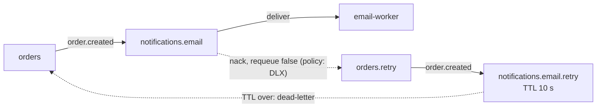

# 14 — Delayed retries with TTL and dead-lettering

**Level:** Engineer  
**Episode:** Delayed retries with TTL and dead-lettering  
**Language:** English  
**Code:** Java 21 · Maven · RabbitMQ Java client · Docker Compose  
**Requires:** [13 — Dead-letter exchanges](../13-rabbitmq-dead-letter-exchange/README.md)  
**Reading time:** about 15 minutes, plus the experiments

## YouTube

https://www.youtube.com/watch?v=0_e1-PNciok

This README is the **written version of the lesson**. It tells the same story as the video, with more room for the reasoning and for the code. You can read it before the video, after it, or instead of it. Everything it describes can be run on your machine with `./run.sh`.

> **The one sentence of this episode**
>
> **A retry queue with a TTL, dead-lettering back to the work queue, delays a retry without a consumer sleeping.**

> **Learning-project disclaimer:** no email is ever sent. The "email worker" calls a **fake mail server** (a pause, a counter and a log line) that is down for a while on purpose, so that you can watch what RabbitMQ does with the answers it gets. The terminal demos in the video run this project against a real RabbitMQ. The code is illustrative, not production-ready (see [What this project does not cover](#what-this-project-does-not-cover)).

## Learning objectives

After this episode you should be able to:

- Define **retry delay**, **retry queue** and **message TTL**.
- Explain why requeue is not a delay, and why sleeping inside a consumer is the wrong place to wait.
- Build a delayed-retry topology: a retry queue with a message TTL that dead-letters back to the work queue, and a policy on the work queue that sends rejected messages to it.
- Say which call sends a message to the retry queue (a nack with `requeue = false`) and why the worker never sleeps.
- Say what this design does not do (it does not end the loop, and the delay is fixed).

## Contents

1. [The problem: a mail server that is down for a while](#the-problem-a-mail-server-that-is-down-for-a-while)
2. [The vocabulary](#the-vocabulary)
3. [Experiment 1: requeue](#experiment-1-requeue)
4. [Experiment 2: sleeping in the consumer](#experiment-2-sleeping-in-the-consumer)
5. [Build the retry queue](#build-the-retry-queue)
6. [Experiment 3: the retry queue](#experiment-3-the-retry-queue)
7. [The rule](#the-rule)
8. [Read the code](#read-the-code)
9. [Try it yourself](#try-it-yourself), [where it fits](#where-it-fits), [things that surprise people](#things-that-surprise-people), [summary](#summary) and [what this project does not cover](#what-this-project-does-not-cover)

| Video scene | Where it is in this README |
|---|---|
| Cold open, "Retry later, without waiting" | [The problem](#the-problem-a-mail-server-that-is-down-for-a-while), [The rule](#the-rule) |
| Board and demo "Requeue: no waiting at all", "Requeue is not a delay" | [Experiment 1](#experiment-1-requeue), [The vocabulary](#the-vocabulary) |
| Board and demo "Sleep: the message is held" | [Experiment 2](#experiment-2-sleeping-in-the-consumer) |
| "The wait lives in a queue", "The build in code" | [Build the retry queue](#build-the-retry-queue), [Read the code](#read-the-code) |
| Challenge, board and demo "The retry queue", "Four calls, ten seconds apart" | [Experiment 3](#experiment-3-the-retry-queue) |
| "What this design does not do" | [Things that surprise people](#things-that-surprise-people), [What this project does not cover](#what-this-project-does-not-cover) |
| Challenge, "When a retry queue fits", recap | [Try it yourself](#try-it-yourself), [Where it fits](#where-it-fits), [Summary](#summary) |

## The problem: a mail server that is down for a while

The queue `notifications.email` holds three orders. The email worker takes one message at a time and calls the mail server:

- `evt_0001` (`ord_1041`) is a good order.
- `evt_0002` (`ord_1042`) goes to a recipient whose mail server is **down for 25 seconds** after the first call. It will work if you try again later.
- `evt_0003` (`ord_1043`) is a good order, behind it.

The failure **passes by itself**, so a retry makes sense (episode 9 told you when it does). The question is **how to wait** before the next attempt. There are three obvious ways, and the project runs all three.


## The vocabulary

Three new terms, each tied to the project:

- **Retry delay**: the time between a failure and the next attempt. Requeue gives it none; the retry queue gives it a number (ten seconds here). Code: `Topology.declareRetry`.
- **Retry queue**: a queue that holds a failed message while it waits for its next attempt. Nobody consumes it. Code: the queue `notifications.email.retry`.
- **Message TTL** (time to live): how long a message may stay in a queue before it expires, in milliseconds. Set with the queue argument `x-message-ttl`, it applies to every message of that queue. An expired message is **dead-lettered** (republished to the queue's dead-letter exchange) if the queue has one. Code: the argument map of `Topology.declareRetry`.

## Experiment 1: requeue

**Predict first.** The worker nacks with `requeue = true` whenever the mail server is down. How many times will the server be called in 25 seconds, and what happens to `evt_0003`?

```bash
./run.sh up          # RabbitMQ in Docker
./run.sh hammering   # the whole experiment, step by step
```

<details>
<summary>The raw commands behind <code>./run.sh hammering</code></summary>

```bash
./run.sh app setup                                     # the exchange orders, the queue notifications.email, the binding
./run.sh app publish --first 1 --count 3
./run.sh app work --on-failure requeue                 # defaults: --work-ms 300 --down-events 2 --down-seconds 25
./run.sh counters
```

</details>

The lines below are written from the log format of `EmailWorker`, with illustrative timestamps: run the experiment to see your own.

```text
[email-worker] received evt_0001 (ord_1041), attempt 1
[email-worker] sent the email for ord_1041 and acknowledged evt_0001
[email-worker] received evt_0002 (ord_1042), attempt 1
[email-worker] the mail server is down (call 1 for evt_0002)
[email-worker] nack evt_0002, requeue=true
[email-worker] received evt_0002 (ord_1042), attempt 2
...
```

**Why.** A nack with `requeue = true` puts the message back in its original position, which is in front of `evt_0003`, and RabbitMQ delivers it again at once. Nothing waits: the worker calls the server as fast as it can (about every 300 ms, the `--work-ms` of the fake call) until the server is back after 25 seconds. `evt_0003` is never received during the outage. The recording script asserts at least ten calls; the exact number depends on your machine.

**Verdict.** Requeue has no retry delay. It hammers a server that is trying to recover, and holds up everything behind it.

## Experiment 2: sleeping in the consumer

**Predict first.** The worker now sleeps ten seconds after a failure, then nacks with requeue. While it sleeps, what do `ready` and `unacked` show? And what happens to the message if you kill the worker during the sleep?

```bash
./run.sh sleeping
```

<details>
<summary>The raw commands behind <code>./run.sh sleeping</code></summary>

```bash
./run.sh app setup
./run.sh app publish --first 1 --count 3
./run.sh app work --on-failure sleep     # --sleep-ms 10000 by default
./run.sh counters                        # while it sleeps; then kill -9 the process and run it again
```

</details>

What the experiment checks (the counters of `notifications.email`):

| When | ready | unacked |
|---|---|---|
| the worker sleeps with `evt_0002` in its hands | 1 (`evt_0003`) | 1 (`evt_0002`) |
| after `kill -9` of the worker | 2 | 0 |

**Why.** The worker has not answered RabbitMQ yet, so `evt_0002` stays **unacknowledged**, and with one message at a time `evt_0003` cannot be delivered to it. When the process dies, the connection closes and RabbitMQ returns the unacknowledged message to the queue **at once**: the delay lived in the worker, so it died with it.

**Verdict.** Sleeping inside the consumer holds the message, blocks the messages behind it, and loses the delay in a crash. (It is not even fair to the server: every restart tries again immediately.)

## Build the retry queue

The wait has to live in the broker. Four pieces:

1. **A retry queue**, `notifications.email.retry`, that nobody consumes.
2. **A message TTL** on it (`x-message-ttl`, ten seconds): every message that arrives expires after ten seconds.
3. **A dead-letter exchange on the retry queue** (`x-dead-letter-exchange` = `orders`): an expired message is republished to `orders` with the routing key it already carries, `order.created`, so it lands in the work queue again.
4. **The way in**: a **policy** on the work queue that sets its dead-letter exchange to `orders.retry`, and the retry queue bound to `orders.retry` with `order.created`. Now a nack with `requeue = false` dead-letters the message into the retry queue.



```bash
./run.sh build
```

It declares pieces 1 to 3 and the binding (`./run.sh app build-retry --delay-ms 10000`) and sets the policy of piece 4 with `rabbitmqctl`:

<!-- snippet: run.sh#policy -->
```bash
# Every message that the work queue dead-letters goes to the exchange orders.retry. A policy, not a queue argument, so it can be
# changed later without deleting the queue.
set_policy() {
  ctl set_policy retry-dlx '^notifications\.email$' '{"dead-letter-exchange":"orders.retry"}' --apply-to queues
}
```
<!-- /snippet -->

The documentation recommends policies over arguments for the dead-letter exchange: a policy can change at any time, while an argument cannot be changed without deleting the queue. (If both are set, the argument wins.)

## Experiment 3: the retry queue

**Predict first.** `evt_0002` is waiting in the retry queue. What happens to `evt_0003`? How many times will the mail server be called about `evt_0002` this time, with a 25-second outage and a 10-second delay? (The second answer is arithmetic: calls at about 0, 10, 20 and 30 seconds; the first three fail.)

```bash
./run.sh retry-queue
```

<details>
<summary>The raw commands behind <code>./run.sh retry-queue</code></summary>

```bash
./run.sh app reset
./run.sh build                                          # retry queue, TTL, policy
./run.sh app publish --first 1 --count 3
./run.sh app work --on-failure retry-queue
./run.sh counters                                       # a fourth column: messages in the retry queue
```

</details>

```text
[email-worker] received evt_0002 (ord_1042), attempt 1
[email-worker] the mail server is down (call 1 for evt_0002)
[email-worker] nack evt_0002, requeue=false
[email-worker] received evt_0003 (ord_1043), attempt 1
[email-worker] sent the email for ord_1043 and acknowledged evt_0003
...                                                    (about ten seconds later)
[email-worker] received evt_0002 (ord_1042), attempt 2, rejected 1 time(s) before (x-death)
```

The log shape is written from `EmailWorker`; timestamps and the figures are yours to measure.

**Why.**

- The nack has `requeue = false`, so RabbitMQ **dead-letters** `evt_0002` to `orders.retry` (the policy) and from there into the retry queue. The worker has already answered, so it is free: `evt_0003` is delivered and sent at once.
- The message waits in the retry queue until its message TTL (ten seconds) is over. Then RabbitMQ dead-letters it to `orders`, and it arrives in the work queue as a **new delivery**.
- The mail server is still down, so it goes round again. After 25 seconds it works and the message is acknowledged.
- The recording script asserts that the mail server was called exactly four times about `evt_0002` and that the counters end at ready 0, retry 0, unacked 0.

**Verdict.** The worker never slept and never held a message. Its answer was one nack; the waiting was done by a queue.

## The rule

> **A retry queue with a TTL, dead-lettering back to the work queue, delays a retry without a consumer sleeping.**

What the sentence does **not** promise: that the loop ends (nothing here limits the attempts), that the delay is exact (a message waits **at least** the TTL), or that the delay can differ per message.

## Read the code

Small supporting pieces (argument parsing, logging, JSON, the attempt counter) you can skip: `Args`, `Log`, `EventJson`, `Attempts`.

| File | Role |
|---|---|
| `App` | the entry point: `setup`, `build-retry`, `publish`, `work`, `explain`, `reset` |
| `Topology` | declares the work side and, in `declareRetry`, the retry side |
| `Setup` | the starting points of the experiments |
| `Publisher` | the producer, `order-service` |
| `OrderEvent` | the message: an event ID, an order ID and an email address |
| `MailServer` | the fake mail server: down for a window for chosen orders, and a count of calls |
| `EmailWorker` | the consumer: calls the mail server and answers with an ack or a nack |
| `Rules` | what the worker answers for each setting, with no broker in it |
| `Deaths` | reads the `x-death` header that RabbitMQ adds when it dead-letters a message |
| `DelayedRetryTest` | unit tests of the rules and the small pieces (no broker needed) |

**1. The entry point.**

<!-- snippet: src/main/java/com/fromdevtodev/rabbitmq/retry/App.java#commands -->
```java
switch (args[0]) {
    case "setup" -> Setup.run();
    case "build-retry" -> Setup.buildRetry(options.number("delay-ms", Topology.retryDelayMillis()));
    case "publish" -> Publisher.publish(options.number("first", 1), options.number("count", 3));
    case "work" -> EmailWorker.run(
            options.text("name", "email-worker"),
            parse(options.text("on-failure", "requeue")),
            options.number("work-ms", 300),
            options.number("sleep-ms", 10000),
            events(options.text("down-events", "2")),
            options.number("down-seconds", 25) * 1000,
            options.number("max-deliveries", 0));
    case "explain" -> explain(options.text("on-failure", "requeue"));
    case "reset" -> Topology.reset();
```
<!-- /snippet -->

**2. The retry side of the topology.** Two arguments do the work. The retry exchange is bound with the key the message already carries.

<!-- snippet: src/main/java/com/fromdevtodev/rabbitmq/retry/Topology.java#retry-topology -->
```java
static void declareRetry(Channel channel, long delayMillis) throws IOException {
    channel.exchangeDeclare(RETRY_EXCHANGE, BuiltinExchangeType.DIRECT, true);
    channel.queueDeclare(RETRY_QUEUE, true, false, false, Map.of(
            "x-queue-type", "classic",
            "x-message-ttl", delayMillis,             // how long a message waits here
            "x-dead-letter-exchange", EXCHANGE));     // where it goes when the time is up
    channel.queueBind(RETRY_QUEUE, RETRY_EXCHANGE, ROUTING_KEY);
}
```
<!-- /snippet -->

**3. The decision.** One answer per setting, the three experiments of this episode.

<!-- snippet: src/main/java/com/fromdevtodev/rabbitmq/retry/Rules.java#decide -->
```java
/** One answer per setting; a transient failure is the same failure in all three. */
static Outcome decide(Failure failure, OnFailure onFailure) {
    if (failure == Failure.NONE) {
        return Outcome.ACK;                                       // the work is done: acknowledge
    }
    return switch (onFailure) {
        case REQUEUE -> Outcome.NACK_REQUEUE;                     // back at once: no delay
        case SLEEP -> Outcome.SLEEP_THEN_REQUEUE;                 // the worker waits, holding the message
        case RETRY_QUEUE -> Outcome.NACK_DEAD_LETTER;             // nack without requeue: the policy sends it to the retry queue
    };
}
```
<!-- /snippet -->

**4. The consumer.** The line `basicNack(deliveryTag, false, requeue)` is the nack, and `requeue` is `false` only in the retry-queue setting. The `x-death` count in the log is read from the message headers.

> **Ignore these for now.** `channel.basicQos(1)` (one message at a time) is prefetch, episode 10. The acknowledgement mode is episode 8.

<!-- snippet: src/main/java/com/fromdevtodev/rabbitmq/retry/EmailWorker.java#worker -->
```java
DeliverCallback onMessage = (consumerTag, delivery) -> {
    OrderEvent order = EventJson.fromBytes(delivery.getBody());
    long deliveryTag = delivery.getEnvelope().getDeliveryTag();
    int attempt = attempts.next(order.eventId());
    long rejected = Deaths.rejections(delivery.getProperties().getHeaders(), Topology.QUEUE);
    Log.info(name, "received " + order.eventId() + " (" + order.orderId() + "), attempt " + attempt
            + (rejected > 0 ? ", rejected " + rejected + " time(s) before (x-death)" : ""));
    sleep(workMillis);                                       // "calling the mail server"

    Rules.Failure failure = mailServer.send(order);
    Rules.Outcome outcome = Rules.decide(failure, onFailure);
    if (outcome == Rules.Outcome.ACK) {
        channel.basicAck(deliveryTag, false);
        Log.info(name, "sent the email for " + order.orderId() + " and acknowledged " + order.eventId());
    } else {
        Log.info(name, failure.reason() + " (call " + mailServer.callsFor(order.eventId()) + " for " + order.eventId() + ")");
        if (outcome == Rules.Outcome.SLEEP_THEN_REQUEUE) {
            Log.info(name, "sleeping " + sleepMillis + " ms before trying again, holding " + order.eventId());
            sleep(sleepMillis);                              // the anti-pattern: the worker waits
        }
        boolean requeue = Rules.requeue(outcome);
        Log.info(name, "nack " + order.eventId() + ", requeue=" + requeue);
        channel.basicNack(deliveryTag, false, requeue);
    }
    if (maxDeliveries > 0 && deliveries.incrementAndGet() >= maxDeliveries) {
        stopped.countDown();
    }
};
channel.basicConsume(Topology.QUEUE, false, onMessage, consumerTag -> stopped.countDown());
```
<!-- /snippet -->

**5. The tests.** They pin the three answers and the arithmetic of the demo (a 10-second delay and a 25-second outage need four calls).

<!-- snippet: src/test/java/com/fromdevtodev/rabbitmq/retry/DelayedRetryTest.java#test -->
```java
@Test
void theThreeSettingsAnswerTheSameFailureDifferently() {
    Rules.Failure down = Rules.Failure.MAIL_SERVER_DOWN;
    assertEquals(Rules.Outcome.NACK_REQUEUE, Rules.decide(down, Rules.OnFailure.REQUEUE));
    assertEquals(Rules.Outcome.SLEEP_THEN_REQUEUE, Rules.decide(down, Rules.OnFailure.SLEEP));
    assertEquals(Rules.Outcome.NACK_DEAD_LETTER, Rules.decide(down, Rules.OnFailure.RETRY_QUEUE));
}

@Test
void onlyTheRetryQueueSettingNacksWithoutRequeue() {
    assertTrue(Rules.requeue(Rules.Outcome.NACK_REQUEUE));
    assertTrue(Rules.requeue(Rules.Outcome.SLEEP_THEN_REQUEUE));
    assertFalse(Rules.requeue(Rules.Outcome.NACK_DEAD_LETTER));
    assertFalse(Rules.requeue(Rules.Outcome.ACK));
}

@Test
void successIsAcknowledgedWhateverTheSetting() {
    for (Rules.OnFailure setting : Rules.OnFailure.values()) {
        assertEquals(Rules.Outcome.ACK, Rules.decide(Rules.Failure.NONE, setting));
    }
}
```
<!-- /snippet -->

## Try it yourself

1. **Predict.** Run `RETRY_DELAY_MS=5000 ./run.sh retry-queue`. How many calls about `evt_0002` do you expect? <details><summary>Answer</summary>Probably six: with a 5-second delay the calls land at about 0, 5, 10, 15 and 20 seconds and fail, and the next one, at about 25 to 27 seconds (each cycle adds the 300 ms of the call), is the first after the outage. It is arithmetic, not a measurement, and the last call is close to the end of the outage, so run it and compare.
</details>
2. **Apply the rule.** The provider is usually back after about a minute. Which retry do you build? <details><summary>Answer</summary>A retry queue whose message TTL is 60 000 ms. Sleeping holds the message, and requeue hammers the provider.</details>
3. **Change the code.** In `Rules.decide`, make `RETRY_QUEUE` return `NACK_REQUEUE` and run `./run.sh test`. Which test fails, and why? <details><summary>Answer</summary>`theThreeSettingsAnswerTheSameFailureDifferently` and `onlyTheRetryQueueSettingNacksWithoutRequeue`: the retry-queue setting would no longer nack without requeue.</details>
4. **Break it on purpose.** Delete the policy (`./run.sh app work --on-failure retry-queue` after `docker compose exec rabbitmq rabbitmqctl clear_policy retry-dlx`). What happens to `evt_0002`? <details><summary>Answer</summary>The nack with `requeue = false` has nowhere to dead-letter to, so the message is discarded and nothing warns you. (The worker's own check only looks for the retry queue, not for the policy. Test the setup with one real failure.)</details>

## Where it fits

Use a retry queue when the failure passes by itself, when the service you call is fragile, and when other messages must keep flowing. Do not use it for failures that never pass, like an order with no email address: waiting changes nothing. It needs a limit on the attempts, which is the next episode.

## Things that surprise people

- **The loop does not end by itself.** If the mail server never comes back, the message goes round every ten seconds for ever. Nothing counts the attempts for you: the attempt number in the log comes from the worker, and `x-death` is the broker's own record.
- **The delay is a minimum, and the same for every message.** A classic queue expires messages at its head, so a per-message TTL can get stuck behind a longer one; one TTL for the whole queue avoids that, at the price of a single delay.
- **A dead letter is a new delivery**, republished with an `x-death` header. In a cluster, a dead letter can be lost if its target queue is not available.
- **The policy is easy to forget.** Without it a nack with `requeue = false` discards the message.
- **Port already in use?** Another episode's RabbitMQ is still running: run `./run.sh down` in that episode's folder first.

## Summary

- Requeue puts the message straight back: no delay, and the server is hammered.
- Sleeping in the consumer holds the message, blocks the queue, and loses the delay in a crash.
- A retry queue with a message TTL, dead-lettering back to the work queue, moves the wait into the broker: the worker nacks without requeue and keeps working.

**Next episode:** [15 — Bounded retries](../15-rabbitmq-bounded-retries-dlq/README.md), how to stop retrying and raise an alert.

## What this project does not cover

- Limiting the attempts, parking queues and alerts: the next episode.
- Delays that differ per message, the delayed-message plugin and exact timing.
- Quorum queues and at-least-once dead-lettering (the retry queue here is classic).
- Publisher confirms, persistence guarantees and idempotent consumers.
- Anything about production use: the "mail server" is a counter and a log line.
